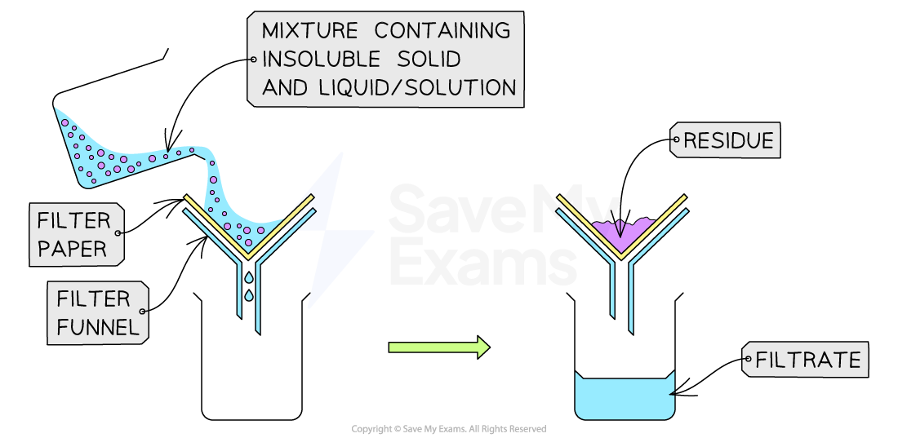
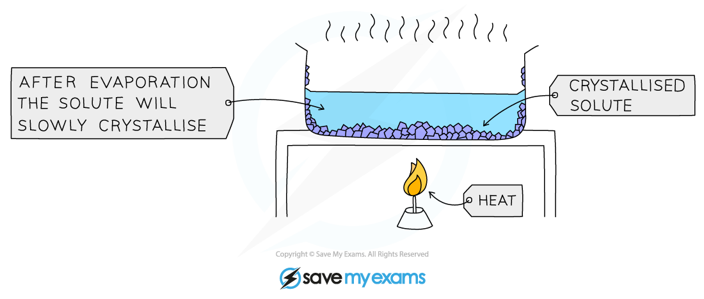
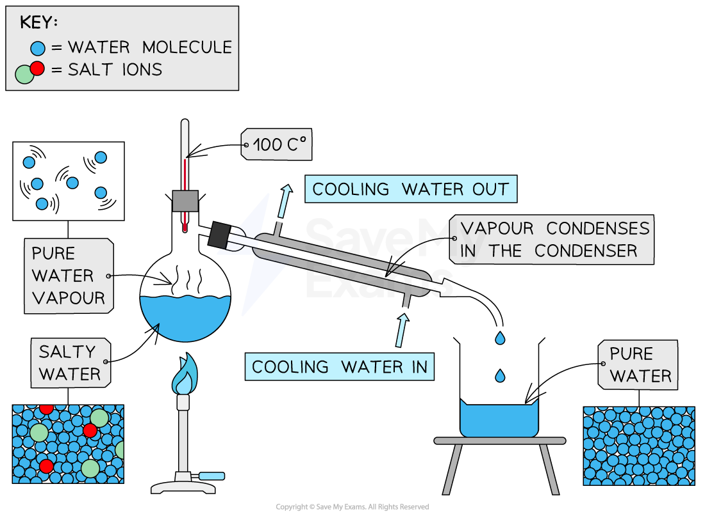
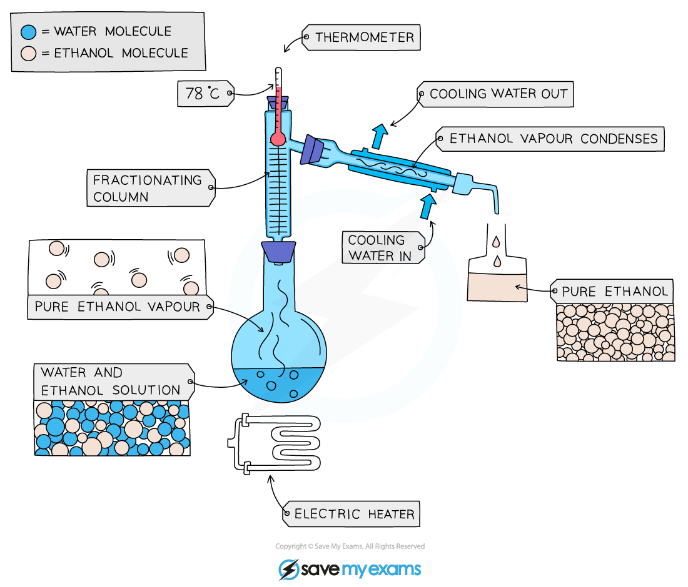
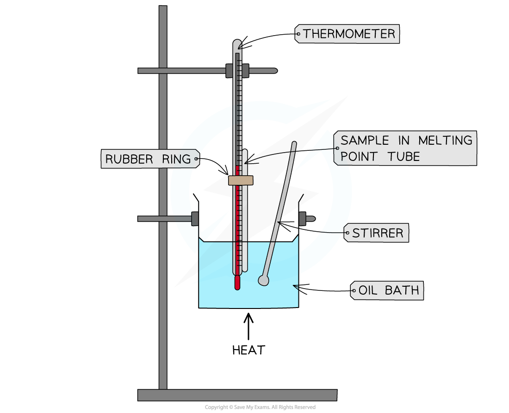

# Separation & Purification Techniques

## Filtration & crystallisation

> **Spec point** — `spcpt_Rw9VbTprTW99wk2m` · Describe and explain methods of separation and purification using: 
a suitable solvent 
filtration 
crystallisation

## Filtration & crystallisation

- The choice of separation technique depends on the substances being separated
- All techniques rely on a **difference** in properties of the chemicals in the mixture

  - This is usually a physical property such as boiling point

### Separating a mixture of solids

- Differences in solubility can be used to separate solids
- For a difference in solubility, a suitable **solvent** must be carefully chosen

  - Only the desired substance should dissolve in the solvent
  - Other substances or impurities in the mixture should not dissolve in the solvent
- For example, to separate a mixture of sand and salt:

  - Water is a suitable solvent because salt is soluble in water, but sand is insoluble in water

### Filtration

- This technique is used to separate an **undissolved solid** from a mixture of the solid and a liquid / solution ( e.g. sand from a mixture of sand and water)

  - ***Centrifugation*** can also be used for this mixture
- A filter paper is placed in a filter funnel above another beaker
- The mixture of insoluble solid and liquid is poured into the filter funnel
- The filter paper will only allow small liquid particles to pass through in the filtrate
- Solid particles are too large to pass through the filter paper so will stay behind as a residue

***Filtration of a mixture of sand and water***

### Crystallisation

- This method is used to separate a **dissolved solid** from a solution

  - A simple application of this is to heat a solution to boiling, remove the heat and leave the solvent to evaporate
- A more common application of this is sometimes called crystallisation

  - This is when the solid is more soluble in hot solvent than in cold, e.g. copper sulphate from a solution of copper(II) sulphate
- The solution is heated, allowing the solvent to evaporate and leaving a saturated solution behind
- You can test if the solution is saturated by dipping a clean, dry, cold glass rod into the solution

  - If the solution is saturated, crystals will form on the glass rod when it is removed and allowed to cool
- The saturated solution is allowed to cool slowly

  - Solids will come out of the solution as the solubility decreases
  - This will be seen as crystals growing
- The crystals are collected by filtration
- They are then washed with distilled water to remove any impurities
- Finally, they are allowed to dry

  - Common places to dry crystals are between sheets of filter paper or in a drying oven

#### The process of crystallisation

***The solution is slowly heated to remove around half of the liquid. The remaining liquid will evaporate slowly ***

> **Exam Hint**
> In exams, you need to be specific that no more than half of the solution is removed by direct heating or you may lose a mark.

## Distillation: simple & fractional

> **Spec point** — `spcpt_2W7Rs53x7dgpKxKy` · Describe and explain methods of separation and purification using: 
simple distillation 
fractional distillation
Suggest suitable separation and purification techniques, given information about the substances involved

## Distillation: simple & fractional

### Simple distillation

- Distillation is used to separate a liquid and **soluble solid** from a solution (e.g. water from a solution of saltwater) or a pure liquid from a mixture of liquids
- The solution is heated and pure water evaporates producing a vapour which rises through the neck of the round-bottomed flask
- The vapour passes through the ***condenser***, where it cools and condenses, turning into pure water which is collected in a beaker
- After all the water is evaporated from the solution, only the solid solute will be left behind

#### Simple distillation apparatus

***Diagram showing the distillation of a mixture of salt and water***

- Simple distillation can be used to separate the products of fermentation, such as alcohol and water
- However, fractional distillation is a more effective separation technique, commonly used when the boiling points of the liquids are close and/or a higher degree of purity is required, such as crude oil

### Fractional distillation

- Used to separate two or more liquids that are ***miscible*** with one another (e.g. ethanol and water from a mixture of the two)
- The solution is heated to the temperature of the substance with the **lowest **boiling point

  - This substance will rise and evaporate first
  - The vapours will pass through a condenser, where they cool and condense
  - The condensed liquid is then collected in a beaker
  - All of the substance is evaporated and collected, leaving behind the other component(s) of the mixture
- For water and ethanol:

  - Ethanol has a boiling point of 78 ºC
  - Water has a boiling point of of 100 ºC
  - The mixture is heated until it reaches 78 ºC, at which point the ethanol distills out of the mixture and into the beaker
  - When the temperature starts to increase to 100 ºC heating should be stopped as the water and ethanol are now separated

***Fractional distillation of a mixture of ethanol and water***

- An electric heater is safer to use when there are flammable liquids present
- The separation of the components in petroleum is achieved by fractional distillation on an industrial scale
- Fractional distillation of crude oil is not carried out in school laboratories due to the toxic nature of some of the components of the crude oil, but it can sometimes be simulated using a synthetic crude oil made specially for the demonstration

> **Worked Example**
> A student is given a mixture of calcium sulfate,  magnesium chloride and water. The table below shows some information about calcium sulfate and  magnesium chloride.
> 
> | substance | solubility in water | state at room temperature |
> |---|---|---|
> | calcium sulfate | insoluble | solid |
> | magnesium chloride | soluble | solid |
> 
> How does the student obtain magnesium chloride crystals from the mixture?
> 
> 1. Crystallisation followed by distillation
> 2. Crystallisation followed by filtration
> 3. Distillation followed by crystallisation
> 4. Filtration followed by crystallisation
> 
> **Answer**
> 
> The correct answer is **D** because:
> 
> - The difference in solubility in water means the first step is to make a solution
> - The magnesium chloride will dissolve, but the solid calcium sulfate will be left behind
> - The mixture is filtered to remove the calcium sulfate and then evaporated and crystallised to obtain magnesium chloride crystals

> **Exam Hint**
> You may be asked how to separate a mixture of gases:
> 
> - One method involves cooling the gaseous mixture sufficiently to liquefy all of the gases, which are then separated by fractional distillation.
> - They can also be separated by diffusion, where the boiling points are very close or it is impractical or expensive to use fractional distillation.

## Assessing purity

> **Spec point** — `spcpt_TW3ccBTVT2v6gdJX` · Identify substances and assess their purity using melting point and boiling point information

## Assessing purity

- Pure substances melt and boil at specific and sharp temperatures

  - For example, water has a boiling point of 100°C and a melting point of 0°C
- Mixtures have a range of melting and boiling points as they consist of different substances that melt or boil at different temperatures

  - Therefore, melting and boiling point data can be used to distinguish pure substances from mixtures
- An unknown pure substance can be identified by experimentally determining its melting point and boiling point and comparing them to literature values / data tables

  - Boiling points are commonly determined by distillation
- Melting point analysis is routinely used to assess the purity of drugs for example

  - This is done using a melting point apparatus which allows you to slowly heat up a small amount of the sample, making it easier to observe the exact melting point

***Melting point test using an oil bath***
*** ***

- This is then compared to data tables
- The closer the measured value is to the actual melting or boiling point, the purer the sample is
- If the sample contains impurities:

  - The **boiling point **may appear **higher **than the sample's actual boiling point
  - The **melting point **may appear **lower **than the sample's actual melting point
