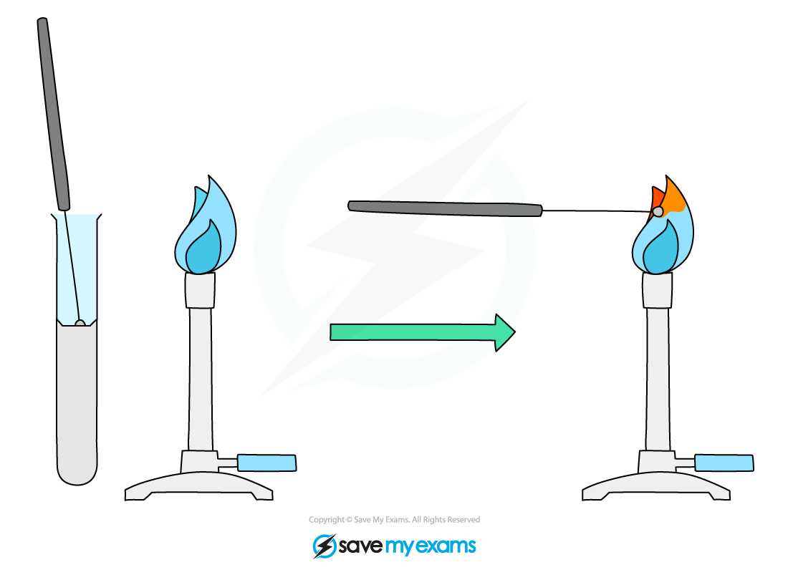
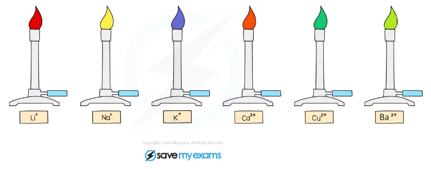

# Identification of Cations

## Identification of cations

> **Spec point** — `spcpt_QYQqPCyhq9SPvztG` · Describe tests using aqueous sodium hydroxide and aqueous ammonia to identify the aqueous cations: 
aluminium, Al 3+ 
ammonium, NH4+ 
calcium, Ca2+ 
chromium(III), Cr3+ 
copper(II), Cu2+ 
iron(II), Fe2+ 
iron(III), Fe3+ 
zinc, Zn2+
Describe the use of a flame test to identify the cations: 
lithium, Li+ 
sodium, Na+ 
potassium, K+ 
calcium, Ca2+ 
barium, Ba2+ 
copper(II), Cu2+

## Identification of cations

### Test for ammonium ions

- Ammonium ions, NH4+, can be identified by gently warming a solution containing the ions with sodium hydroxide solution

  - The sodium hydroxide solution is a source of hydroxide ions, OH–, for the test
- This releases ammonia gas which turns damp red litmus paper blue

#### Testing for ammonium ions

***Heating ammonium ions with sodium hydroxide solution releases ammonia gas which turns damp red litmus blue ***

- Metal cations in aqueous solution can be identified by the **colour **of the precipitate they form on addition of sodium hydroxide and ammonia

  - Most transition metals produce hydroxides with distinctive colours

### Test for metal ions with sodium hydroxide solution

- If a small amount of sodium hydroxide solution is used, the resulting **metal hydroxide** normally precipitates out of solution
- If **excess** sodium hydroxide solution is used, some of the precipitates may re-dissolve

  - For this reason, just a few drops of sodium hydroxide solution are added at first and **very slowly**
- The sodium hydroxide test for the metal ion is:

  - Add a few drops of sodium hydroxide solution
  - Record any colour changes or precipitates formed
  - Add excess sodium hydroxide solution
  - Record any colour changes or changes to precipitates

### Test with sodium hydroxide summary

| **Metal Ion** | Effect of aqueous NaOH | Effect of excess aqueous NaOH |
|---|---|---|
| aluminium, Al3+ | white precipitate | soluble in excess giving a colourless solution |
| ammonium, NH4+ | ammonia produced on warming | - |
| calcium, Ca2+ | white precipitate | insoluble in excess |
| chromium(III), Cr3+ | green precipitate | soluble in excess |
| copper, Cu2+ | light blue precipitate | insoluble in excess |
| iron, Fe2+ | green precipitate | insoluble in excess, but the surface of the precipitate turns brown on standing |
| iron, Fe3+ | red-brown precipitate | insoluble in excess |
| zinc, Zn2+ | white precipitate | soluble in excess giving a colourless solution |

### Test for metal ions with ammonia solution

- If a small amount of ammonia solution is used, the resulting **metal hydroxide** normally precipitates out of solution
- If **excess** ammonia solution is used, some of the precipitates may re-dissolve

  - For this reason, just a few drops of ammonia solution are added at first and **very slowly**
- The ammonia test for the metal ion is:

  - Add a few drops of ammonia solution
  - Record any colour changes or precipitates formed
  - Add excess ammonia solution
  - Record any colour changes or changes to precipitates

### Test with ammonia summary

| **Metal Ion** | **Addition of 2-3 drops of  ammonia** | **Addition of excess ammonia** |
|---|---|---|
| aluminium, Al3+ | white precipitate | insoluble in excess |
| calcium, Ca2+ | no precipitate or very slight white precipitate | no change |
| chromium(III), Cr3+ | green precipitate | insoluble in excess |
| copper, Cu2+ | light blue precipitate | soluble in excess giving a dark blue solution |
| iron, Fe2+ | green precipitate | insoluble in excess, but the surface of the precipitate turns brown on standing |
| iron, Fe3+ | red-brown precipitate | insoluble in excess |
| zinc, Zn2+ | white precipitate | soluble in excess giving a colourless solution |

### Analysing results

- The tables above contain the results for all **metal cations **included in the syllabus
- For example, zinc chloride:

ZnCl2 (aq) + 2NaOH (aq) →  Zn(OH)2 (s) + 2NaCl (aq)

- There are 3 metal ions that all form white precipitates:

  - Aluminium ions, Al3+
  - Calcium ions, Ca2+
  - Zinc ions, Zn2+
- Calcium ions, Ca2+, can be easily distinguished from Zn2+ and Al3+

  - The white precipitate of calcium hydroxide **does not dissolve **in excess sodium hydroxide solution
  - The white precipitates of zinc hydroxide and aluminium hydroxide **dissolve **in excess sodium hydroxide solution
- Zinc ions, Zn2+, can then be distinguished from Al3+ ions as

  - The white precipitate of zinc hydroxide **dissolves** in excess ammonia solution
  - The white precipitate of aluminium hydroxide **does not dissolve** in excess ammonia solution

> **Exam Hint**
> The ammonia or sodium hydroxide solution must be added very slowly. If it is added too quickly and the precipitate is soluble in excess, then you run the risk of missing the formation of the initial precipitate, which dissolves as quickly as it forms if excess solution is added.
> 
> Be sure to distinguish between the term “**colourless**” and “**clear**”. A solution that loses its colour has become colourless. A clear solution is one that you can see through such as water. Solutions can be clear **and** have colour eg. dilute copper sulphate.

### Flame tests for metal ions

- The ***flame test*** is used to identify the metal cations by the colour of the flame they produce

  - Ions from **different** metals produce **different** **colours**
- Dip the loop of an **unreactive** metal wire such as nichrome or platinum in concentrated acid and then hold it in the blue flame of a Bunsen burner until there is no colour change

  - This is an important step as the test will only work if there is just **one type** of ion present
  
    - Two or more ions means the colours will mix, making identification erroneous
    - This cleans the wire loop and avoids **contamination**
- A small sample of the compound is placed on an **unreactive** metal wire loop such as nichrome or platinum
- Dip the loop into the solid sample / solution and place it in the edge of the **blue** Bunsen flame

  - Avoid letting the wire get so hot that it glows red otherwise this can be confused with a flame colour

***Diagram showing the technique for carrying out a flame test***

- The colour of the flame is observed and used to identify the metal ion present:

| **Cation** | **Flame Colour** |
|---|---|
| Li+ | Red |
| Na+ | Yellow |
| K+ | Lilac |
| Ca2+ | Orange-red |
| Ba2+ | Light-green |
| Cu2+ | Blue-green |

***Metal ions form distinctive coloured flames***

> **Exam Hint**
> The sample needs to be heated strongly, so the Bunsen burner flame should be on a blue flame.
