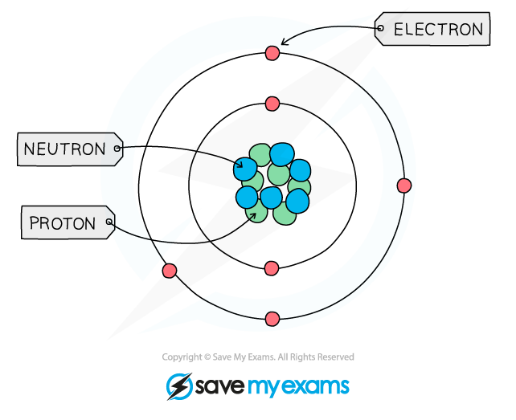

# Atomic Structure

## Atomic Structure

> **Spec point** — `spcpt_zDJv5V8v8cppxK58` · nan

## What is atomic structure?

- All substances are made of tiny particles of matter called **atoms** which are the building blocks of all matter
- Each atom is made of subatomic particles called **protons**, **neutrons,** and **electrons**
- The protons and neutrons are located at the centre of the atom, which is called the **nucleus**
- The electrons move very fast around the nucleus in orbital paths called **shells**
- The mass of the electron is negligible, hence the mass of an atom is contained within the nucleus where the protons and neutrons are located

#### The structure of an atom

***The structure of the carbon atom***

## Protons, neutrons & electrons

> **Spec point** — `spcpt_Qfv9fnKFNhbhb52F` · State the relative charges & relative masses of a proton, a neutron & an electron

## Protons, neutrons & electrons

- The size of atoms is so tiny that we can't really compare their masses in conventional units such as kilograms or grams, so a unit called the relative atomic mass is used
- One **relative** **atomic** **mass** unit is equal to 1/12th the mass of a carbon-12 atom.
- All other elements are measured relative to the mass of a carbon-12 atom, so relative atomic mass has no units
- Hydrogen for example has a relative atomic mass of 1, meaning that 12 atoms of hydrogen would have exactly the same mass as 1 atom of carbon

#### Table of subatomic particles

| **Particle** | **Relative mass** | **Charge** |
|---|---|---|
| Proton | 1 | 1+ |
| Neutron | 1 | 0 (neutral) |
| Electron | $\frac{1}{1840}$ | 1- |

> **Exam Hint**
> Knowing the exact mass of an electron is not in the specification and saying it is almost nothing or negligible will be sufficient. It does, however, sometimes appear in particle identification questions, but you can usually deduce that it is the electrons from other information in the question.

## Defining proton number

> **Spec point** — `spcpt_8yBhgnGwpmZbT9CZ` · nan

## Defining proton number

- The ***atomic number*** (or **proton number**) is the number of protons in the nucleus of an atom
- The symbol for atomic number is ***Z***
- It is also the number of electrons present in a neutral atom and determines the **position** of the element on the Periodic Table

## Defining mass number

> **Spec point** — `spcpt_DZ257wGkK96Fkm3t` · Define mass number nucleon number as the total number of protons & neutrons in the nucleus of an atom

## Defining mass number

- The ***nucleon number*** (or **mass number**) is the total number of protons **and** neutrons in the nucleus of an atom
- The symbol for nucleon number is ***A***
- The nucleon number **minus** the proton number gives you the number of **neutrons** of an atom
- Note that protons and neutrons can collectively be called **nucleons**.
- The atomic number and mass number of an element can be shown using **atomic notation**
- The **Periodic Table** shows the elements together with their atomic (proton) number at the top and relative atomic mass at the bottom - there is a difference between relative atomic mass and mass number, but for your exam, you can use the relative atomic mass as the mass number (with the exception of chlorine)

#### Atomic number & mass number diagram

***Diagram showing the notation used on the periodic table***

### How to calculate numbers of protons, neutrons and electrons

#### Protons

- The atomic number of an atom and ion determines which element it is
- E.g. lithium has an atomic number of 3 (three protons) whereas beryllium has atomic number of 4 (four protons)Therefore, all atoms and ions of the **same element** have the same number of protons (atomic number) in the nucleus
- The number of protons equals the **atomic (proton) number**
- The number of protons of an **unknown **element can be calculated by using its mass number and number of neutrons:

**Mass number = number of protons + number of neutrons**

**Number of protons = mass number – number of neutrons**

#### Electrons

- An atom is **neutral **and therefore has the **same **number of **protons **and **electrons**

#### Neutrons

- The **mass **and **atomic** **numbers **can be used to find the number of **neutrons** in **ions **and **atoms:**

**Number of neutrons = mass number – number of protons**

> **Worked Example**
> Determine the number of protons, electrons and neutrons in an atom of element X with atomic number 29 and mass number 63
> 
> **Answer**
> 
> **Protons**
> 
> - The number of protons of element **X** is the same as the atomic number
> 
>   - Number of protons = 29
> 
> **Electrons**
> 
> - The **neutral atom **of element **X**  therefore also has **29 electrons**
> 
> **Neutrons**
> 
> - The atomic number of an element **X **atom is 29 and its mass number is 63
> 
>   - Number of neutrons = mass number – number of protons
>   - Number of neutrons = 63 – 29
>   - Number of neutrons = 34

> **Exam Hint**
> Both the atomic number and the relative atomic number (which you can use as the mass number) are given on the Periodic Table but it can be easy to confuse them.
> 
> Think **MASS = MASSIVE**, as the mass number is **always** the bigger of the two numbers, the other smaller one is thus the atomic / proton number.
> 
> **Beware **that some Periodic Tables show the numbers the other way round with the atomic number at the bottom!
