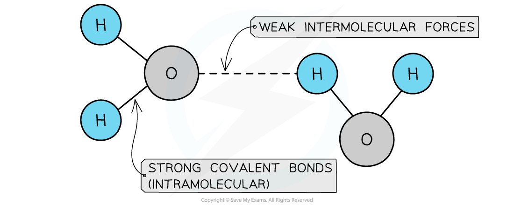
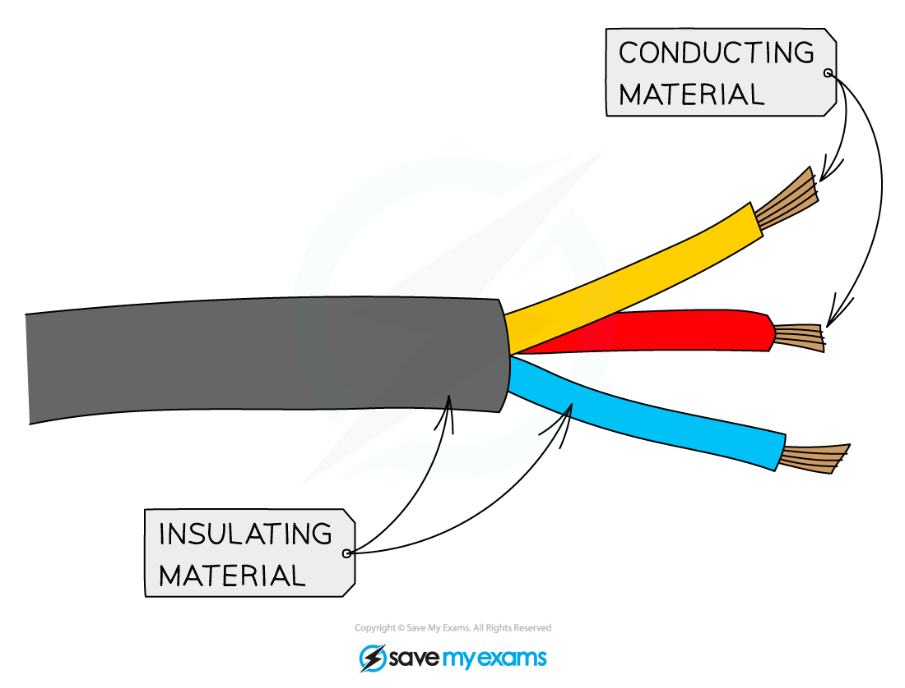

# Properties of Simple Molecular Compounds

## Properties of simple molecular compounds

> **Spec point** — `spcpt_7tCQfxYQZBXDdfCm` · Describe in terms of structure and bonding the properties of simple molecular compounds: (a) low melting points and boiling points; (b) poor electrical conductivity

## Properties of simple molecular compounds

- Small molecules are compounds made up of molecules that contain just a few atoms **covalently bonded** together
- They have** low** melting and boiling points so covalent compounds are usually **liquids** or **gases** at room temperature
- As the molecules increase in **size**, the melting and boiling points generally increase
- Small molecules have poor electrical conductivity

## Explaining the properties of simple molecular compounds

> **Spec point** — `spcpt_pTJyjKpR3d5k78kq` · Explain in terms of structure and bonding the properties of simple molecular compounds: 
low melting points and boiling points in terms of weak intermolecular forces (specific types of intermolecular forces are not required); 
poor electrical conductivity

## Explaining the properties of simple molecular compounds

#### Extended tier only

### Linking bonding and properties

- Small molecules have covalent bonds joining the atoms together, but weak intermolecular forces that act between neighbouring molecules
- They have** low** melting and boiling points as there are only **weak intermolecular** forces acting **between** the molecules
- These forces are **very weak** when compared to the covalent bonds and so most small molecules are either gases or liquids at room temperature
- As the molecules increase in **size** the intermolecular forces also increase as there are more electrons available
- This causes the melting and boiling points to** increase**

***The bonds between hydrogen and oxygen in water are COVALENT, and the attractions between the molecules are INTERMOLECULAR FORCES which are about one tenth as strong as covalent bonds***

### Electrical Conductivity

- Molecular compounds are **poor conductors** of electricity as there are no free ions or electrons to carry the charge.
- Most covalent compounds do not conduct at all in the solid state and are thus **insulators**
- Common insulators include the plastic coating around household electrical wiring, rubber and wood

***The plastic coating around electrical wires is made from covalent molecules that do not allow a flow of charge***

> **Exam Hint**
> The atoms within covalent molecules are held together by covalent bonds while the molecules in a covalent substance are attracted to each other by intermolecular forces.
