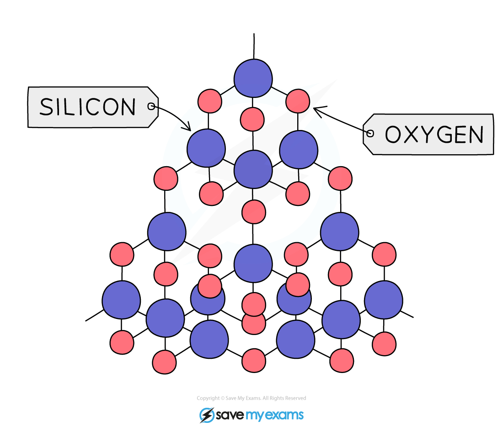

# Silicon(IV) Oxide

## Structure of silicon(IV) oxide

> **Spec point** — `spcpt_DWDXc9R7SctTssf6` · Describe the giant covalent structure of silicon(IV) oxide, SiO2

## Structure of silicon(IV) oxide

### What is the structure of silicon(IV) oxide?

#### Extended tier only

- Silicon(IV) oxide (also known as silicon dioxide or silica), SiO2, is a macromolecular compound which occurs naturally as **sand **and **quartz**
- Each oxygen atom forms covalent bonds with **2** silicon atoms and each silicon atom in turn forms covalent bonds with **4** oxygen atoms
- A tetrahedron is formed with one silicon atom and four oxygen atoms, similar to diamond

#### The structure of silicon(IV) oxide

***Diagram showing the structure of SiO******2 ******with the silicon atoms in blue and the oxygen atoms in red***

## Comparing diamond & silicon(IV) oxide

> **Spec point** — `spcpt_wp9t2xd6DYCpQBw3` · Describe the similarity in properties between diamond and silicon(IV) oxide, related to their structures

## Comparing diamond & silicon(IV) oxide

### How does diamond compare to silicon(IV) oxide?

#### Extended tier only

- SiO2 has lots of very strong covalent bonds and no intermolecular forces so it has similar properties to diamond
- It is very **hard**, has a very **high** boiling point, is insoluble in water and does not conduct electricity
- SiO2 is cheap since it is available naturally and is used to make sandpaper and to line the inside of furnaces
