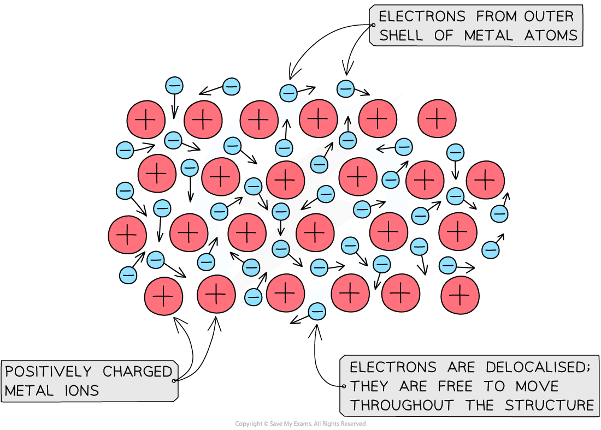
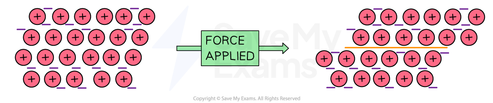

# Metallic Bonding

## Metallic bonding

> **Spec point** — `spcpt_mdCpZTbrHwMHdgc4` · Describe metallic bonding as the electrostatic attraction between the positive ions in a giant metallic lattice and a ‘sea’ of delocalised electrons

## Metallic bonding

### The structure of a metal

#### Extended tier only

- Metals consist of** giant** structures
- Within the metal lattice, the atoms lose their outer electrons and become positively charged metal** ions**

  - The outer electrons no longer belong to any specific metal atom and are said to be** delocalised**
  - This means they can move freely between the positive metal ions and act like a *“sea of electrons”*
- The metallic bond is the strong force of **attraction** between the positive metal ions and the delocalised electrons
- This type of bonding occurs in metals and metal alloys, which are mixtures of metal

#### Diagram to show metallic bonding

***Diagram showing metallic lattice structure with delocalised electrons***

## Properties of metals

> **Spec point** — `spcpt_pdVBCvCCjNtVfDWX` · Explain in terms of structure and bonding the properties of metals: (a) good electrical conductivity; (b) malleability and ductility

## Properties of metals

### What are the properties of metals?

#### Extended tier only

- Most metals have **high melting and boiling points**

  - There are strong electrostatic forces of attraction between the positive metal ions and the negative delocalised electrons within the metal lattice structure
  - These needs lots of energy to be broken
- Metals are **good conductors of heat and electricity**

  - The delocalised electrons are free to move and carry a charge through the whole structure
- Most metals are **malleable**

  - This means they can be hammered into shape
  - This is because the atoms are arranged in layers which can slide over each when force is applied

#### Malleability of metals

***When a force is applied, the layers of positive ions slide over each other***

- Most metals are **ductile**

  - This means they can be pulled into wires
  - This is also because the atoms are arranged in layers which can slide over each when force is applied

> **Exam Hint**
> When explaining why metals can conduct electricity, be careful of the terminology you use. Don't get confused with ionic compounds.
> 
> **Metals** can** **conduct electricity as they have free **electrons **that can carry charge whereas molten or aqueous **ionic **compounds can conduct electricity because they have free **ions** that can carry charge.
