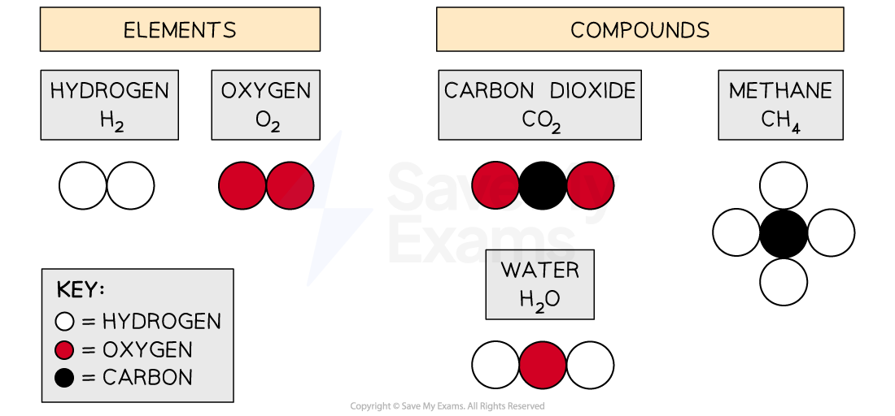

# Formulae

## Molecular formulae

> **Spec point** — `spcpt_4TV53pyBRWZWJM6H` · State the formulae of the elements and compounds named in the subject content                       
Define the molecular formula of a compound as the number and type of different atoms in one molecule
Deduce the formula of a simple compound from the relative numbers of atoms present in a model or a diagrammatic representation

## Molecular formulae

- Elements are often represented using their **chemical symbol **from the Periodic Table

#### Chemical symbols of elements table

| **Element** | **Symbol** | **Element** | **Symbol** |
|---|---|---|---|
| Lithium | Li | Calcium | Ca |
| Chromium | Cr | Gold | Au |
| Aluminium | Al | Sulfur | S |

- Seven elements exist as diatomic **molecules**, which means that they are molecules made of two atoms:

  1. Hydrogen, H2
  2. Nitrogen, N2
  3. Oxygen, O2
  4. Fluorine, F2
  5. Chlorine, Cl2
  6. Bromine, Br2
  7. Iodine, I2

#### Periodic Table identifying the 7 diatomic elements

***The highlighted elements all exist as diatomic molecules with the formula X******2***

- These 7 elements are also classed as **simple molecules**

- Atoms combine together in** fixed ratios** that will give them full outer shells of electrons

  - When this happens, a molecule is formed
- The molecular formula of a molecule shows:

  - The type of atoms involved, given by the chemical symbol
  **AND**
  - The number of atoms, given by the subscript (little) number after a chemical symbol

#### Examples of molecular formulae

| **Substance** | **Molecular formula** | **Made from** |
|---|---|---|
| Hydrogen | H2 | 2 hydrogen atoms |
| Chlorine | Cl2 | 2 chlorine atoms |
| Water | H2O | 2 hydrogen atoms 1 oxygen atom |
| Methane | CH4 | 1 carbon atom 4 hydrogen atoms |
| Ammonia | NH3 | 1 nitrogen atom 3 hydrogen atoms |
| Sulfuric acid | H2SO4 | 2 hydrogen atoms 1 sulfur atom 4 oxygen atoms |

- The table also shows that the molecular formula can be deduced from the relative number of atoms present

  - E.g. Ammonia contains 3 atoms of hydrogen and 1 atom of nitrogen, which means its molecular formula is NH3

### Diagrammatic representation of chemicals

- Diagrams or models can be used to represent and/or deduce the molecular formula of elements and simple compounds:

***When simple molecules are represented using coloured atoms, a key is used to show the colours for each type of atom***

- Using the water examples, it is important to know that these representations also show the arrangement of the atoms in the molecule

  - Water, H2O
  
    - The hydrogen atoms are on either side of the oxygen atom
    - It does not have two hydrogen atoms and an oxygen atom all joined together in a row

> **Worked Example**
> What is the molecular formula of the following compound?
> 
> 
> 
> **Answer:**
> 
> - The molecule contains:
> 
>   - 4 carbon atoms
>   - 10 hydrogen atoms
> - Therefore, the molecular formula is C4H10
