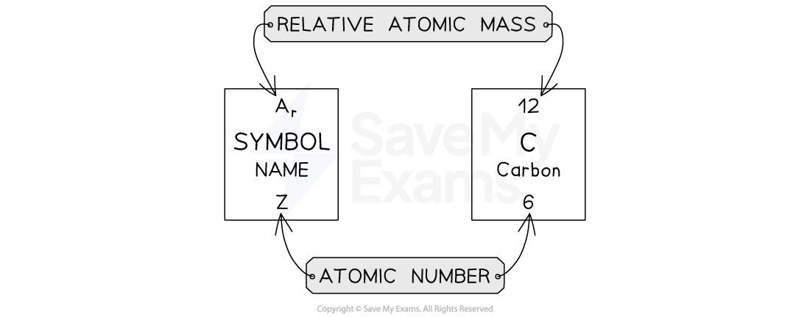

# Ar & Mr

## Relative masses

> **Spec point** — `spcpt_nh8N7RNM9zvDvBp6` · Describe relative atomic mass, Ar, as the average mass of the isotopes of an element compared to 1/12th of the mass of an atom of 12C  
Define relative molecular mass, Mr, as the sum of the relative atomic masses. Relative formula mass, Mr, will be used for ionic compounds 
Calculate reacting masses in simple proportions. Calculations will not involve the mole concept

## Relative masses

### Relative atomic mass

- The symbol for relative atomic mass is *A*r
- The relative atomic mass for each element can be found in the Periodic Table, along with the atomic number

  - Relative atomic mass is shown on the atomic symbol
  - It is always larger than the atomic number (except for hydrogen, where they are the same)
  - Use the key on the Periodic Table to correctly identify the relative atomic mass

#### Key for chemical symbols on the Periodic Table

***This key is given on the Periodic Table in exams and identifies the number that is the relative atomic mass.***

- Atoms are too small to accurately weigh but scientists needed a way to compare the masses of atoms

  - Carbon-12 is used as the standard atom and has a fixed mass of 12 units
  - The mass of all other atoms are compared against carbon-12
- The relative atomic mass of carbon is 12

  - The relative atomic mass of magnesium is 24 which means that magnesium is twice as heavy as carbon
  - The relative atomic mass of hydrogen is 1 which means it has one-twelfth the mass of one carbon-12 atom

### Relative molecular (formula) mass

- The symbol for the relative molecular mass is *M*r
- Relative molecular mass is the sum of the relative atomic masses of all the atoms in a molecule

  - The term **relative formula mass **is used when referring to the total mass of an **ionic** compound
- To calculate the *M*r of a substance, you have to add up the relative atomic masses of all the atoms present in the formula

#### Relative Formula Mass Calculations Table

| **Substance** | **Atoms present** | **Calculation** | ***M******r****** *** |
|---|---|---|---|
| **Hydrogen** **H****2**** ** | 2 x H | (2 x 1) | 2 |
| **Water** **H****2****O** | (2 x H) + (1 x O) | (2 x 1) + (1 x 16) | 18 |
| **Potassium carbonate** **K****2****CO****3**** ** | (2 x K) + (1 x C) + (3 x O) | (2 x 39) + (1 x 12) + (3 x 16) | 138 |
| **Calcium hydroxide** **Ca(OH)****2**** ** | (1 x Ca) + (2 x O) + (2 x H) | (1 x 40) + (2 x 16) + (2 x 1) | 74 |
| **Ammonium sulfate** **(NH****4****)****2****SO****4** | (2 x N) + (8 x H) + (1 x S) + (4 x O) | (2 x 14) + (8 x 1) + (1 x 32) + (4 x 16) | 132 |

> **Worked Example**
> Calculate the relative formula mass of:
> 
> 1. Sodium chloride, NaCl
> 2. Copper oxide, CuO
> 3. Magnesium nitrate, Mg(NO3)2
> 
> **Answers:**
> 
> 1. Sodium chloride
> 
>   - NaCl = 23 + 35.5 = 58.5
> 2. Copper oxide
> 
>   - CuO = 63.5 + 16 = 79.5
> 3. Magnesium nitrate
> 
>   - Mg(NO3)2 = 24 + (14 x 1 x 2) + (16 x 3 x 2) = 148

### Reacting masses

- The Law of Conservation of mass tells us that mass cannot be created or destroyed

  - In a chemical reaction, the total mass of reactants equals the total mass of the products
- We can use this, along with relative atomic / formula masses to perform calculations to identify the quantities of reactants or products involved in a chemical reaction
- **Example**:

**2Ca + O****2**** → 2CaO**

- Relative atomic masses: Ca = 40; O = 16
- Using the balanced symbol equation:

  - Reactants:
  
    - 2 x 40 = 80 units of mass of calcium
    - 16 x 2 = 32 units of mass of oxygen (O2 molecule, 16 + 16 = 32)
  - Products:
  
    - 2 x (40 + 16) = 112 units of mass of CaO

**2Ca + O****2**** → 2CaO**

**80 + 32   =   112**

- The ratio of the mass of calcium and oxygen reacting will always be the same, regardless of the units

  - 80 g of calcium will react with 32 g of oxygen to form 112 g of calcium oxide
  - 80 tonnes of calcium will react with 32 tonnes of oxygen to form 112 tonnes of calcium oxide
  - So, 40 kg of calcium will react with 16 kg of oxygen to form 56 kg of calcium oxide

> **Worked Example**
> Calculate the mass of carbon dioxide produced when 32 g of methane, CH4, reacts completely in excess oxygen:
> 
> CH4 + 2O2 → CO2 + 2H2O
> 
> Relative atomic masses, *A*r: H = 1; C = 12; O = 16
> 
> **Answer:**
> 
> - Using the balanced symbol equation:
> 
>   - Reactants:
>   
>     - 12 + (1 x 4) = 16 units of mass of methane
>     - 2 x (16 x 2) = 64 units of mass of oxygen (2 molecules of O2, each 16 + 16 = 32)
>   - Products:
>   
>     - 12 + (16 x 2) = 44 units of mass of carbon dioxide
>     - 2 x ((1 x 2) + 16) = 36 units of mass of water
> 
> **CH****4****      +       2O****2****        →         CO****2****     +        2H****2****O**
> 
> **16       +          64        →         44        +         36**
> 
> - So, 16 g of methane would react in excess oxygen to form 44 g of carbon dioxide
> - 32 g of methane is double the amount of methane from the balanced symbol equation
> - So, this would produce double the amount of carbon dioxide
> 
>   - 2 x 44 = **88 g** of carbon dioxide
