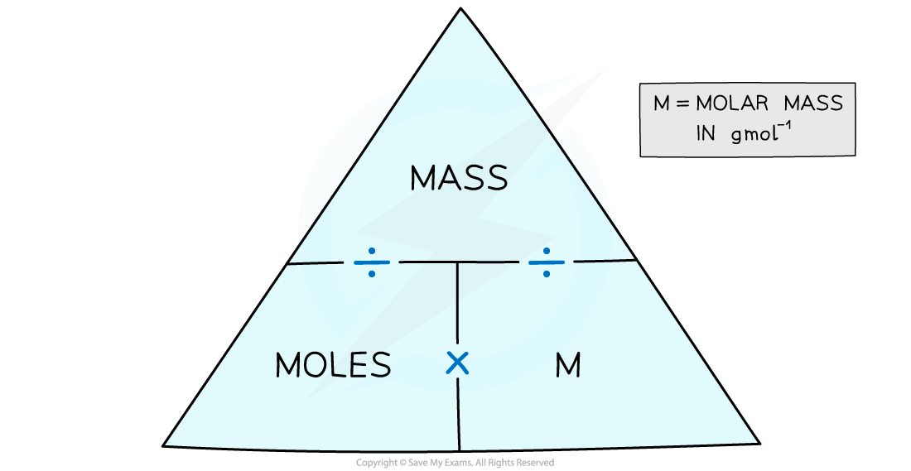

# Linking Moles, Mass & Mr

## Linking moles, mass & Mr

> **Spec point** — `spcpt_S6xxPdtkW4RG4jcm` · Use the relationship amount of substance (mol) = mass (g) / molar mass (g /mol) to calculate: 
amount of substance, 
mass, 
molar mass, 
relative atomic mass or relative molecular/formula mass, 
number of particles, using the value of the Avogadro constant

## Linking moles, mass & Mr

#### Extended tier only

- One mole of any element is equal to the [relative atomic mass](https://www.savemyexams.com/igcse/chemistry/cie/23/revision-notes/3-stoichiometry/3-1-formulae-and-relative-masses/3-1-4-ar-and-mr/) of that element in **grams**
- If you had 1 mole of carbon atoms in your hand, that number of carbon atoms would have a mass of 12 g (because the *A*r of carbon is 12)

  - So, one mole of helium atoms has a mass of 4 g (*A*r of He is 4)
  - One mole of lithium has a mass of 7 g (*A*r of Li is 7) and so on
- One mole of any compound is the **relative molecular mass** or[ relative formula mass](https://www.savemyexams.com/igcse/chemistry/cie/23/revision-notes/3-stoichiometry/3-1-formulae-and-relative-masses/3-1-4-ar-and-mr/) in **grams**
- To find the mass of one mole of a compound, add up the relative atomic masses

  - For example, carbon dioxide has an *M*r of:

(1 x C) + (2 x O)

(1 x 12) + (2 x 16) = 44

### Moles, mass and relative mass

- The number of moles of any chemical can be calculated using:

**Moles = **$\frac{\mathrm{mass}}{M_{r}}$

- We can use the following formula triangle to convert between moles, mass in grams and the molar mass:

***Formula triangle for moles, mass and molar mass***

- Calculating the number of moles of an element uses the same equation, but with relative atomic mass replacing M

> **Worked Example**
> What is the mass of 0.250 moles of zinc?
> 
> **Answer:**
> 
> - From the Periodic Table, the relative atomic mass of Zn is 65
> 
>   - So, the molar mass is 65 g / mol
> - The mass is calculated by **moles x molar mass**:
> 
> 0.250 mol x 65 g / mol = **16.25 g**

> **Worked Example**
> How many moles are in 2.64 g of sucrose, C12H22O11  (*M**r* = 342)?
> 
> **Answer:**
> 
> - The molar mass of sucrose is 342 g / mol
> - The number of moles is found by **mass ÷ molar mass**:
> 
> $\frac{2.64}{342}$ = **7.72 x 10****-3**** mol**

> **Exam Hint**
> Always show your workings in calculations as its easier to check for errors and you may pick up credit if you get the final answer wrong.

## Calculating moles & masses

- Chemical amounts are measured in moles
- The mole, symbol mol, is the SI unit of **amount of substance**
- One mole of any substance contains the same number of the stated particles

  - This can be atoms, molecules or ions
- One mole contains **6.02 x 10****23** particles

  - This number is known as the **Avogadro constant**
- For example:

  - One mole of sodium (Na) contains 6.02 x 1023 atoms of sodium
  - One mole of hydrogen (H2) contains 6.02 x 1023 molecules of hydrogen
  - One mole of sodium chloride (NaCl) contains 6.02 x 1023 formula units of sodium chloride

> **Worked Example**
> For magnesium chloride, MgCl2, calculate the number of:
> 
> 1. Molecules in 1 mole
> 2. Atoms in 1 mole
> 3. Chloride ions in 1 mole
> 4. Magnesium ions in 2 moles
> 
> **Answers:**
> 
> 1. The formula is MgCl2, so 1 mole of MgCl2 is:
> 
> 1 x 6.02 x 1023 = 6.02 x 1023 molecules
> 
> 2. There are 3 atoms in MgCl2, so 1 mole of MgCl2 contains:
> 
> 3 x 6.02 x 1023 = 1.806 x 1024 atoms
> 
> 3. There are 2 chloride ions in MgCl2, so 1 mole of MgCl2 contains:
> 
> 2 x 6.02 x 1023 = 1.204 x 1024 chloride ions
> 
> 4. There is 1 magnesium ion in MgCl2, so 2 mole of MgCl2 contains:
> 
> 2 x (1 x 6.02 x 1023) = 1.204 x 1024 magnesium ions

> **Worked Example**
> In 15.7 g of water (*M*r = 18):
> 
> 1. How many molecules are there?
> 2. How many atoms are there?
> 
> **Answers:**
> 
> The number of molecules:
> 
> - The molar mass of water is 18 g / mol
> - The number of moles is found by **mass ÷ molar mass**
> 
> 15.7 g ÷ 18 g / mol = **0.872 mol**
> 
> - There are 6.02 x 1023 molecules of water in 1 mole of water
> - So, in 0.872 moles of water, there are:
> 
> 6.02 x 1023 x 0.872 = **5.25 x 10****23** molecules
> 
> The number of atoms:
> 
> - In each molecule of water, there are 3 atoms (2 hydrogen atoms, one oxygen atom)
> - So, the number of atoms in 15.7 g is:
> 
> 3 x 5.25 x 1023 = **1.58 x 10****24** atoms
