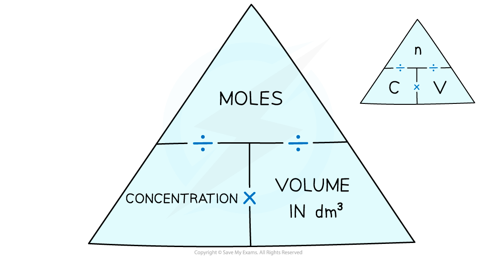

# Calculating Concentration

## Units of concentration

> **Spec point** — `spcpt_Xccr4Fh5Nghzkf4P` · State that concentration can be measured in g /dm3 or mol/dm3

## Units of concentration

- A **solute **is a solid substance that dissolves into a liquid

  - The amount of solute can be expressed in **grams (g) **or **moles (mol)**
- A **solvent **is the liquid that a solute dissolves in

  - The amount / volume of a solvent is measured in **cm****3**** **or **dm****3**
- Most chemical reactions occur between solutes which are dissolved in solvents, such as water or an organic solvent
- A **solution **is the mixture formed when a solute dissolves in a solvent

  - The amount / volume of a solution measured in **cm****3**** **or **dm****3**
- **Concentration **refers to the amount of solute there is in a specific volume of the solvent

  - The greater the amount of solute in a given volume, the greater the concentration
  - Concentration is sometimes commonly referred to as strength
  
    - For example, dissolving more coffee in hot water results in a stronger coffee

- Typically, concentration is expressed in terms of the amount of substance per dm3

  - Therefore, the units of concentration are:
  
    - **g / dm****3**** **
    - **mol / dm****3**

## Calculating concentration

> **Spec point** — `spcpt_JhxxrgyPTvqYYxmn` · Calculate stoichiometric reacting masses, limiting reactants, volumes of gases at r.t.p., volumes of solutions and concentrations of solutions expressed in g /dm3 and mol/dm3 , including conversion between cm3 and dm3

## Calculating concentration

#### Extended tier only

### Calculating concentration using mass

- The general formula to calculate the concentration in g / dm3 is:

concentration (g / dm3) = $\frac{\mathrm{mass} \mathrm{of} \mathrm{solute}(g)}{\mathrm{volume} \mathrm{of} \mathrm{solution}(\mathrm{dm}^{3})}$

- Concentration can also be measured in grams per cubic decimetre

  - 1 decimetre cubed (dm3) = 1000 cm3
  - 1 decimetre cubed (dm3) is the same as 1 litre
- You may be given data in a question which needs to be converted from cm3 to dm3 or the other way around

#### Converting cm3 and dm3

***To go from cm******3****** to dm******3 ******divide by 1000. To go from dm******3****** to cm******3 ******multiply by 1000***

> **Worked Example**
> A student dissolved 10 g of sodium hydroxide, NaOH, in 2 dm3 of distilled water. Calculate the concentration of the solution in g / dm3.
> 
> **Answer:**
> 
> - Write down the information you are given in the question:
> 
>   - Mass of solute: 10 g
>   - Volume of solution: 2 dm3
> - Calculate the concentration:
> 
>   - Concentration = `fraction numerator mass space of space solute space open parentheses straight g close parentheses over denominator volume space open parentheses dm cubed close parentheses end fraction`
>   - Concentration = $\frac{10g}{2\mathrm{dm}^{3}}$ = **5 g / dm****3**** **

### Calculating concentration using moles

- It is more useful to a chemist to express concentration in terms of moles per unit volume rather than mass per unit volume
- Concentration can therefore be expressed in moles per decimetre cubed and calculated using the following equation:

$\mathrm{concentration}(\mathrm{mol}/\mathrm{dm}^{3})=\frac{\mathrm{number} \mathrm{of} \mathrm{moles} \mathrm{of} \mathrm{solute}(\mathrm{mol})}{\mathrm{volume} \mathrm{of} \mathrm{solution}(\mathrm{dm}^{3})}$

- We can modify the concentration formula to include moles

  - The units in the answer can be written as mol / dm3 (this can also be written as mol dm-3)
- You may have to convert from g / dm3 into mol / dm3 and vice versa depending on the question

- To go from g / dm3 to mol / dm3

  - Divide by the molar mass in grams
- To go from mol / dm3 to g / dm3

  - Multiply by the molar mass in grams

- Some students find formula triangles help them to understand the relationship:

***The concentration-moles formula triangle can help you solve these problems***

> **Worked Example**
> Calculate the amount of solute, in moles, present in 2.5 dm3 of a solution whose concentration is 0.2 mol / dm3.
> 
> **Answer:**
> 
> - Write down the information you are given in the question:
> 
>   - Concentration of solution: 0.2 mol / dm3
>   - Volume of solution: 2.5 dm3
> - Calculate the number of moles:
> 
>   - Moles = concentration x volume
>   - Moles = 0.2 x 2.5 = **0.5 mol**

> **Worked Example**
> Calculate the concentration of a solution of sodium hydroxide, NaOH, in mol / dm3, when 80 g is dissolved in 500 cm3 of water.
> 
> Relative atomic masses, *A*r:  Na = 23;   H = 1;   O = 16
> 
> **Answer:**
> 
> - Calculate the *M*r of NaOH:
> 
>   - 23 + 16 + 1 = 40
> - Determine the number of moles of NaOH:
> 
>   - 40 g = 1 mole
>   - So, 80 g = 2 moles
> - Convert cm3 to dm3:
> 
>   - $\frac{500}{1000}$ = 0.5 dm3
> - Calculate the concentration:
> 
>   - Concentration = $\frac{\mathrm{moles}}{\mathrm{volume}}$
>   - Concentration = $\frac{2}{0.5}$ = 4 mol / dm3

> **Worked Example**
> 25.0 cm3 of 0.050 mol / dm3 sodium carbonate was completely neutralised by 20.00 cm3 of dilute hydrochloric acid. Calculate the concentration in mol / dm3 of the hydrochloric acid.
> 
> Na2CO3 + 2HCl → 2NaCl + H2O + CO2
> 
> **Answer:**
> 
> - Calculate the moles of sodium carbonate:
> 
>   - Moles of Na2CO3 = concentration x volume
>   
>     - **Remember: **The volume needs to be in dm3
>   - Moles of Na2CO3 = 0.05 x $\frac{25.0}{1000}$ = 0.00125
> - Calculate the moles of hydrochloric acid:
> 
>   - The balanced symbol equation shows that 1 mole of Na2CO3 reacts with 2 moles of HCl
>   - So, 0.00125 moles of Na2CO3 reacts with 0.00250 moles of HCl
> - Calculate the concentration of hydrochloric acid:
> 
>   - Concentration = $\frac{\mathrm{moles}}{\mathrm{volume}}$
>   
>     - **Remember: **The volume needs to be in dm3
>     - 20 cm3 ÷ 1000 = 0.02 dm3
>   - Concentration = $\frac{0.00250}{0.02}$ = 0.125 mol / dm3

> **Exam Hint**
> **Remember: **Always convert the units from cm3 to dm3 by dividing by 1000.
