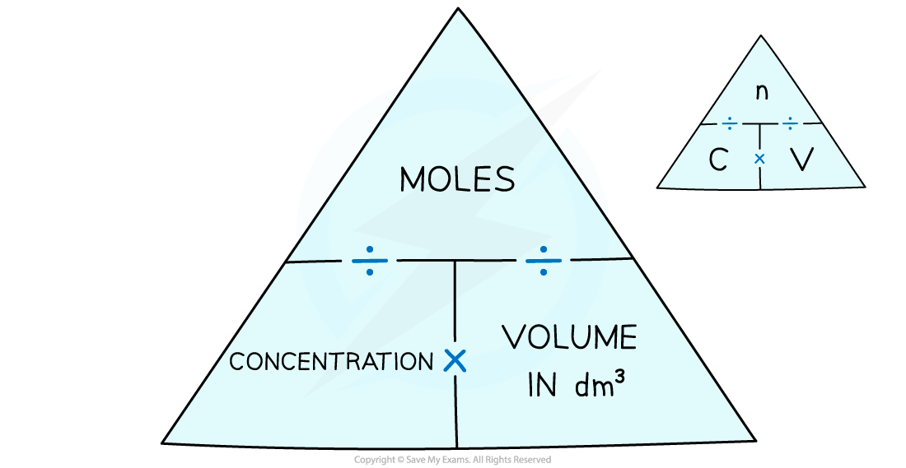

# Titration Calculations

## Titration calculations

> **Spec point** — `spcpt_VrBVngZHzJyKwR7V` · Use experimental data from a titration to calculate the moles of solute, or the concentration or volume of a solution

## Titration calculations

**Extended tier only**

- Titrations are a method of analysing the **concentration** of solutions

  - Acid-base titrations are one of the most important kinds of titrations
- Titrations can determine exactly how much alkali is needed to neutralise a quantity of acid – and vice versa
- You may be asked to calculate:

  - The **moles** present in a given amount
  - The **concentration **or **volume **required to **neutralise** an acid or a base
- Once a titration is completed and the average titre has been calculated, you can calculate the unknown variable using the formula triangle as shown below

***Formula triangle showing the relationship between concentration, number of moles and volume of liquid***

> **Worked Example**
> A solution of 25.0 cm3 of hydrochloric acid was titrated against a solution of 0.100 mol/dm3 NaOH.
> 
> 12.1 cm3 of NaOH was required for a complete reaction.
> 
> Determine the concentration of the acid.
> 
> **Answer:**
> 
> - **Step 1: **Write the equation for the reaction:
> 
>   - **HCl (aq) + NaOH (aq) → NaCl (aq) + H****2****O (l)**
> - **Step 2: **Calculate the number of moles of the NaOH
> 
>   - Moles = ($\frac{\mathrm{volume}}{1000}$) x concentration
>   - Moles of NaOH = 0.012 dm3 x 0.100 mol / dm3 = 1.21 x 10–3 mol
> - **Step 3: **Deduce the number of moles of the acid
> 
>   - Since the acid reacts in a 1:1 ratio with the alkali,  the number of moles of HCl is also 1.21 x 10–3 mol
>   - This is present in 25.0 cm3 of the solution (25.0 cm3 = 0.025 dm3)
> - **Step 4: **Find the concentration of the acid
> 
>   - Concentration = $\frac{moles}{volume ( dm^{3} )}$
>   - Concentration of HCl = $\frac{1.21\times10^{-3}\mathrm{mol}}{0.025\mathrm{dm}^{3}}$=** 0.0484 mol/dm****3**

> **Worked Example**
> 25.00 cm3 of 0.15 mol / dm3 barium hydroxide, Ba(OH)2, was required to neutralise 12.80 cm3 of nitric acid, HNO3 , during a titration. Calculate the concentration of HNO3 that was used. Give your answer to 2 decimal places.
> 
> **Ba(OH)****2**** (aq) + 2HNO****3**** (aq) → Ba(NO****3****)****2**** (aq) + 2H****2****O (l)**
> 
> **Answer:**
> 
> - **Step 1:** Calculate the number of moles of barium hydroxide
> 
>   - Moles of barium hydroxide = concentration x volume (dm3) = 0.15 x 0.025 = 3.75 x 10–3 mols
> - **Step 2:** Using the equation, calculate the number of moles of nitric acid
> 
>   - Moles of nitric acid = 3.75 x 10–3 x 2 = 7.5 x 10-3
>   - The number of moles must be multiplied by 2 due to the 1:2 ratio
> - **Step 3:** Calculate the concentration of nitric acid
> 
>   - Concentration of nitric acid = $\frac{7.5\times10^{-3}}{0.0128}$= **0.59 mol / dm****3**** to 2 dp**
> - Remember to convert cm3 to dm3 by dividing by 1000

> **Worked Example**
> **Calculating volume**
> 
> Calculate the volume of 0.50 mol / dm3 nitric acid, HNO3, required to neutralise 25.00 cm3 of 0.80 mol / dm3 potassium hydroxide, KOH. Give your answer in cm3.
> 
> **KOH (aq) + HNO****3**** (aq) → KNO****3**** (aq) + H****2****O (l)**
> 
> **Answer:**
> 
> - **Step 1:** Calculate the number of moles of potassium hydroxide
> 
>   - Moles of potassium hydroxide = concentration x volume (dm3) = 0.80 x 0.025 = 0.02 mols
> - **Step 2:** Using the equation, calculate the number of moles of nitric acid
> 
>   - Moles of nitric acid = 0.02 mols
>   - The ratio is 1:1 so the number of moles of nitric acid is the same
> - **Step 3:** Calculate the volume of nitric acid in cm3 
> 
>   - Volume of nitric acid =$\frac{\mathrm{moles}}{\mathrm{concentration}}$=  $\frac{0.02}{0.50}$ = 0.040 dm3
>   - Volume of nitric acid =** **0.040 dm3 x 1000 = 40 cm3
