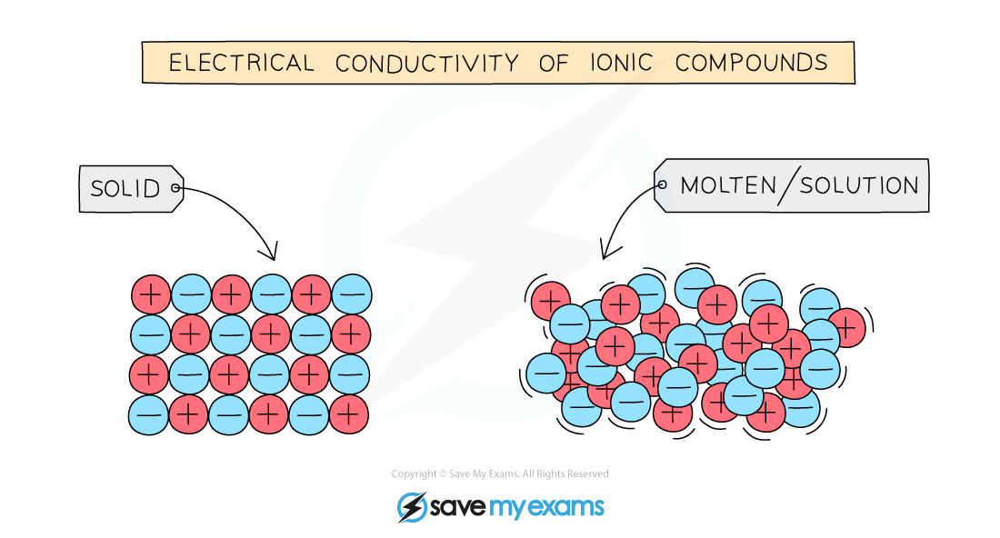
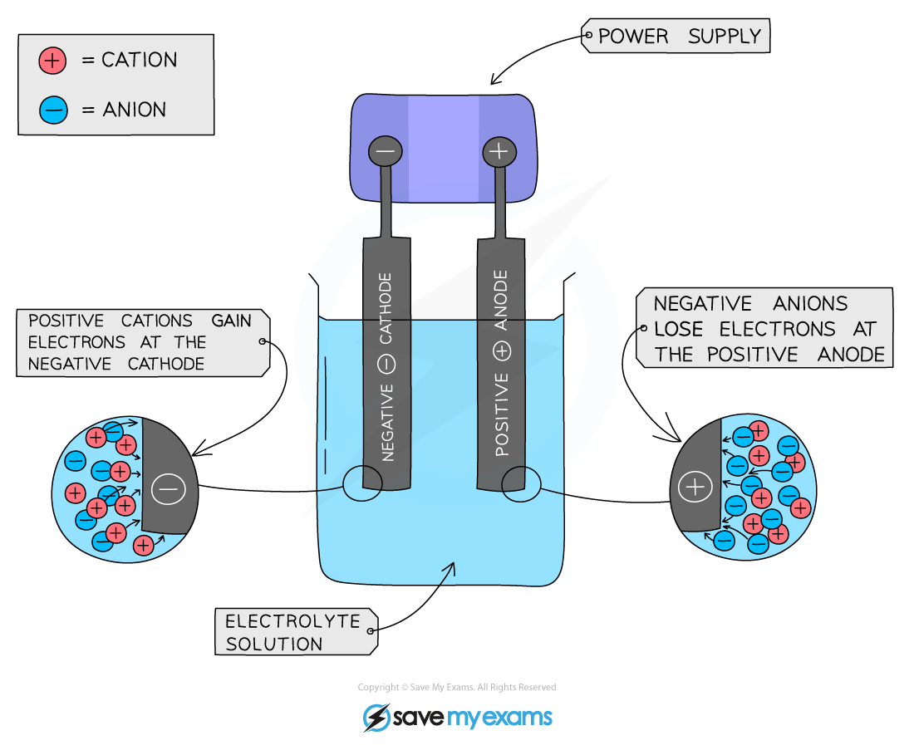
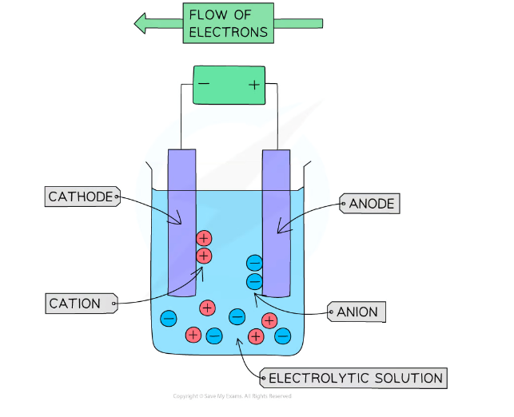

# Electrolysis Principles

## Electrolysis: general principles

> **Spec point** — `spcpt_vX7yWRDVgxXFyZsw` · Define electrolysis as the decomposition of an ionic compound, when molten or in aqueous solution, by the passage of an electric current  
Identify in simple electrolytic cells: 
the anode as the positive electrode 
the cathode as the negative electrode 
the electrolyte as the molten or aqueous substance that undergoes electrolysis
State that metals or hydrogen are formed at the cathode and that non-metals (other than hydrogen) are formed at the anode

## Electrolysis: general principles

- Electrolysis is the process in which a molten ionic compound is broken down by an electric current
- The process also occurs for **aqueous solutions** of ionic compounds
- Covalent compounds do not conduct electricity, so they cannot undergo electrolysis
- Ionic compounds in the solid state cannot conduct electricity either since they have **no free ions** that can move and carry the charge

***In solids, ions are fixed in place. When molten or in solution, they are free to move and carry charge.***

### Key terms used in a simple electrolytic cell

- **Electrode** is a rod (usually metal or graphite) that conducts electricity into or out of an electrolyte
- **Electrolyte** is the ionic compound in a molten or dissolved solution that conducts the electricity
- **Anode** is the positive electrode of an electrolysis cell
- **Anion** is a negatively charged ion which is attracted to the anode
- **Cathode** is the negative electrode of an electrolysis cell
- **Cation** is a positively charged ion which is attracted to the cathode

***The basic set-up of an electrolytic cell***

- Metals and hydrogen form positive ions, so a **metal **or **hydrogen **gas is formed at the **cathode**

  - The production of a metal or hydrogen gas depends on the reactivity series
  - If the metal is **less reactive** than hydrogen (e.g. copper, silver), then the **metal **is produced
  - If the metal is **more reactive** than hydrogen (e.g. sodium, magnesium), then **hydrogen **gas is produced instead
- Non-metals form negative ions, so **non-metals (except hydrogen)** are formed at the **anode**

> **Exam Hint**
> Use the PANIC mnemonic to remember which electrode is the positive and which is the negative:
> 
> **Positive (is) Anode Negative Is Cathode**

## Electrolysis: charge transfer

> **Spec point** — `spcpt_gvDjV4J2sYJSxw2C` · Describe the transfer of charge during electrolysis to include: 
the movement of electrons in the external circuit 
the loss or gain of electrons at the electrodes 
the movement of ions in the electrolyte

## Electrolysis: charge transfer

#### Extended tier only

### How charge flows in electrolysis

- During electrolysis, current flows around the circuit as **electrons and ions move **

  - **Electrons and ions transfer charge because they are the charged particles**
- Electrons flow from the **negative terminal** of the power supply to the **cathode**

  - This gives the cathode its **negative charge**
- The electrons do not pass through the solution

- At the cathode, cations gain electrons to form atoms

- Meanwhile, **anions** move to the **anode** and lose electrons

  - These electrons then flow through the external circuit back to the power supply’s **positive terminal**, completing the circuit
- So, in a complete circuit:

  - **Electrons** are the charge carriers in the **external circuit**
  - **Ions** are the charge carriers in the **electrolyte**

> **Exam Hint**
> In electrolysis, we focus on the movement of **electrons**, not the direction of conventional current:
> 
> - **Electrons** flow from the **negative terminal to the positive terminal**
> 
>   - They flow alphabetically, from the anode to the cathode
> - **Conventional current** flows from **positive to negative**

### Movement of ions in the electrolyte

- **Positive ions** (cations) in the electrolyte move towards the **cathode**

  - **Reduction** occurs at the **cathode** (gain of electrons)
- **Negative ions** (anions) in the electrolyte move towards the **anode**

  - **Oxidation** occurs at the **anode** (loss of electrons)

#### The flow of electrons and ions in electrolysis

*Diagram showing the direction of movement of electrons and ions in the electrolysis of an electrolytic solution*
