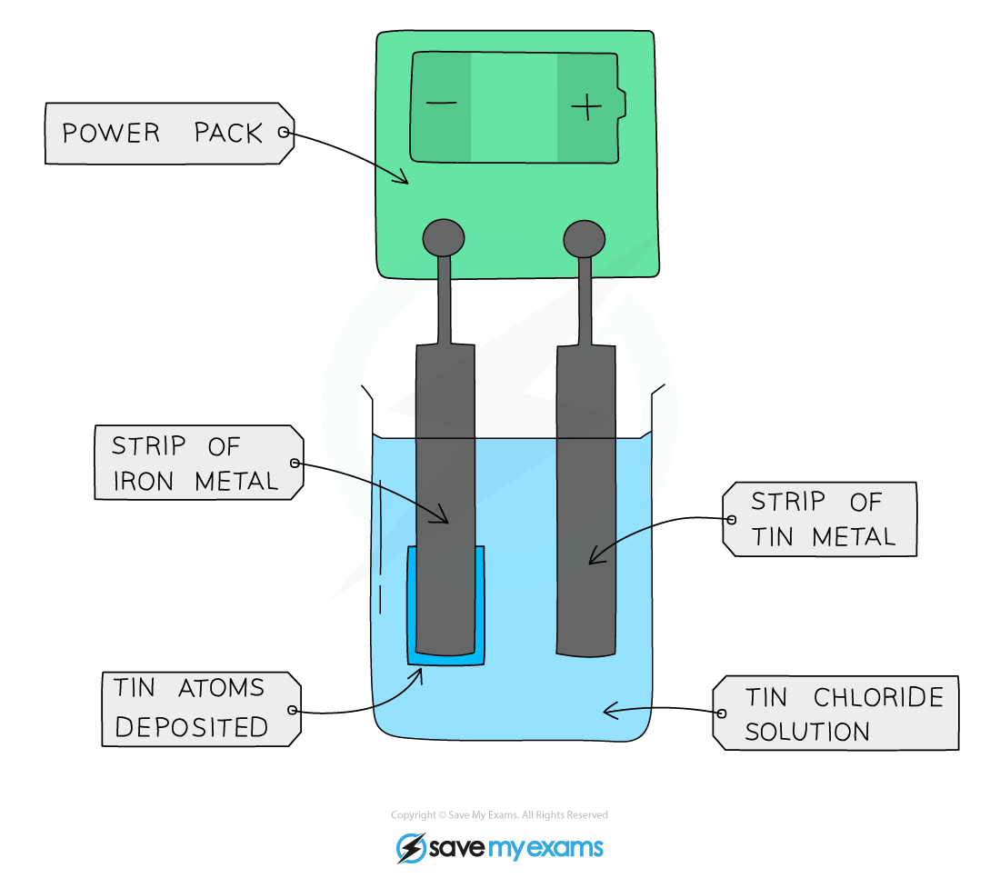

# Electroplating

## Electroplating

> **Spec point** — `spcpt_k7wqYwV7VMxjMXyg` · State that metal objects are electroplated to improve their appearance and resistance to corrosion
Describe how metals are electroplated

## Electroplating

### What is electroplating?

- Electroplating is a process where the surface of one metal is **coated** with a layer of a different metal
- The **cathode / negative electrode** is the **object** to be electroplated
- The **anode / positive electrode** is made from the **pure** metal that will be plated onto the object
- The **electrolyte **is an **aqueous solution** of a soluble salt of the pure metal at the anode

#### Electroplating a strip of iron with tin

***A piece of iron being electroplated with tin. The electrolyte is tin(II) chloride, a water-soluble salt of tin***

- At the anode:

  - Tin atoms lose electrons to form tin ions in solution
  - The loss of electrons is oxidation
- At the cathode:

  - Tin ions gain electrons to form tin atoms
  - The gain of electrons is reduction
  - The tin atoms are deposited on the strip of iron metal, coating it with a layer of tin

> **Exam Hint**
> Extended Tier students may be asked to write the ionic half equations for the reaction at each electrode. For the example above, these would be:
> 
> **At the anode:** Sn (s) → Sn2+ (aq) + 2e-
> 
> **At the cathode: **Sn2+ (aq) + 2e- → Sn (s)

### What is electroplating used for?

- Electroplating is done to make metals more **resistant** to corrosion or damage

  - e.g. chromium and nickel plating
  - e.g. galvanising - zinc plating / coating, typically done to iron and steel
- It is also done to **improve the appearance** of metals,

  - e.g. coating cutlery and jewellery with silver
