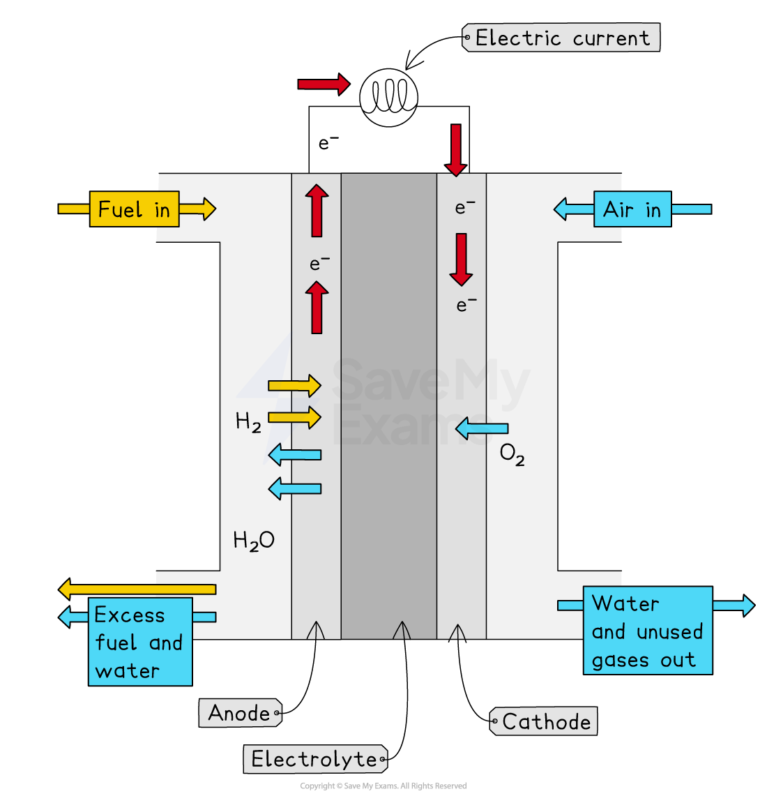

# Hydrogen Fuel Cells

## Hydrogen fuel cells

> **Spec point** — `spcpt_Yf3KSfXJ9cqnxpHK` · State that a hydrogen–oxygen fuel cell uses hydrogen and oxygen to produce electricity with water as the only chemical product

## Hydrogen fuel cells

- A fuel is a substance which releases energy when burned
- Hydrogen is used as a fuel in rocket engines and in fuel cells to power some cars
- A fuel cell is an electrochemical cell in which a fuel** donates** electrons at one electrode and oxygen** gains** electrons at the other electrode

  - H2 → 2H+ + 2e–
  - O2 + 4H+ + 4e- → 2H2O
- The **hydrogen-oxygen** fuel cell produces electricity by combining both elements, releasing energy and water
- The overall equation for the reaction within a hydrogen fuel cell is:

**hydrogen   +   oxygen   →   water**

**2H****2**** + O****2**** → 2H****2****O**

- The diagram below shows the setup of a hydrogen fuel cell

  - The air entering provides the oxygen
  - The fuel entering is hydrogen
  - The only chemical product made is **water **

***Diagram showing the movement of hydrogen, oxygen and electrons in a hydrogen-oxygen fuel cell***

## Advantages & disadvantages of hydrogen fuel cells

> **Spec point** — `spcpt_pfj5hd8K9tr6sZn5` · Describe the advantages and disadvantages of using hydrogen–oxygen fuel cells in comparison with gasoline /petrol engines in vehicles

## Advantages & disadvantages of hydrogen fuel cells

#### Extended tier only

- Hydrogen-oxygen fuel cells are an alternative technology for powering vehicles, replacing traditional petrol or diesel engines.

### Advantages

#### No pollutants produced

- The only product of the reaction is water. This is a major advantage over petrol engines which produce harmful pollutants such as carbon dioxide (a greenhouse gas), oxides of nitrogen (which cause acid rain), and carbon monoxide.

#### High efficiency

- They release more energy per kilogram than either petrol or diesel.

#### Renewable

- The hydrogen fuel can be produced by the electrolysis of water, which is a renewable resource.

### Disadvantages

#### Hydrogen production:

- Most hydrogen is currently produced from fossil fuels (like methane), which is a non-renewable process that releases carbon dioxide.
- The electrolysis of water requires large amounts of electricity, which may be generated by burning fossil fuels.

#### Storage and Safety

- Hydrogen is a highly flammable gas that is difficult and expensive to store safely, often requiring high-pressure tanks. This is less convenient than storing liquid petrol.

#### Cost and Infrastructure:

- The materials used to make fuel cells are often expensive.
- There is a very limited number of hydrogen filling stations available.

> **Exam Hint**
> When comparing fuel cells to petrol engines, your answers should focus on the **chemical products** and their **environmental impact**.
> 
> Fuel cells are much quieter, leading to less noise pollution. However, this is considered a physical or engineering advantage. So, this is unlikely to score a mark.
> 
> Always stick to the chemical points, like "**the only product is water**" or "**no carbon dioxide is produced**."
