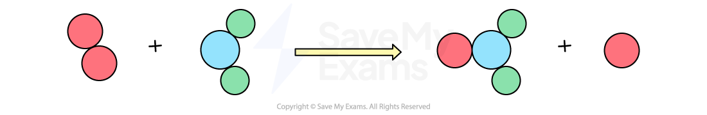
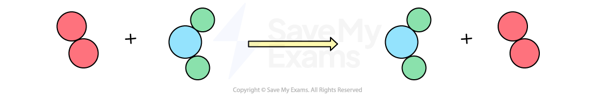

# Collision Theory

## Collision theory

> **Spec point** — `spcpt_DY57jxyqYD9xwM7K` · Describe collision theory in terms of: 
number of particles per unit volume 
frequency of collisions between particles 
kinetic energy of particles 
activation energy, Ea 

## Collision theory

#### Extended tier only

### What is collision theory?

- Collision theory states that in order for a reaction to occur:

  - The particles must **collide** with each other
  - The collision must have **sufficient energy** to cause a reaction i.e. enough energy to break bonds
  - The minimum energy that colliding particles must have to react is known as the **activation energy**

- Collisions can be described as **successful** or **unsuccessful**

  - A **successful collision **means that the reactant particles collide and rearrange to form the products
  
    - This happens when the particles have sufficient energy (i.e. energy greater than the activation energy) to react

***The collision is successful resulting in a rearrangement of atoms to form the products ***

- An **unsuccessful collision **means that the reactant particles just bounce off each other and remain unchanged

  - This happens when the particles do not have sufficient energy to break the necessary bonds or do not collide in the correct orientation

***The collision is unsuccessful resulting in no rearrangement of atoms  ***

### How to increase the number of successful collisions

- Increasing the number of successful collisions means that a greater proportion of reactant particles collide to form product molecules
- The number of successful collisions depends on:

  - The **number of particles per unit volume **- more particles in a given volume will produce more frequent successful collisions
  - The **frequency of collisions** - a greater number of collisions per second will give a greater number of successful collisions per second
  - The **kinetic energy of the particles** - greater kinetic energy means a greater proportion of collisions will have an energy that exceeds the activation energy and the more frequent the collisions will be as the particles are moving quicker, therefore, more collisions will be successful
  - The **activation energy** - fewer collisions will have an energy that exceeds higher activation energy and fewer collisions will be successful
- These all have an impact on the rate of reaction which is dependent on the number of successful collisions per unit of time
