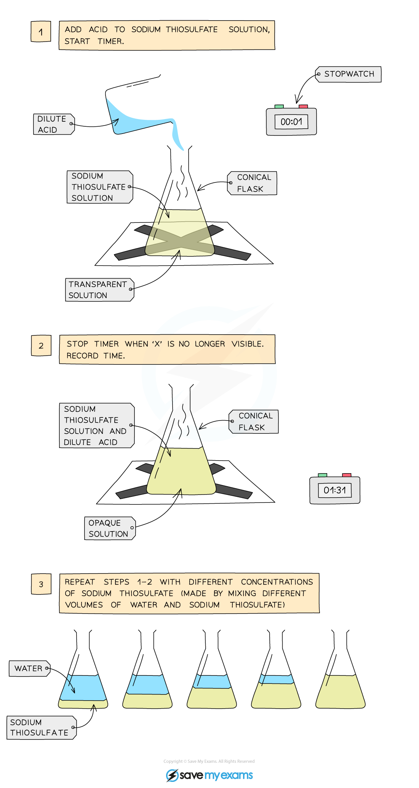
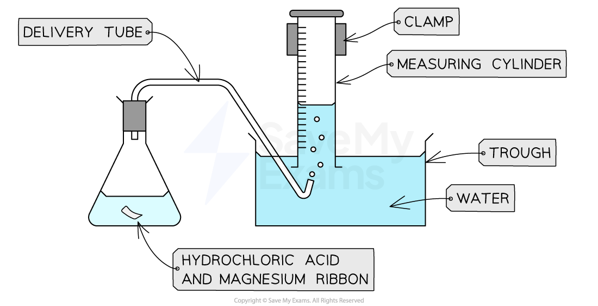
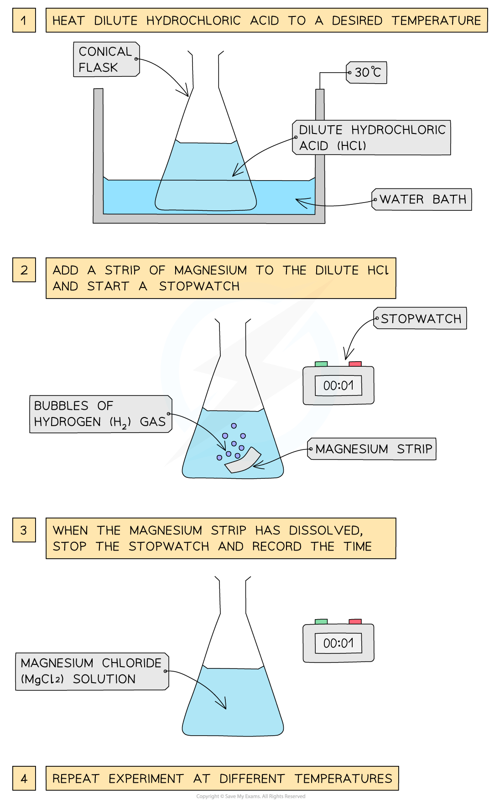
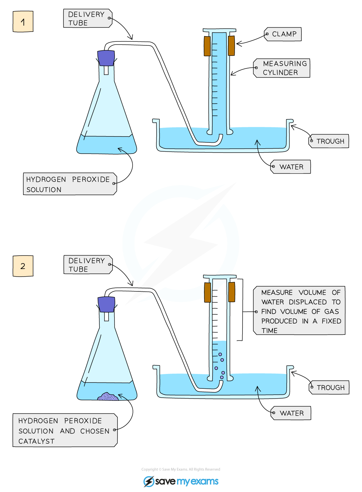
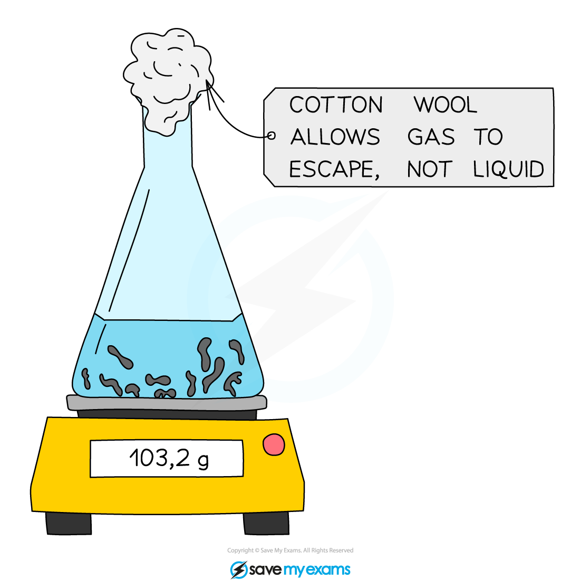

# Investigating The Rate of a Reaction

## Investigating the rate of a reaction

> **Spec point** — `spcpt_2Fv5yMMpjpFGmPVZ` · Describe practical methods for investigating the rate of a reaction including change in mass of a reactant or a product and the formation of a gas

## Investigating the rate of a reaction

- To measure the **rate of a reaction**, we need to be able to measure:

  - How quickly the reactants are used up
  **OR**
  How quickly the products are formed
- The method used for measuring depends on the substances involved
- There are a number of ways to measure a reaction rate in the lab

  - They all depend on a property changing during the course of the reaction
  - Properties that change during the course of a reaction include:
  
    - Colour
    - Mass
    - Volume
- The changing property is taken to be **proportional** to the concentration of the reactant or product
- Faster reactions can be easier to measure when the reaction is over

  - This can be done by averaging a collected measurement over the course of the reaction
- Some reaction rates can be measured as the reaction proceeds (this generates more data)
- Three commonly used techniques are:

  - **measuring mass loss on a balance**
  - **measuring the volume of a gas produced**
  - **measuring a reaction where there is a colour change at the end of the reaction**

### Investigating the effect of concentration of a solution on the rate of reaction

***Diagram showing the apparatus needed to investigate the effect of concentration on the rate of reaction***

#### Method:

- Measure 50 cm3 of sodium thiosulfate solution into a flask
- Measure 5 cm3 of dilute hydrochloric acid into a measuring cylinder
- Draw a cross on a piece of paper and put it underneath the flask
- Add the acid into the flask and immediately start the stopwatch
- Look down at the cross from above and stop the stopwatch when the cross can no longer be seen
- Repeat using different concentrations of sodium thiosulfate solution (mix different volumes of sodium thiosulfate solution with water to dilute it)

#### Result:

- With an increase in the concentration of a solution, the rate of reaction will increase
- This is because there will be more reactant particles in a given volume, allowing more frequent and successful collisions, increasing the rate of reaction

### Investigating the effect of surface area on the rate of reaction

***Diagram showing the process of downwards displacement to investigate the effect of the surface area of a solid on the rate of reaction***

#### Method:

- Add dilute hydrochloric acid into a conical flask
- Use a delivery tube to connect this flask to a measuring cylinder upside down in a bucket of water (downwards displacement)
- Add magnesium ribbon to the conical flask and quickly put the bung back into the flask
- Measure the volume of gas produced in a fixed time using the measuring cylinder
- Repeat with different size pieces of magnesium ribbon

  - The same total mass of magnesium must be used

#### Result:

- Smaller pieces of magnesium ribbon cause an increase in the surface area of the solid, so the rate of reaction will increase
- This is because more surface area of the particles will be exposed to the other reactant so there will be more frequent and successful collisions, increasing the rate of reaction

### Investigating the effect of temperature on the rate of reaction

***Diagram showing the apparatus needed to investigate the effect of temperature on the rate of reaction***

#### Method:

- Dilute hydrochloric acid is heated to a set temperature using a water bath
- Add the dilute hydrochloric acid into a conical flask
- Add a strip of magnesium and start the stopwatch
- Stop the time when the magnesium fully reacts and disappears
- Repeat at different temperatures and compare results

#### Result:

- With an increase in the temperature, the rate of reaction will increase
- This is because the particles will have more kinetic energy than the required activation energy, therefore more frequent and successful collisions will occur, increasing the rate of reaction

### Investigating the effect of a catalyst on the rate of reaction

***Diagram showing the apparatus needed to investigate the effect of a catalyst on the rate of reaction***

#### Method:

- Add hydrogen peroxide into a conical flask
- Use a delivery tube to connect this flask to a measuring cylinder upside down in a tub of water (downwards displacement)
- Add the catalyst manganese(IV) oxide into the conical flask and quickly place the bung into the flask
- Measure the volume of gas produced in a fixed time using the measuring cylinder
- Repeat experiment without the catalyst of manganese(IV) oxide and compare results

#### Result:

- Using a catalyst will increase the rate of reaction
- The catalyst will provide an alternative pathway requiring lower activation energy so more colliding particles will have the necessary activation energy to react
- This will allow more frequent and successful collisions, increasing the rate of reaction

### Monitoring changes in mass

- Many reactions involve the production of a gas which will be released during the reaction
- The gas can be collected and the volume of gas monitored as per some methods above
- Alternatively, the reaction can be performed in an **open flask **on a balance to measure the loss in mass of reactant
- Cotton wool is usually placed in the mouth of the flask which allows gas out but prevents any materials from being ejected from the flask (if the reaction is vigorous)

***Diagram showing the set-up for measuring the rate of reaction by loss in mass***

- This method is not suitable for hydrogen and other gases with a small relative formula mass, *M**r* as the loss in mass may be too small to measure

> **Exam Hint**
> There are many different methods of investigating the rate of reaction.
> 
> Another method of gas collection you may see uses a gas syringe.
> 
> Extended tier students may be required to devise and evaluate methods of investigating rates of reaction.

## Evaluating investigations of rates of reactions

> **Spec point** — `spcpt_639n63B7VSSPynTY` · Evaluate practical methods for investigating the rate of a reaction including change in mass of a reactant or a product and the formation of a gas

## Evaluating investigations of rates of reactions

**Extended tier only**

- When investigating rates of reaction, there are a number of different methods that can be used to carry out the same investigation
- Evaluating what is the best method to use is part of good experimental planning and design
- This means appreciating some of the advantages and disadvantages of the methods available

#### Advantages and disadvantages of methods of investigating rates of reaction

| **Experiment** | **Advantage** | **Disadvantage** |
|---|---|---|
| Formation of a solid / precipitate  (Disappearing cross experiment) | Simple experiment with no specialist equipment | Difficult to determine when the cross is obscured as people will determine the cross to have disappeared at different levels of cloudiness  Easy to contaminate equipment |
| Gas collection using a gas syringe | Works for all reactions that produce a gas  All the gas collected is from the reaction  Easy to set up | Gas syringes are fragile and expensive  Gas syringes can stick  They can collect limited volumes  Gas can be lost before the bung is securely connected to the reaction flask, especially in fast reactions |
| Gas collection using an inverted measuring cylinder | Works for all reactions that produce a gas  Uses common lab equipment | The delivery tube can pop out of the measuring cylinder  It can be difficult to read the scale as it is upside down and may be obscured by bubbles  Gas is lost while the bung is connected to the reaction flask |
| Measuring mass lost on a balance | Easy to set up  Uses common lab equipment | Not suitable for gases with low molecular mass |
