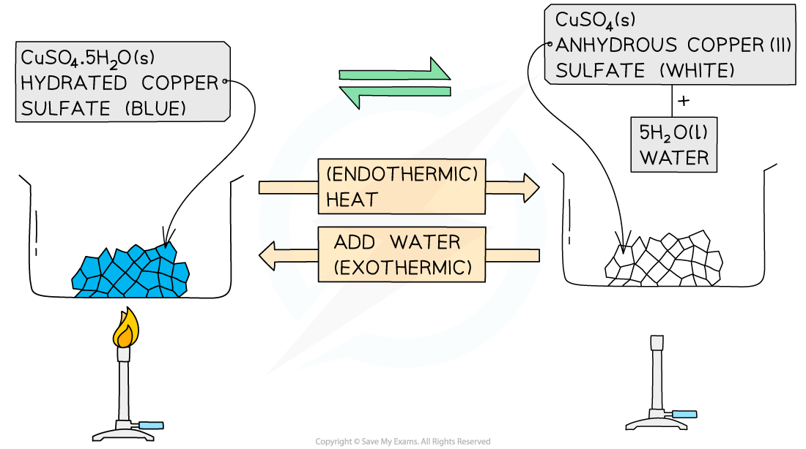
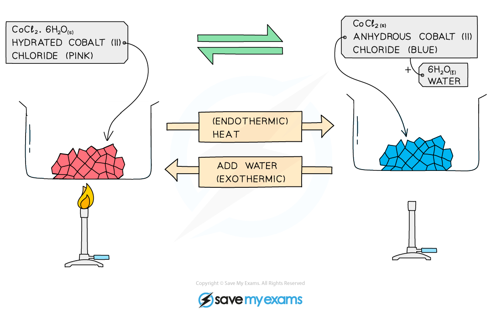

# Reversible Reactions

## Reversible reactions

> **Spec point** — `spcpt_rRBtbcNgyyRhxyf6` · State that some chemical reactions are reversible as shown by the symbol ⇌
Describe how changing the conditions can change the direction of a reversible reaction for: 
the effect of heat on hydrated compounds 
the addition of water to anhydrous compounds limited to copper(II) sulfate and cobalt(II) chloride

## Reversible reactions

- Some reactions go to **completion**, where the reactants are used up to form the product molecules and the reaction stops when all of the reactants are used up
- In ***reversible reactions***, the product molecules can themselves react with each other or decompose and form the reactant molecules again
- It is said that the reaction can occur in **both** **directions**:

  - The **forward **reaction forming the products
  - The **reverse **reaction forming the reactants
- If the forward reaction is [exothermic](https://www.savemyexams.com/igcse/chemistry/cie/23/revision-notes/5-chemical-energetics/5-1-exothermic-and-endothermic-reactions/5-1-1-endothermic-and-exothermic-reactions/)**,** then the reverse reaction will be [endothermic](https://www.savemyexams.com/igcse/chemistry/cie/23/revision-notes/5-chemical-energetics/5-1-exothermic-and-endothermic-reactions/5-1-1-endothermic-and-exothermic-reactions/)

  - The same amount of heat is transferred in both directions

### Chemical equations for reversible reactions

- When writing chemical equations for reversible reactions, the following symbol is used:

$\rightleftharpoons$

- An example is, the reaction for the** **[Haber process](https://www.savemyexams.com/igcse/chemistry/cie/23/revision-notes/6-chemical-reactions/6-2-reversible-reactions-and-equilibrium/6-2-3-the-haber-process/)** **which produces ammonia from nitrogen and hydrogen

N2 + 3H2 ⇌ 2NH3

- The forward reaction, producing ammonia, is exothermic
- So, the reverse reaction is endothermic

### Hydrated and anhydrous salts

- ***Hydrated*** salts are salts that contain **water** **of** **crystallisation** which affects their molecular shape and colour

  - Water of crystallisation is the water that is stoichiometrically included in the structure of some salts during the crystallisation process
- One example is copper(II) sulfate:

**hydrated copper(II) sulfate ⇌ anhydrous copper(II) sulfate + water**

**CuSO****4****•5H****2****O ⇌ CuSO****4**** + 5H****2****O**

- The hydrated salt is copper(II) sulfate pentahydrate, CuSO4•5H2O

  - These are usually seen as blue crystals
  - The hydrated salt can be heated / dehydrated to form anhydrous copper(II) sulfate, CuSO4
  - This reaction is endothermic as energy is taken in to remove the water
- The anhydrous salt is copper(II) sulfate

  - This is usually seen as white crystals / powder
  - Adding water to the anhydrous salt forms the hydrated copper(II) sulfate pentahydrate, CuSO4•5H2O
  - This reaction is highly exothermic

***The forward reaction is exothermic and the reverse reaction is endothermic***

- Another example is cobalt(II) chloride:

**hydrated cobalt(II) chloride ⇌ anhydrous cobalt(II) chloride + water**

**CoCl****2****•6H****2****O ⇌ CoCl****2**** + 6H****2****O**

- The hydrated salt is cobalt(II) chloride hexahydrate, CoCl2•6H2O

  - These are usually seen as pink crystals
  - The hydrated salt can be heated / dehydrated to form anhydrous cobalt(II) chloride, CoCl2
  - This reaction is endothermic as energy is taken in to remove the water
- The anhydrous salt is cobalt(II) chloride, CoCl2

  - This is usually seen as blue crystals
  - Adding water to the anhydrous salt forms the hydrated cobalt(II) chloride hexahydrate, CoCl2•6H2O
  - This reaction is highly exothermic

***The forward reaction is exothermic and the reverse reaction is endothermic***

> **Exam Hint**
> The hydration of CoCl2 and  CuSO4 are chemical tests used to detect the presence of water.
> 
> You should remember the equations and colour changes:
> 
> - CoCl2 + 6H2O ⇌ CoCl2**.**6H2O **Blue to pink**
> - CuSO4 + 5H2O ⇌ CuSO4**.**5H2O **White to blue**
