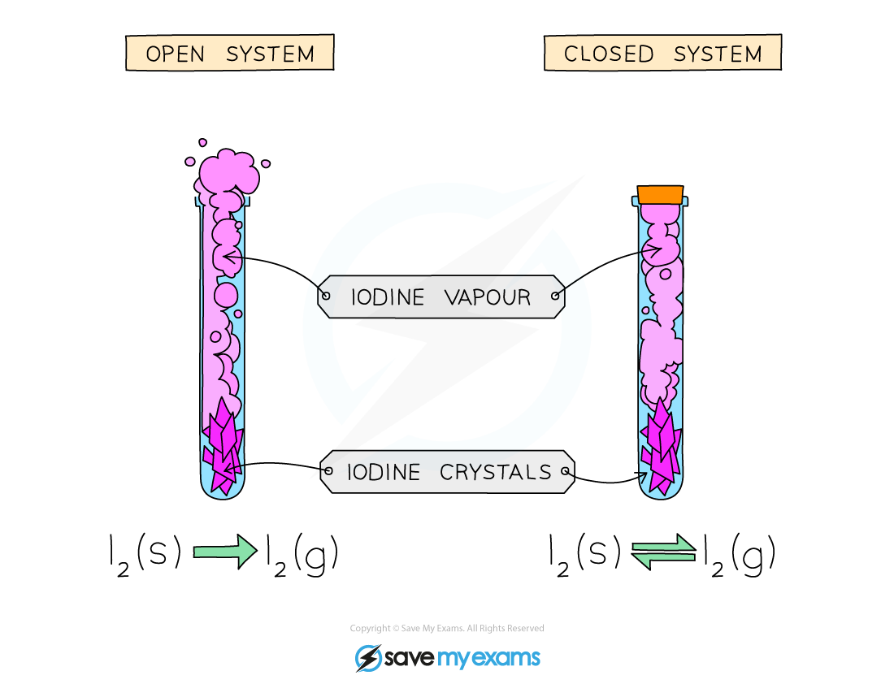
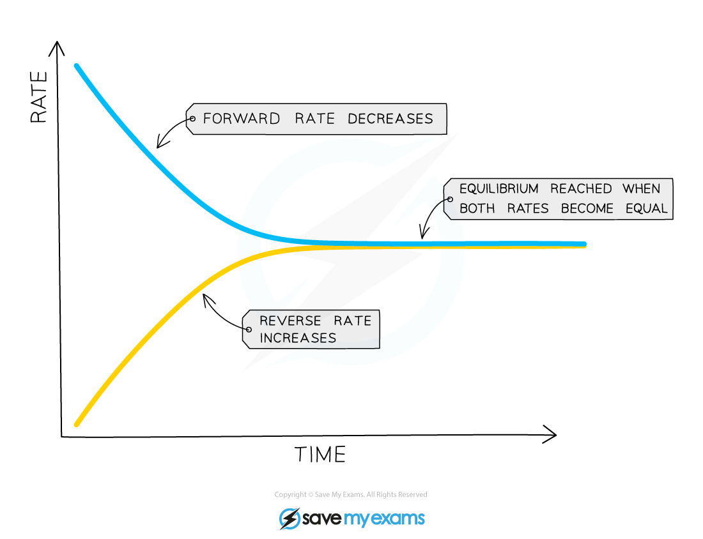

# Equilibrium

## The concept of equilibrium

> **Spec point** — `spcpt_Mc7z9JPxXkKSNbgf` · State that a reversible reaction in a closed system is at equilibrium when: 
the rate of the forward reaction is  equal to the rate of the reverse reaction 
the concentrations of reactants and products are no longer changing

## The concept of equilibrium

**Extended tier only**

- Reversible reactions occur in **both **the forward and backward directions
- A reversible reaction can reach **equilibrium **in a **closed system**

  - This is so none of the participating chemical species can leave the reaction vessel and nothing else can enter

***Equilibrium can only be reached in a closed vessel which prevents reactants or products from escaping the system***

- At equilibrium:

  - The rate of the forward reaction is **equal **to the rate of the reverse reaction
  - The **concentration **of reactants and products remains **constant** (given there is no other change to the system such as temperature and pressure)
- Equilibrium is **dynamic**

  - This means that the molecules on the left and right of the equation are **changing** into each other by chemical reactions constantly and at the same rate

- An example of a reaction reaching equilibrium is the reaction between H2 and N2 in the [Haber process](https://www.savemyexams.com/igcse/chemistry/cie/23/revision-notes/6-chemical-reactions/6-2-reversible-reactions-and-equilibrium/6-2-3-the-haber-process/):

  - At the start of the reaction, only nitrogen and hydrogen are present
  
    - This means that the rate of the forward reaction is at its **highest**, since the **concentrations** of hydrogen and nitrogen are at their **highest**
  - As the reaction proceeds, the **concentrations **of hydrogen and nitrogen gradually **decrease**
  
    - So, the rate of the forward reaction will **decrease**
  - However, the concentration of ammonia is gradually increasing and so the rate of the **backward** reaction will increase
  
    - Ammonia will decompose to reform hydrogen and nitrogen
  - In a closed system, the two reactions are interlinked and none of the gases can escape
  - So, the rate of the forward reaction and the rate of the backward reaction will eventually become** equal** and equilibrium is reached:

***At equilibrium, the rate of the forward reaction is equal to the rate of the reverse reaction***

## Le Chatelier’s principle

> **Spec point** — `spcpt_BZ7nxycDrmC7G4mj` · Predict and explain, for a reversible reaction, how the position of equilibrium is affected by: 
changing temperature  
changing pressure 
changing concentration 
using a catalyst using information provided

## Le Chatelier’s principle

**Extended tier only**

- The relative amounts of all the reactants and products at equilibrium depend on the **conditions** of the reaction

  - This balance is framed in an important concept known as Le Chatelier's Principle,
- This principle states that when a change is made to the conditions of a system at equilibrium, the system automatically moves to **oppose **the change
- The principle is used to predict changes to the position of equilibrium when there are changes in:

  - **Temperature**
  - **Pressure**
  - **Concentration**
- Knowing the energy changes, states and concentrations involved allows us to use the principle to manipulate the outcome of reversible reactions
- For example, if pressure is increased, the position of equilibrium moves in the direction which has the smallest amount of gaseous molecules
- The position of equilibrium is said to shift to the **right **when the **forward **reaction is favoured

  - This means that there is an increase in the amount of **products **formed
- The position of equilibrium is said to shift to the **left **when the **reverse **reaction is favoured

  - So, there is an increase in the amount of **reactants **formed

### How temperature affects equilibrium

- We can predict the effect of changes in temperature on systems in equilibrium

  - To make this prediction it is necessary to know whether the reaction is exothermic or endothermic
- If the temperature is **raised**:

  - The yield from the endothermic reaction increases
  - The yield from the exothermic reaction decreases
- If the temperature is** lowered**:

  - The yield from the endothermic reaction decreases
  - The yield from the exothermic reaction increases
- When a change in temperature is made to a system, the system will **oppose** the change

  - E.g. If the temperature is increased, the system will oppose the change by decreasing the temperature
  - It will do this by favouring the endothermic reaction

#### The effects of temperature on equilibrium

| **Change** | **How the equilibrium shifts  ** |
|---|---|
| Increase in temperature | Equilibrium moves in the **endothermic** direction to reverse the change |
| Decrease in temperature | Equilibrium moves in the **exothermic** direction to reverse the change |

> **Worked Example**
> Iodine monochloride reacts reversibly with chlorine to form iodine trichloride.
> 
> The forward reaction is exothermic:
> 
> ICl             +              Cl2             ⇌             ICl3 
> 
> dark brown                                                    yellow
> 
> What colour will the mixture turn when heated? Explain your answer.
> 
> **Answer:**
> 
> - The system will oppose the increase in temperature
> 
>   - Increasing the temperature of an equilibrium reaction favours the endothermic reaction
> - If the forward reaction is exothermic, then the backward reaction must be endothermic
> - Therefore, the equilibrium will move to the left and produce more of the reactants
> - This means that the colour of the mixture will become increasingly brown as the temperature increases

### How pressure affects equilibrium

- Changes in pressure only affect reactions where the reactants or products are gases
- We can predict the effect of changes in pressure on systems in equilibrium

  - To make this prediction, the balanced symbol equation must be known

#### The effects of pressure on equilibrium

| **Change** | **How the equilibrium shifts  ** |
|---|---|
| Increase in pressure | Equilibrium shifts in the direction that produces the **least **number of molecules |
| Decrease in pressure | Equilibrium shifts in the direction that produces the **greatest **number of molecules |

> **Worked Example**
> Nitrogen dioxide molecules can dimerise and form dinitrogen tetroxide in the following equilibrium reaction:
> 
> 2NO2 (g)            ⇌              N2O4 (g) 
> brown gas                    colourless gas
> 
> What will the colour change be if the pressure is increased? Explain your answer.
> 
> **Answer:**
> 
> - The number of gas molecules produced by the forward reaction = 1
> - The number of gas molecules produced by the reverse reaction = 2
> - An **increase **in pressure will cause equilibrium to shift in the direction that produces the **least **number of molecules of gas
> 
>   - This is the forward reaction
> - So, the equilibrium shifts to the right
> - This means that:
> 
>   - The mixture will become increasingly colourless
>   - The concentration of N2O4 will increase

### How concentration affects equilibrium

- The effect of changing concentration can be thought of as a balance, with the reactants on the left and the products on the right

  - If the concentration of a reactant increases, then the equilbrium shifts to the right to balance this balance

#### The effects of concentration on equilibrium

| **Change** | **How the equilibrium shifts  ** |
|---|---|
| Increase in concentration of a reactant | Equilibrium shifts to the right |
| Decrease in concentration of a reactant | Equilibrium shifts to the left |
| Increase in concentration of a product | Equilibrium shifts to the left |
| Decrease in concentration of a product | Equilibrium shifts to the right |

> **Worked Example**
> Iodine monochloride reacts reversibly with chlorine to form iodine trichloride
> 
> ICl             +              Cl2             ⇌             ICl3 
> 
> dark brown                                                    yellow
> 
> Explain what happens when:
> 
> 1. The concentration of ICl3 increases
> 2. Some Cl2 is removed
> 
> **Answers:**
> 
> 1. The concentration of ICl3 increases
> 
>   - There are more molecules of ICl3 on the products side
>   - So, the position of the equilibrium moves **to the left**
>   - This produces more ICl and Cl2
>   
>     - So, the reaction mixture gets darker / turns dark brown
> 2. Some Cl2 is removed
> 
>   - There are less molecules of Cl2 on the reactants side
>   - So, the position of the equilibrium moves **to the left**
>   - This produces more Cl2 (and ICl)
>   
>     - So, the reaction mixture gets darker / turns dark brown

### How catalysts affects equilibrium

- The presence of a catalyst:

  - Does **not** affect the position of equilibrium
  - Increases the rate at which equilibrium is reached
- This is because the catalyst increases the rate of **both** the forward and backward reactions by the same amount by providing an alternative pathway requiring lower activation energy
- As a result, the equilibrium **concentration** of reactants and products is the **same** as it would be without the catalyst 

***Diagram showing the effect of a catalyst on the time taken for equilibrium to be established***

> **Exam Hint**
> When the conditions at equilibrium are changed, the system always responds by doing the **opposite**.
> 
> For example if the concentration is increased the system tries to reduce it by changing the direction of the reaction or if the temperature is increased the system will try to reduce the temperature by absorbing the extra heat.
