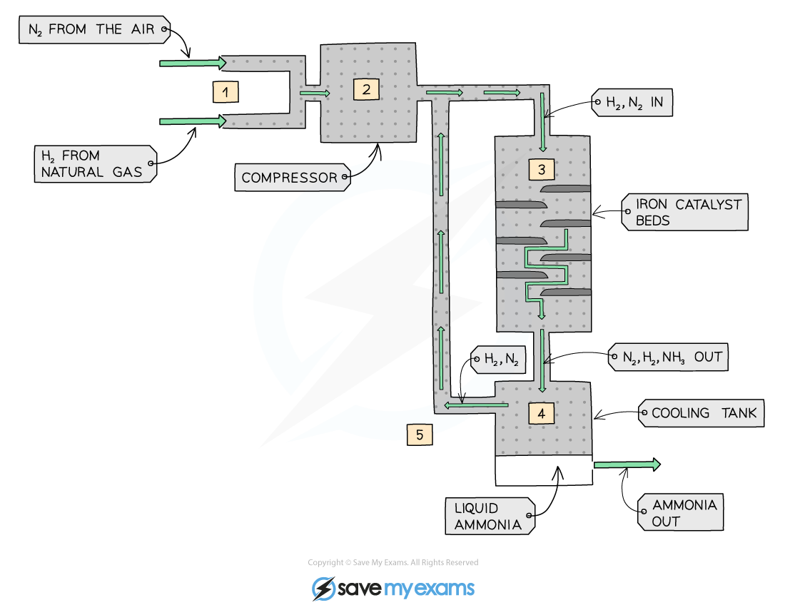
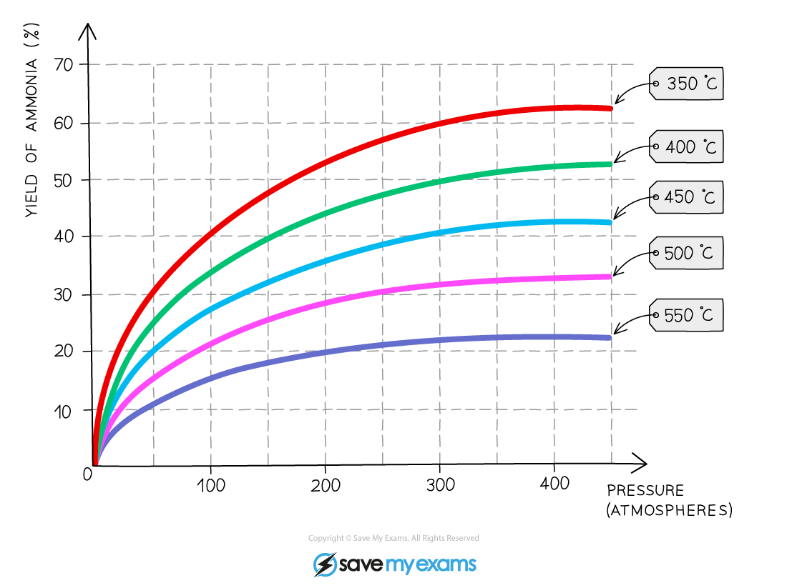

# The Haber Process

## The Haber process

> **Spec point** — `spcpt_fkcxYVh7yM3gVw4z` · State the symbol equation for the production of ammonia in the Haber process, N2(g) + 3H2(g) ⇌ 2NH3(g) 
State the sources of the hydrogen (methane) and nitrogen (air) in the Haber process
State the typical conditions in the Haber process as 450°C, 20000kPa /200atm and an iron catalyst

## The Haber process

**Extended tier only**

- Ammonia is manufactured in an **exothermic **reaction called the **Haber process** which occurs in five stages:
- **Stage 1**

  - H2 is obtained from methane
  - N2 is obtained from the air
  - They are pumped into the compressor through a pipe
- **Stage 2**

  - Inside the compressor, the gases are compressed to around **20 000 kPa** or **200 atmospheres **
- **Stage 3**

  - The pressurised gases are pumped into a tank containing layers of an **iron catalyst **at a temperature of **450 °C**
  - Some of the hydrogen and nitrogen react to form ammonia:

N2 (g) + 3H2 (g) ⇌ 2NH3 (g)

- **Stage 4**

  - Unreacted H2 and N2 and the ammonia product pass into a cooling tank
  - The ammonia is liquefied and removed to pressurised storage vessels
- **Stage 5**

  - The unreacted H2 and N2 gases are recycled back into the system and start over again

***The production of ammonia by the Haber process***

> **Worked Example**
> Ammonia is produced during the Haber Process. The reaction is summarised in the diagram below.
> 
> 
> 
> 1. Name gas **A**.
> 2. Name catalyst **B** used and state why it is used
> 
> **Answer:**
> 
> 1. Gas **A** is hydrogen / H2.
> 2. Catalyst **B** is iron, which is used to speed up the reaction / increase the rate of reaction.

> **Exam Hint**
> Examiners often comment that while many students can state the overall reaction, they frequently lose marks by not knowing the specific details.
> 
> To secure top marks, make sure you can recall:
> 
> - The **sources of the raw materials**:
> 
>   - **Nitrogen** from the fractional distillation of liquid **air**
>   - **Hydrogen** from **natural gas** (methane)
>   - This is a specific syllabus point and is often tested
> - The **name of the catalyst**:
> 
>   - **Iron**
>   - Do not confuse it with catalysts from other industrial processes, like 'vanadium oxide' and 'enzymes'

## Explaining the conditions in the Haber process

> **Spec point** — `spcpt_z8Kf3KQmYDK9hw54` · Explain, in terms of rate of reaction and position of equilibrium, why the typical conditions stated are used in the Haber process, including safety considerations and economics

## Explaining the conditions in the Haber process

**Extended tier only**

- Chemists' knowledge of the energy changes and factors affecting reaction rates can be used to predict the best possible conditions to make the most ammonia in the fastest possible time
- However, sometimes those conditions are contradictory and choices have to be made between factors that improve the yield of ammonia and those that speed up the reaction
- The graph below illustrates the effects of changing temperature and pressure on the yield of ammonia obtained

***The yield of ammonia produced changes with changes made to temperature and pressure***

- From the graph:

  - As the **pressure increases,** the percentage yield increases
  
    - This is shown by following any of the curved lines
  - As the temperature** decreases,** the percentage yield increases
  
    - This is shown by following any vertical line upwards from the x-axisthat
- The actual conditions used must be chosen depending on a number of economical, chemical and practical considerations

### Economic considerations

- Like all industries, companies that manufacture and sell chemical goods do so to make a profit
- Part of the industrial process is the economic decision on how and where to design and implement a manufacturing site
- The availability and cost of** raw materials** is a major consideration which must be studied well before any decisions are taken
- In the Haber Process the raw materials are readily available and inexpensive to purify:

  - **Nitrogen** - from the **air**
  - **Hydrogen**- from **natural gas**
- If the cost of extraction of raw materials is too high or they are unavailable then the process is no longer **economically viable**
- Many industrial processes require huge amounts of **heat** and **pressure** which is very expensive to maintain
- Production energy costs are also a factor to be considered carefully and alongside the raw materials issue

### Temperature: 450ºC

- **High **temperature favours the reverse reaction as it is endothermic

  - So, a higher yield of **reactants** will be made
- **Low** temperature favours the forward reaction as it is exothermic

  - So, a higher yield of **products** will be made
- However, at low temperature the rate of reaction is very **slow**
- So, 450 ºC is a compromise temperature between having a **lower yield** of products but being made more quickly

### Pressure: 200 atm

- **Low** pressure favours the reverse reaction as there are more moles of gaseous reactant

  - So, a higher yield of **reactants** will be made
- **High** pressure favours the forward reaction as there are **fewer **moles of gaseous product

  - So, a higher yield of **products** will be made
- However, high pressure can be dangerous and very expensive equipment is needed
- So, 200 atmospheres is a **compromise** pressure between a lower yield of products being made **safely** and **economically**

### Catalyst: Iron

- The presence of a catalyst does **not** affect the position of equilibrium but it does increase the **rate** at which equilibrium is reached
- This is because the catalyst increases the rate of **both** the forward and backward reactions by the same amount (by providing an alternative pathway requiring **lower activation energy**)
- As a result, the** concentration** of reactants and products is nevertheless the** same** at equilibrium as it would be without the catalyst. So a catalyst is used as it helps the reaction reach equilibrium quicker
- It allows for an acceptable yield to be achieved at a** lower temperature** by lowering the activation energy required
- Without it the process would have to be carried out at an even **higher temperature**, increasing **costs** and decreasing **yield** as the higher temperature **decomposes** more of the NH3 molecules

> **Exam Hint**
> The reaction conditions chosen for the Haber process are not ideal in terms of the yield but do provide balance between product yield, reaction rate and production cost.
> 
> These are called **compromise conditions** as they are chosen to give a good compromise between the yield, rate and cost.
