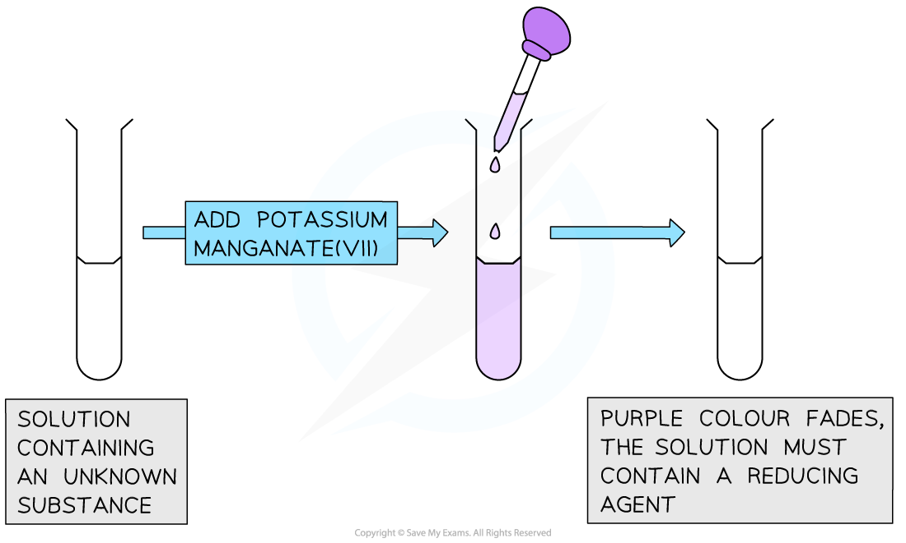
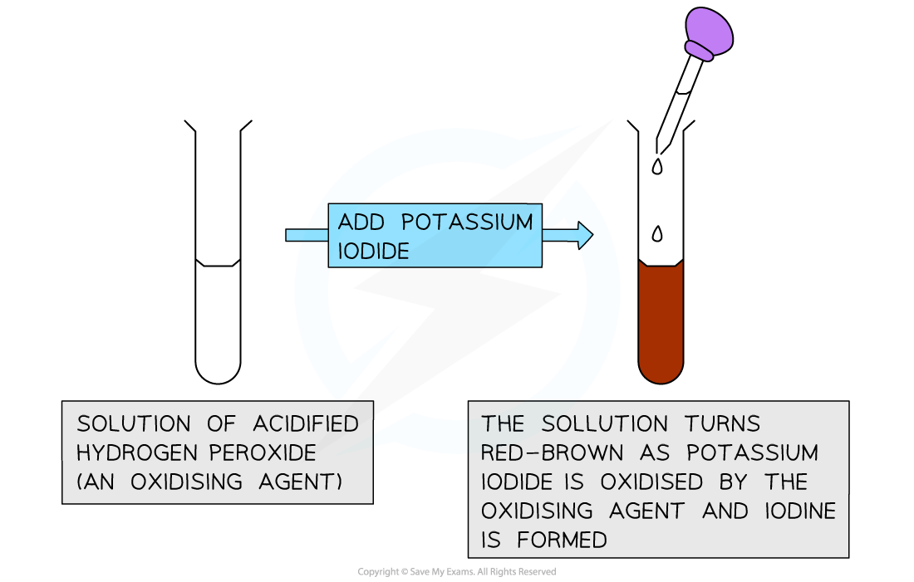

# Redox & Electron Transfer

## Redox & electron transfer

> **Spec point** — `spcpt_2SDcCH3Hyy4Qw9Yz` · Define oxidation in terms of: 
loss of electrons 
an increase in oxidation number
Define reduction in terms of: 
gain of electrons 
a decrease in oxidation number
Identify redox reactions as reactions involving gain and loss of electrons

## Redox & electron transfer

**Extended tier only**

- Redox reactions can also be defined in terms of electron transfer
- **Oxidation **is a reaction in which an element, ion or compound** loses electrons**

  - The **oxidation number** of the element is **increased**
  - This can be shown in a half-equation, e.g. when silver reacts with chlorine, silver is **oxidised **to silver ions:

Ag → Ag+ + e-

- **Reduction **is a reaction in which an element, ion or compound **gains electrons**

  - The **oxidation number** of the element is **decreased**
  - This can be shown in a half-equation, e.g. when oxygen reacts with magnesium, oxygen is **reduced **to oxide ions:

O2 + 4e- → 2O2-

- For example, when iron reacts with a compound of copper such as copper sulfate, a displacement reaction occurs

**iron + copper sulfate → iron(II) sulfate + copper **

**Fe + CuSO****4**** → FeSO****4**** + Cu**

- We can write this as an [ionic equation](https://www.savemyexams.com/igcse/chemistry/cie/23/revision-notes/3-stoichiometry/3-1-formulae-and-relative-masses/3-1-3-writing-equations/)

**Fe + Cu****2+**** + SO****4****2–**** → Fe****2+**** + SO****4****2–**** + Cu**

- We can then remove the spectator ions to see the overall change

**Fe + Cu****2+****→ Fe****2+**** + Cu**

- The iron atom has lost electrons to become a positive ion, so has been oxidised
- The positive copper ion has gained electrons to become an atom, so have been reduced

#### The redox reaction between Fe and Cu2+

***The Fe atom is oxidised (loses electrons) and the Cu******2+****** ion is reduced (gains electrons)***

> **Worked Example**
> Which change in the following equation is oxidation?
> 
> **V****3+**** + Fe****3+****  → V****4+**** + Fe****2+**
> 
> **Answer:**
> 
> - **Step 1** - Identify the changes for each species:
> 
>   - V3+ to V4+
>   
>     - V3+ has lost 1 electron
>   - Fe3+ to Fe2+
>   
>     - Fe3+ has gained 1 electron
> - **Step 2 **- Identify each change as either oxidation and reduction
> 
>   - V3+ to V4+ is oxidation
>   - Fe3+ to Fe2+ is reduction
> - Therefore, V3+ has been oxidised

> **Exam Hint**
> Use the mnemonic **OIL-RIG** to remember oxidation and reduction in terms of the movement of electrons:
> 
> - **O**xidation** I**s **L**oss
> - **R**eduction **I**s **G**ain.

## Identifying redox reactions

> **Spec point** — `spcpt_WG9HZG7SFWxdRjB5` · Identify redox reactions by changes in oxidation number using: 
the oxidation number of elements in their uncombined state is zero 
the oxidation number of a monatomic ion is the same as the charge on the ion 
the sum of the oxidation numbers in a compound is zero 
the sum of the oxidation numbers in an ion is equal to the charge on the ion
Identify redox reactions by the colour changes involved when using acidified aqueous potassium manganate(VII) or  aqueous potassium iodide

## Identifying redox reactions

**Extended tier only**

#### Identifying redox reactions using oxidation numbers

- The **oxidation number** is a number assigned to an atom or ion in a compound
- It shows the number of electrons that an atom has lost, gained or shared in forming a compound

  - So, the oxidation number helps you to keep track of the movement of electrons in a redox process
- It is written as a +/- sign followed by a number

  - Positive oxidation number = loss of electrons
  - Negative oxidation number = gain of electrons
  - For example, aluminium in a compound usually has the oxidation number of +3 indicating it has lost 3 electrons
  - **Careful: **It is easy to confuse oxidation number with charge which is written by a number followed by a +/- sign)
- A few simple rules help guide you through the process of determining the oxidation number of any element

#### Rules for assigning oxidation numbers

|   | **Rule** | **Example** |
|---|---|---|
| **1** | The oxidation number of any uncombined element is zero | H2  Zn O2 |
| **2** | Many atoms or ions have fixed oxidation numbers in compounds | Group 1 elements are always +1 Group 2 elements are always +2 Fluorine is always –1 Hydrogen is +1, except in hydrides like NaH where it is –1 Oxygen is –2, except in peroxides where it is in –1 and in F2O where it is +2 |
| **3** | The oxidation number of an element in a monoatomic ion is always the same as the charge | Zn2+ = +2 Fe3+ = +3 Cl– = –1 |
| **4** | The sum of the oxidation numbers in a compound is zero | NaCl Na = +1 Cl = –1 Sum of oxidation numbers = 1 – 1 = 0 |
| **5** | The sum of the oxidation numbers in an ion is equal to the charge on the ion | SO42– S = +6 Four O atoms = 4 x (–2) = –8 Sum of oxidation numbers = 6 – 8 = –2 |
| **6** | In either a compound or an ion, the more electronegative element is given the negative oxidation number | F2O Two F atoms = 2 x (–1) = –2 O = +2 |

- Redox reactions can be identified by the changes in the **oxidation number** when a reactant goes to a product

> **Worked Example**
> The equation for the reaction between chlorine and potassium iodide is shown below.
> 
> Cl2 + 2KI → 2KCl + I2
> 
> Identify which species has been:
> 
> 1. Oxidised
> 2. Reduced
> 
> **Answer: **
> 
> 1. The species that has been oxidised is iodine
> 
>   - 2I- → I2 +2e-
>   - The oxidation number of I- is -1
>   - The oxidation number of iodine in I2 is 0
>   - The oxidation number has increased so the iodide ions have been oxidised / lost electrons
> 2. The species that has been reduced is chloride ions
> 
>   - Cl2 + 2e- → 2Cl-
>   - The oxidation number of chlorine as Cl2 is 0
>   - The oxidation number of Cl- is -1
>   - The oxidation number has decreased so the Cl2 has been reduced / gained electrons

### Identifying redox reactions by colour changes

- The tests for redox reactions involve the observation of a colour change in the solution being analysed
- Two common examples are acidified potassium manganate(VII), and potassium iodide
- Potassium manganate(VII), KMnO4, is an **oxidising agent** which is often used to test for the presence of **reducing **agents
- When acidified potassium manganate(VII) is added to a reducing agent its colour changes from **purple **to **colourless**

***Diagram to show the colour change when potassium manganate(VII) is added to a reducing agent***

- Potassium iodide, KI, is a **reducing **agent which is often used to test for the presence of **oxidising **agents
- When added to an acidified solution of an oxidising agent such as aqueous chlorine or hydrogen peroxide (H2O2), the solution turns a **red-brown** colour due to the formation of iodine, I2

***Diagram to show the colour change when potassium iodide is added to an oxidising agent***

- The potassium iodide is oxidised as it loses electrons
- The hydrogen peroxide is reduced
- Therefore, potassium iodide is acting as a **reducing agent**

## Oxidising & reducing agents

> **Spec point** — `spcpt_9mXTt8yFNWdbX62T` · Define an oxidising agent as a substance that oxidises another substance and is itself reduced 
Define a reducing agent as a substance that reduces another substance and is itself oxidised
Identify oxidising agents and reducing agents in redox reactions

## Oxidising & reducing agents

**Extended tier only**

### What is an oxidising agent?

- An oxidising agent is a substance that **oxidises **another substance, and becomes **reduced **in the process
- An oxidising agent **gains **electrons as another substance loses electrons
- Common examples include hydrogen peroxide, fluorine and chlorine

### What is a reducing agent?

- A reducing agent is a substance that **reduces** another substance, and becomes **oxidised **in the process
- A reducing agent **loses **electrons as another substance gains electrons
- Common examples include carbon and hydrogen
- The process of reduction is very important in the chemical industry as a means of extracting metals from their ores** **

### Identifying oxidising and reducing agents

CuO + H2 → Cu + H2O

- Hydrogen is reducing the CuO
- Hydrogen is itself oxidised as it has gained oxygen / lost electrons
- So, the **reducing agent** is **hydrogen**:

H2 → 2H+ + 2e-

- CuO is reduced by hydrogen

  - This means that the hydrogen is oxidised by CuO
- CuO is reduced as it has lost oxygen / gained electrons
- So, the **oxidising** **agent** is **copper** **oxide**

Cu2+ +2e- →  Cu

> **Worked Example**
> When iron reacts with bromine to form iron(II) bromide, a redox reaction reaction occurs:
> 
> Fe + Br2 →  FeBr2
> 
> Which species is acting as the reducing agent in this reaction?
> 
> **Answer**
> 
> 1. **Step 1 **- Write half equations to work out what has gained/lost electrons
> 
>   - Fe → Fe2+ + 2e-
>   - Br2 + 2e- → 2Br-
>   - Fe loses electrons; Br2 gains electrons
> 2. **Step 2** - Deduce what has been oxidised/reduced (remember OIL RIG)
> 
>   - Fe has been oxidised as it has lost electrons
>   - Br2 has been reduced as it has gained electrons
> 3. **Step 3** - Identify the reducing agent
> 
>   - Fe is the reducing agent as it has been oxidised by losing electrons and caused Br2 to be reduced as it gained electrons
