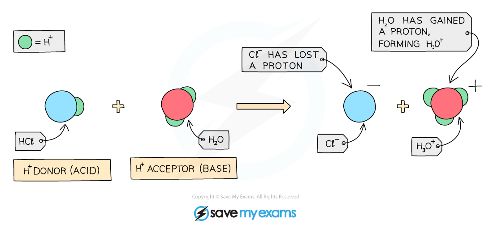

# Proton Transfer, Strong & Weak Acids

## Proton transfer, strong & weak acids

> **Spec point** — `spcpt_fVMpg2mgd2R6GRMr` · Define acids as proton donors and bases as proton acceptors
Define a strong acid as an acid that is completely dissociated in aqueous solution and a weak acid as an acid that is partially dissociated in aqueous solution
State that hydrochloric acid is a strong acid, as shown by the symbol equation, HCl(aq) → H+ (aq) + Cl–(aq)
State that ethanoic acid is a weak acid, as shown by the symbol equation,CH3COOH(aq) ⇌ H+ (aq) + CH3COO–(aq)

## Proton transfer, strong & weak acids

### Proton transfer

**Extended tier only **

- Acids are **proton donors **as they ionise in solution producing protons, which are H+ ions
- These H+ ions make the aqueous solution acidic
- Bases are** proton acceptors** as they accept the protons which are donated by the acid

#### Proton transfer between hydrochloric acid and water

***Diagram showing the role of acids and bases in the transfer of protons - here water acts as a base as it accepts a proton***

* *

### What is a strong acid?

- Acids can be either **strong** or **weak**, depending on how many H+ ions they produce when dissolved in water
- Strong acids **completely dissociate **(or ionise) in water, producing solutions of a **very low pH **
- Strong acids include HCl and H2SO4
- Example of a strong acid: hydrochloric acid

**HCl (aq) → H****+**** (aq) + Cl****-**** (aq)**

### What is a weak acid?

- Weak acids **partially** **dissociate **(or ionise) in water and produce pH values which are closer to the **middle** of the pH scale, whilst still being below 7
- For weak acids, there is usually an [equilibrium](https://www.savemyexams.com/gcse/chemistry/wjec/18/revision-notes/2-chemical-bonding-application-of-chemical-reactions-and-organic-chemistry/2-6-reversible-reactions-industrial-processes-and-important-chemicals/reversible-reactions/) set-up between the molecules and their ions once they have been added to water
- Example of a weak acid: propanoic acid

**CH****3****CH****2****COOH ⇌ H****+**** + CH****3****CH****2****COO****-**

- The equilibrium lies to the **left**, indicating a high concentration of intact acid molecules, with a low concentration of H+ ions in the solution
- Another example of a weak acid is [ethanoic acid](https://www.savemyexams.com/gcse/chemistry/wjec/18/revision-notes/2-chemical-bonding-application-of-chemical-reactions-and-organic-chemistry/2-5-crude-oil-fuels-and-organic-chemistry/oxidation-of-alcohols/) which will react with alkalis such as sodium hydroxide to form ethanoate salts

**ethanoic acid + sodium hydroxide → sodium ethanoate + water**

**CH****3****COOH + NaOH → CH****3****COONa + H****2****O**

### Effect of concentration on strong and weak acids

- A concentrated solution of an acid is one that contains a **higher number** of acid **molecules** per dm3 of solution
- It does not necessarily mean that the acid is strong

  - A concentrated weak acid only partly ***dissociates*** so the H+ concentration remains relatively low

#### Comparing strong and weak acids at the same concentration:

- A strong acid at a given concentration has a lower pH than a weak acid at the same concentration
- This is because the strong acid completely dissociates, producing a higher concentration of H+ ions
- A weak acid only partially dissociates, so fewer H+ ions are produced and the pH is higher (less acidic)

  - For example, at the same concentration, hydrochloric acid has a lower pH than ethanoic acid
- Weak acids typically give pH values in the range 3 – 6, not pH 1 or 2

#### Reactivity:

- Since strong acids produce more H+ ions at the same concentration, they are more reactive than weak acids

  - For example, hydrochloric acid reacts more vigorously with a metal or carbonate than ethanoic acid at the same concentration

#### Concentration vs strength:

- A dilute solution of a strong acid (e.g. HCl) can be more acidic than a concentrated solution of a weak acid (e.g. CH3COOH), because the strong acid dissociates completely even when dilute
