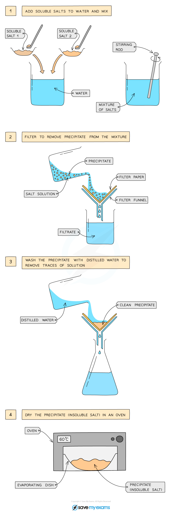

# Preparing Insoluble Salts

## Preparing insoluble salts

> **Spec point** — `spcpt_nYf8Wb3scdB8fBdt` · Describe the preparation of insoluble salts by precipitation

## Preparing insoluble salts

**Extended tier only**

- Insoluble salts can be prepared using a ***precipitation reaction***
- The solid salt obtained is the precipitate
- To successfully use this method:

  - The solid salt (precipitate) being formed must be insoluble in water
  - The reactants must be soluble

#### Using two soluble reactants

***Diagram showing the filtration of the mixture to remove the precipitate***

### Method

- Make aqueous solutions of two soluble salts
- Mix together using a stirring rod in a beaker
- Filter to remove the precipitate from the mixture
- Wash the precipitate with distilled water to remove traces of other solutions
- Leave to dry (for example in a warm oven)

#### Example: Preparation of pure, dry, solid lead(II) sulfate using a precipitation reaction

- Dissolve lead(II) nitrate and potassium sulfate in water
- Mix together using a stirring rod in a beaker
- Filter to remove the precipitate from the mixture
- Wash the precipitate with distilled water to remove traces of potassium nitrate solution
- Leave to dry (for example in a warm oven)

**lead(II) nitrate + potassium sulfate → lead(II) sulfate + potassium nitrate**

**Pb(NO****3****)****2**** (aq) + K****2****SO****4**** (aq) → PbSO****4**** (s) + 2KNO****3**** (aq)**
