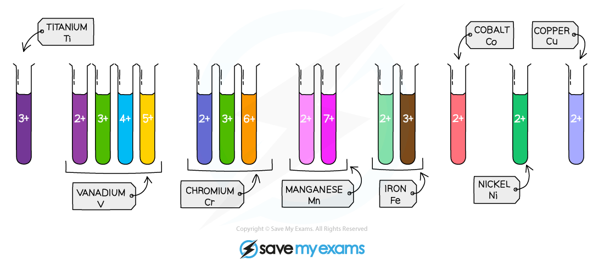

# Transition Elements

## Transition elements

> **Spec point** — `spcpt_jxPK72xT9PSVKKw6` · Describe the transition elements as metals that: 
have high densities 
have high melting points 
form coloured compounds 
often act as catalysts as elements and in compounds

## Transition elements

- Transition elements are found in the centre of the [Periodic Table](https://www.savemyexams.com/igcse/chemistry/cie/23/revision-notes/8-the-periodic-table/8-1-the-periodic-table-and-trends/8-1-1-the-periodic-table/) between Group 2 and Group 3
- Most metals are transition elements and have properties typical of a metal:

  - They are **lustrous**
  - They are **hard** and **strong**
  - They** conduct** heat and electricity
  - They have **high melting points**
  
    - Except mercury: This has a low melting point which is why it is a liquid at room temperature

#### The transition elements in the Periodic Table

***Transition elements are found in the middle of the Periodic Table***

- There are some properties that are only typical of transition elements :

  - They form **ions with different charges**
  
    - E.g. Iron forms Fe2+ and Fe3+ ions
  - They are useful as **catalysts**
  
    - E.g. Iron is used as the catalyst in the [Haber process](https://www.savemyexams.com/igcse/chemistry/cie/23/revision-notes/6-chemical-reactions/6-2-reversible-reactions-and-equilibrium/6-2-3-the-haber-process/)

- They form **coloured compounds**

  - E.g. Copper forms blue copper sulfate, black copper oxide and green copper carbonate

#### Coloured compounds formed by transition metal ions

***The colours produced by some transition elements ions***

> **Exam Hint**
> Although scandium and zinc are in the transition element area of the Periodic Table, they are not considered transition elements as they do **not** form coloured compounds and have only **one **oxidation state.

## Transition elements oxidation numbers

> **Spec point** — `spcpt_mspTkjmchPkWMJGG` · Describe transition elements as having ions with variable oxidation numbers, including iron(II) and iron(III)

## Transition elements oxidation numbers

**Extended tier only **

- The transition elements have more than one **oxidation number**, as they can lose a different number of electrons
- For example. iron either:

  - Lose **two** electrons to form Fe2+ so has an oxidation number of +2
  - Loses **three** electrons to form Fe3+ so has an oxidation number of +3
- Compounds containing transition elements in different oxidation states will have different **properties** and colours

> **Exam Hint**
> Transition elements also referred to as transition metals.
