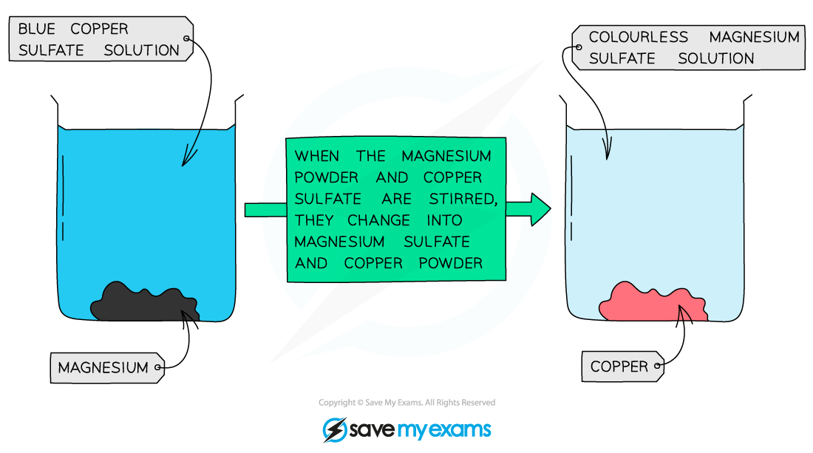

# Explaining Reactivity

## Explaining reactivity

> **Spec point** — `spcpt_KTcy6y55k5r9dsyn` · Describe the relative reactivities of metals in terms of their tendency to form positive ions, by displacement reactions, if any, with the aqueous ions of magnesium, zinc, iron, copper and silver
Explain the apparent unreactivity of aluminium in terms of its oxide layer

## Explaining reactivity

**Extended tier only **

- Metal atoms form **positive ions** by loss of electrons when they react with other substances
- The **tendency** of a metal to lose electrons is a measure of how reactive the metal is
- A metal that is high up on the series loses electrons easily and is thus **more reactive** than one which is lower down on the series

### Displacement reactions between metals and aqueous solutions of metal salts

- Any metal will displace another metal that is **below** it in the reactivity series from a solution of one of its salts
- This is because more reactive metals lose electrons and form ions more readily than less reactive metals, making them better **reducing agents**
- The less reactive metal is a better electron acceptor than the more reactive metal, thus the less reactive metal is reduced

  - OILRIG: reduction is gain of electrons

### Magnesium + copper sulfate

- Magnesium is a reactive metal and can displace copper from a copper sulfate solution
- Magnesium loses its electrons more easily and the ion of the less reactive metal, copper, will gain these electrons to form elemental copper
- This is easily seen as the more reactive metal slowly **disappears** from the solution,** displacing** the less reactive metal

**magnesium + copper sulfate → magnesium sulfate + copper**

**Mg (s) + CuSO****4 ****(aq) → MgSO****4**** (aq) + Cu (s)**

- The blue colour of the CuSO4 solution **fades** as colourless magnesium sulfate solution is formed
- Copper coats the surface of the magnesium and also forms solid metal which falls to the bottom of the beaker

#### The reaction between magnesium and copper sulfate

***Diagram showing the colour change when magnesium displaces copper from copper sulfate***

- By combining different metals and metal salts solutions it is possible to come up with a relative reactivity order

**Metal Solutions Displacement Table**

| **Mixture** | **Products** | **Equation for Reaction ** |
|---|---|---|
| Magnesium and iron(II) sulfate | Magnesium sulfate and iron | Mg + FeSO4 → MgSO4 + Fe |
| Zinc and iron chloride | Zinc chloride and iron | Zn + FeCl2 → ZnCl2 + Fe |
| Iron and silver nitrate | Iron(II) nitrate and silver | Fe + AgNO3 → Fe(NO3)2 + 2Ag |
| Copper and iron(II) chloride | No reaction | ------ |
| Silver and copper(II) sulfate | No reaction | ------ |
| Zinc and magnesium chloride | No reaction | ------ |

- From this table we can deduce the order of reactivity:

  - Magnesium and zinc are both more reactive than iron but magnesium is more reactive than zinc
  - Copper and silver are both less reactive than iron but silver is less reactive than copper
- The order of reactivity of the metals tested can be therefore be deduced as:

  - Mg > Zn > Fe > Cu > Ag

### Reactivity of aluminium

- Aluminium is high in the reactivity series, but in reality, it does not react with water and the reaction with dilute acids can be quite slow
- This is because it reacts readily with oxygen, forming a protective layer of aluminium oxide which is very thin
- This layer prevents reaction with water and dilute acids, so aluminium can behave as if it is unreactive
