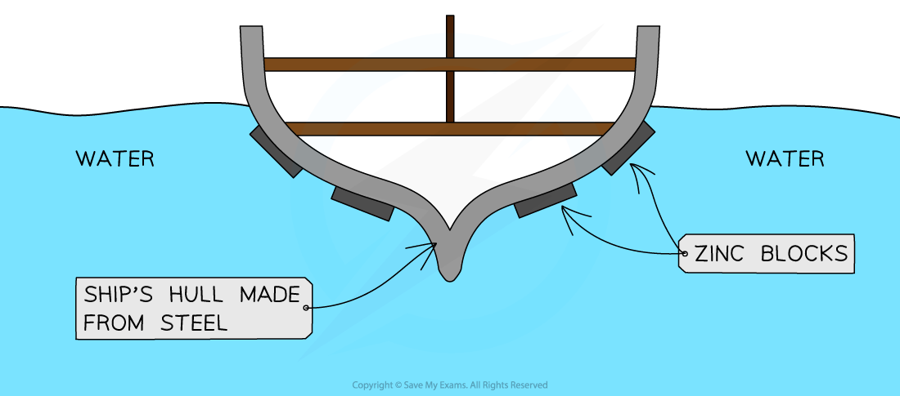

# Galvanising & Sacrificial Protection

## Galvanising & sacrificial protection

> **Spec point** — `spcpt_4NB6WyZTyNc3FkGB` · Describe the use of zinc in galvanising as an example of a barrier method and sacrificial protection
Explain sacrificial protection in terms of the reactivity series and in terms of electron loss

## Galvanising & sacrificial protection

**Extended tier only**

### Sacrificial Protection

- Iron can be prevented from rusting using the **reactivity** **series**
- A **more **reactive metal can be attached to a **less **reactive metal
- The more reactive metal will oxidise and therefore corrode first, protecting the less reactive metal from corrosion

#### Zinc bars on the side of steel ships

***Diagram to show the use of zinc bars on the sides of steel ships as a method of sacrificial protection***

- Zinc is more reactive than iron therefore will lose its electrons more easily than iron and is oxidised more easily:

Zn → Zn2+ + 2e-

- The iron is less reactive therefore will not lose its electrons as easily so it is not oxidised; the zinc is **sacrificed **to protect the steel

  - The zinc blocks do not need to cover the whole hull
  - As long as they are electrically connected to the steel, they can protect nearby areas
  - They are often placed on edges and joints where corrosion is most likely.
- For continued protection, the zinc bars have to be replaced before they completely corrode

### Galvanising

- **Galvanising** is a process where the iron to be protected is coated with a layer of zinc
- This can be done by electroplating or dipping it into molten zinc
- ZnCO3 is formed when zinc reacts with oxygen and carbon dioxide in the air and protects the iron by the barrier method
- If the coating is damaged or scratched, the iron is still protected from rusting by **sacrificial** **protection**

> **Exam Hint**
> You maybe asked to explain why a metal is/is not suitable as a method of preventing an iron/steel object from rusting. Remember that if it is higher in the reactivity series than iron, it will be suitable for sacrificial protection as it will be oxidised instead of iron. If it is lower in the reactivity series than iron, it would not be suitable as iron would be oxidised, causing it to rust.
