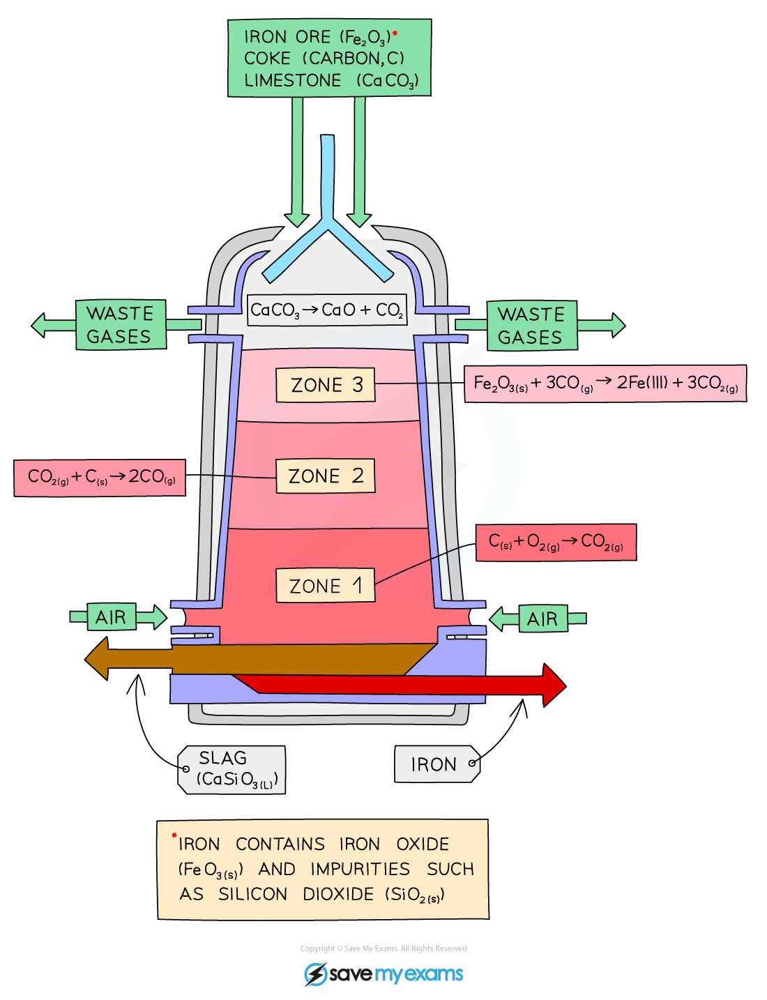

# Extraction of Iron from Hematite

## Extraction of iron from hematite

> **Spec point** — `spcpt_3yVJG3nWj7bQ8Gys` · Describe the extraction of iron from hematite in the blast furnace, limited to: 
the burning of carbon (coke) to  provide heat and produce carbon dioxide 
the reduction of carbon dioxide to carbon monoxide 
the reduction  of iron(III) oxide by carbon monoxide 
the thermal decomposition of calcium carbonate /limestone to produce  calcium oxide 
the formation of slag 
Symbol equations are not required in core

## Extraction of iron from hematite

- Iron is extracted in a large container called a blast furnace from its ore, hematite
- Modern blast furnaces produce approximately 10,000 tonnes of iron per day

#### The blast furnace

***Diagram showing the carbon extraction of iron***

- The raw materials: iron ore (hematite), coke (an impure form of carbon), and limestone are added into the top of the blast furnace
- Hot air is blown into the bottom

### Zone 1

- Coke **burns **in the hot air to form **carbon dioxide**
- The reaction is exothermic and provides **heat **for the furnace

**carbon + oxygen → carbon dioxide**

### Zone 2

- At high temperatures, carbon (coke) reacts with carbon dioxide to form carbon monoxide.
- Carbon monoxide is the main reducing agent in the furnace.

**carbon + carbon dioxide → carbon monoxide**

### Zone 3

- Carbon monoxide **reduces **the iron(III) oxide to iron

  - Iron is extracted by reduction because oxygen is removed from iron(III) oxide
- The molten iron collects at the bottom of the furnace and is tapped off

**iron(III) oxide + carbon monoxide  →  iron + carbon dioxide**

- Limestone (calcium carbonate) is added to the furnace to remove impurities in the ore

  - The calcium carbonate in the limestone **thermally decomposes** to form calcium oxide

**calcium carbonate → calcium oxide + carbon dioxide**

- The calcium oxide formed reacts with the silicon dioxide, which is an impurity in the iron ore, to form calcium silicate
- This melts and collects as a molten **slag **floating on top of the molten iron, which is tapped off separately

**calcium oxide + silicon dioxide →  calcium silicate**

> **Exam Hint**
> For Core students, the symbol equations are **not **needed for the different reactions involved in the extraction of iron from hematite.

## Equations for extraction of iron from hematite

> **Spec point** — `spcpt_M2KbsYcmWbJGJbdM` · State the symbol equations for the extraction of iron from hematite 
C + O2 → CO2 
C + CO2 → 2CO 
Fe2O3 + 3CO → 2Fe + 3CO2 (
CaCO3 → CaO + CO2 
CaO + SiO2 → CaSiO3

## Equations for extraction of iron from hematite

**Extended tier only**

### Zone 1

- The burning of carbon (coke) to provide heat and produce carbon dioxide:

**C (s)  +  O****2**** (g)  →  CO****2**** (g)**

### Zone 2

- The reduction of carbon dioxide to carbon monoxide:

**CO****2**** (g)  +  C (s)  →  2CO (g)**

### Zone 3

- The reduction of iron(III) oxide by carbon monoxide:

**Fe****2****O****3**** (s)  +  3CO (g)  →  2Fe (l)  +  3CO****2**** (g)**

- The thermal decomposition of calcium carbonate (limestone) to produce calcium oxide:

**CaCO****3**** (s)  →  CaO (s)  +  CO****2 ****(g)**

- The formation of slag:

**CaO (s)  +  SiO****2**** (s)  →  CaSiO****3 ****(l)**
