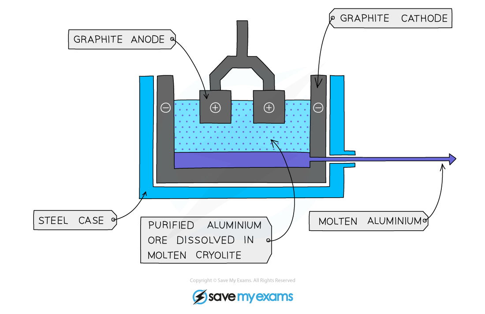

# Extraction of Aluminium from Bauxite

## Extraction of aluminium from bauxite

> **Spec point** — `spcpt_5t7v4v5Hs8wfhHvn` · State that the main ore of aluminium is bauxite and that aluminium is extracted by electrolysis 

## Extraction of aluminium from bauxite

- Aluminium is a reactive metal, above carbon in the reactivity series
- Its main ore, is **bauxite**, which contains aluminium oxide
- Aluminium is higher in the reactivity series than carbon, so it cannot be extracted by reduction using carbon
- Instead, aluminium is extracted by **electrolysis** ** **

#### The electrolysis of aluminium

***Diagram showing the extraction of aluminium by electrolysis***

> **Exam Hint**
> If you are a Core student, you do **not** need to explain the process of extraction of aluminium by electrolysis.

## The process of aluminium extraction by electrolysis

> **Spec point** — `spcpt_P3pndSVKwvpVxyXv` · Describe the extraction of aluminium from purified bauxite / aluminium oxide, including: 
the role of cryolite (
why the carbon anodes need to be  regularly replaced 
the reactions at the electrodes, including ionic half-equations 
Details of the purification of bauxite are not required

## The process of aluminium extraction by electrolysis

**Extended tier only **

- Bauxite is first **purified** to produce aluminium oxide, Al2O3
- Aluminium oxide is then dissolved in **molten cryolite **

  - This is because aluminium oxide has a melting point of over 2000 °C which would use a lot of energy and be very expensive
  - The resulting mixture has a lower melting point without interfering with the reaction
- The mixture is placed in an electrolysis cell, made from steel, lined with graphite
- The **graphite** lining acts as the negative electrode, with several large graphite blocks as the positive electrodes
- At the **cathode** (negative electrode)**: **

  - Aluminium ions gain electrons (reduction)
  - Molten aluminium forms at the bottom of the cell
  - The molten aluminium is siphoned off from time to time and fresh aluminium oxide is added to the cell

Al3+ +  3e-   →  Al

- At the **anode **(positive electrode)**:**

  - Oxide ions lose electrons (oxidation)
  - Oxygen is produced at the anode:

2O2- →   O2 + 4e-

- The overall equation for the reaction is:

2Al2O3 → 4Al  +  3O2

- The carbon in the **graphite** anodes reacts with the oxygen produced to produce **CO****2**

C (s) + O2 (g)   →   CO2 (g)

- As a result the anode wears away and has to be replaced regularly
- A lot of **electricity** is required for this process of extraction, this is a major **expense**

> **Exam Hint**
> Use OIL RIG to remember whether oxidation or reduction has occurred at the electrodes:
> 
> 
