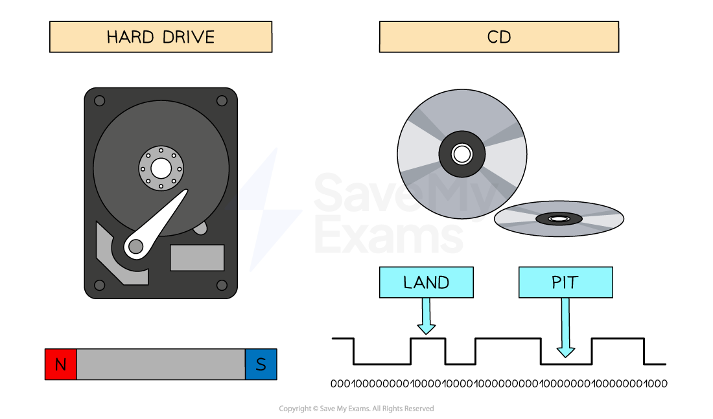

# Computers & Binary

## Why Computers Use Binary

> **Spec point** — `spcpt_WdR3sjcY39fVW7WS` · 1 Understand how and why computers use binary to represent all forms of data

## Why Computers Use Binary

> **Exam Hint**
> *This note covers exactly what Cambridge 0478 expects you to know about binary processing—nothing more, nothing less.*

### Why does data have to be converted to binary to be processed by a computer?

- Data is processed in a computer using **logic gates **that only have **two states**
- The binary number system only has two digits (**1/0**), which means each digit can **represent a different state **(1 = on, 0 = off)
- All data must be converted to binary **before **a computer can **understand **and **process **it
- Converting data to binary allows computers to process it at an incredible **speed**, perform complex **calculations** and **store **vast amounts of data **efficiently**

- Secondary storage is a great example of the process

  - **Magnetic hard drives **use **North **and **South polarity **to represent a 1 or a 0
  - In **Optical** **disks,** light hitting a flat area (**land**) is interpreted as a 1 and light hitting a bump (**pit**) is interpreted as a 0
- Take an example of driving a car

  - When driving a car the accelerator pedal is used to increase the cars speed
  - If a car was accelerating from 50mph to 100mph the increase would be gradual
  - In a computer system, the car is doing either 50mph (0) or 100mph (1), there is no in-between
  - Trying to change the computer system so that it has more options would be less efficient and require more complex parts for the computer to understand

> **Worked Example**
> Explain why computers process data in binary format **[2]**
> 
> **Answer**
> 
> - **Computers process data using logic gates... ****[1]**
> - **... that can only have two states (1/0) ****[1]**

> **Exam Hint**
> *Mark schemes expect: logic gates + two states (1/0). Phrases like “computers understand binary” don’t get the mark, this does.*
