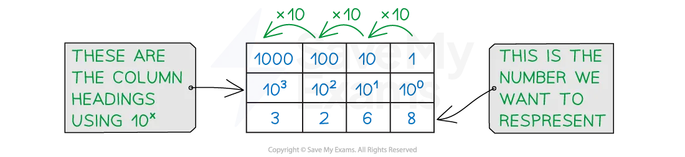

# Number Systems

## The Denary, Binary & Hexadecimal Number Systems

> **Spec point** — `spcpt_7zRFHH6R7bQSwk2j` · 2 (a) Understand the denary, binary and hexadecimal number systems

## The Denary, Binary & Hexadecimal Number Systems

> **Exam Hint**
> *All conversions here are capped at 16 bits because that’s Cambridge’s limit. No distractions, just the format you’ll see in Paper 1.*

### What is denary?

- Denary is a number system that is made up of **10 digits (0-9)**
- Denary is referred to as a **base-10** number system
- Each digit has a weight factor of **10 raised to a power**, the rightmost digit is 1s (100), the next digit to the left 10s (101) and so on
- Humans use the denary system for **counting**, **measuring **and **performing maths calculations**
- Using combinations of the 10 digits we can represent any number

- In this example, (3 x 1000) + (2 x 100) + (6 x 10) + (8 x 1) = 3268
- To represent a bigger number we **add more digits**

### What is binary?

- Binary is a number system that is made up of **two digits (1 and 0) **
- Binary is referred to as a **base-2** number system
- Each digit has a weight factor of **2 raised to a power**, the rightmost digit is 1s (20), the next digit to the left 2s (21) and so on
- Each time a new digit is added, the **column value is multiplied by 2**
- Using **combinations of the 2 digits** we can represent any number

- In this example, **Binary 1100** = **(1 x 8) + (1 x 4) = 12**
- To represent bigger numbers we add more **b**inary dig**its** (bits)

| 32,768 | 16,384 | 8,192 | 4,096 | 2,048 | 1,024 | 512 | 256 | **128** | **64** | **32** | **16** | **8** | **4** | **2** | **1** |
|---|---|---|---|---|---|---|---|---|---|---|---|---|---|---|---|
| 215 | 214 | 213 | 212 | 211 | 210 | 29 | 28 | 27 | 26 | 25 | 24 | 23 | 22 | 21 | 20 |

> **Exam Hint**
> *The largest denary number that can be represented using 16 bits is:*
> 
> - *  65,535 (Binary 1111111111111111)*

### What is hexadecimal?

- Hexadecimal is a number system that is made up of **16 digits**, 10 numbers (**0-9**) and 6 letters (**A-F**)

| **0** | **1** | **2** | **3** | **4** | **5** | **6** | **7** | **8** | **9** | **10** | **11** | **12** | **13** | **14** | **15** |
|---|---|---|---|---|---|---|---|---|---|---|---|---|---|---|---|
| **0** | **1** | **2** | **3** | **4** | **5** | **6** | **7** | **8** | **9** | **A** | **B** | **C** | **D** | **E** | **F** |

- Hexadecimal is referred to as a **base-16** number system
- Each digit has a weight factor of **16 raised to a power**, the rightmost digit is 1s (16^0), the next digit to the left 16s (16^1)
- In GCSE you are required to work with up to and including** 2 digit hexadecimal** values

| **16s** | **1s** |   |
|---|---|---|
| **1** | **3** |   |
| 1 x16 | 3 x 1 | = 19 |

- A quick comparison table demonstrates a **relationship **between **hexadecimal and a binary *****nibble***
- One hexadecimal digit can represent **four bits** of binary data

> **Exam Hint**
> *You must be able to convert binary to hex and back using nibbles. Write out the hex digits (0–F) during the exam to avoid confusion—it’s a top tip that examiners mention every year.*

| **Denary** | **Binary** | **Hexadecimal** |
|---|---|---|
| 0 | *0000* | **0** |
| 1 | *0001* | **1** |
| 2 | *0010* | **2** |
| 3 | *0011* | **3** |
| 4 | *0100* | **4** |
| 5 | *0101* | **5** |
| 6 | *0110* | **6** |
| 7 | *0111* | **7** |
| 8 | *1000* | **8** |
| 9 | *1001* | **9** |
| 10 | *1010* | **A** |
| 11 | *1011* | **B** |
| 12 | *1100* | **C** |
| 13 | *1101* | **D** |
| 14 | *1110* | **E** |
| 15 | *1111* | **F** |
