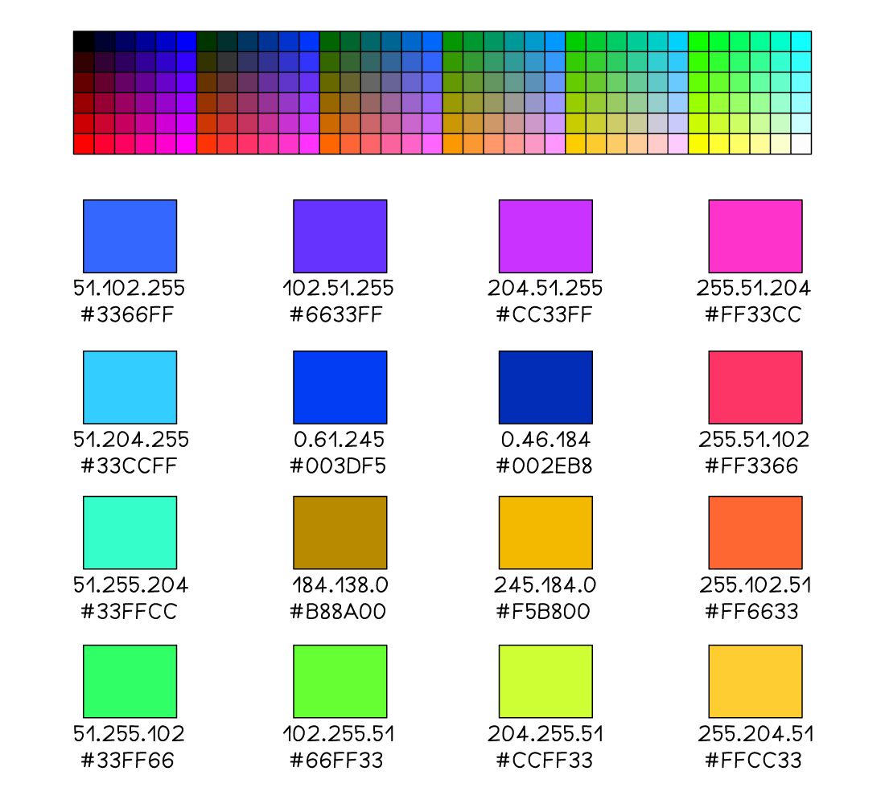

# Uses of Hexadecimal

## Uses of Hexadecimal

> **Spec point** — `spcpt_dJw8qZ5cfBf6FWqv` · 3 Understand how and why hexadecimal is used as a beneficial method of data representation

## Uses of Hexadecimal

> **Exam Hint**
> *Cambridge IGCSE 0478 specifically requires you to explain why hexadecimal is used instead of binary—especially for things like MAC addresses, colour codes, and URLs. Everything on this page comes straight from the spec.*

### Why is hexadecimal used?

- In Computer Science hexadecimal is often preferred when working with** large values**
- It takes **fewer digits to represent a given value** in hexadecimal than in binary

  - 1 hexadecimal digit corresponds 4 bits (one nibble) and can represent 16 unique values (0-F)
- It is **beneficial **to use hexadecimal over binary because:

  - The more bits there are in a binary number, the **harder it makes for a human to read**
  - Numbers with more bits are more **prone to errors** when being copied

> **Exam Hint**
> *In the exam, don’t just say “hex is shorter” or “hex is easier.” Use phrases like “****fewer digits = easier for humans to read****” or “****less chance of copying errors****”—these match the mark scheme language.*

- Examples of where hexadecimal can be seen:

  - **MAC addresses**
  - **Colour codes**
  - **URLs**

#### MAC addresses

- MAC address are covered [here](https://www.savemyexams.com/o-level/computer-science/cie/21/revision-notes/3-hardware/network-hardware/mac-addresses-and-ip-addresses/) in full
- A typical MAC address consists of **12 hexadecimal digits**, equivalent to** 48 digits** in in binary

  - **AA:BB:CC:DD:EE:FF**
  - **10101010:10111011:11001100:11011101:11101110:11111111**
- **Writing down** or **performing calculations** with 48 binary digits makes it** very easy to make a mistake**

#### Colour codes

- A typical hexadecimal colour code consists of **6 hexadecimal digits**, equivalent to** 24 digits** in binary

  - **#66FF33** (green)
  - **01100110:11111111:00110011**

#### URL's

- A URL can only contain **standard characters** (a-z and A-Z), **numbers **(0-9) and some **special symbols** which is enough for basic web browsing
- If a URL needs to include a character **outside of this set**, they are converted into a **hexadecimal code**
- Hexadecimal codes included in a URL are prefixed with a **% **sign

> **Exam Hint**
> *You might see other uses of hex online (like memory dumps or debug screens). For your exam, stick to the three covered here: ****MAC addresses, colour codes, and URLs****—they're the only ones that come up in past papers.*
