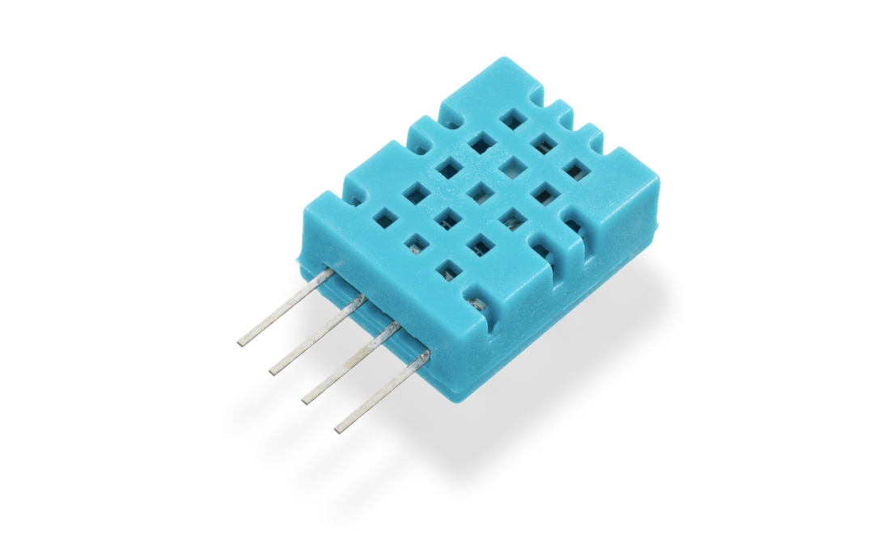
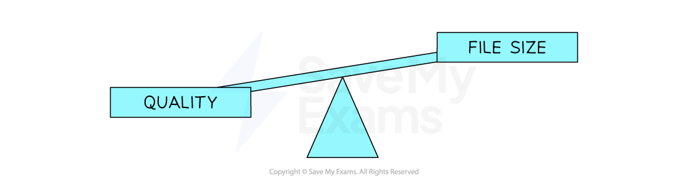

# Representing Images

## Bitmap Images

> **Spec point** — `spcpt_qWTYr3cmPwq2rbGm` · "3 Understand how and why a computer represents
an image, including the effects of the resolution
and colour depth"

## Bitmap Images

### What is a bitmap?

- A bitmap image is made up of squares called **pixels**
- A pixel is the **smallest element** of a bitmap image
- Each pixel is** stored as a binary code**
- Binary codes are **unique **to the **colour **in each pixel
- A typical example of a bitmap image is a photograph

- The more colours and more detail in the image, the higher the quality of the image and the more binary that needs to be stored

## Resolution & Colour Depth

> **Spec point** — `spcpt_7sSxFjH7q7mfgtHm` · "3 Understand how and why a computer represents
an image, including the effects of the resolution
and colour depth"

## Resolution & Colour Depth

> **Exam Hint**
> *Cambridge IGCSE 0478 expects you to define ****resolution**** and ****colour depth****, explain how both affect ****file size****, and use formulas like *`width × height × colour depth` *to calculate storage needs. This page keeps everything focused on exam-ready phrasing and examples.*

### What is resolution?

- Resolution is the **total number of pixels** that make up a bitmap image
- It is calculated by multiplying the image's **width and height in pixels**
- In general, **higher resolution means more detail** and **better image quality**
- Display resolution is often described by the vertical pixel count, for example:

  - **Computer monitors**: 1440p has 1440 pixels vertically (2560×1440), while 4K has 2160 pixels vertically (3840×2160)
  
    - The "**4K**" name comes from its horizontal resolution of roughly 4,000 pixels
  - **TVs**: HD channels are 1080p (1080 pixels vertically), while UHD/4K channels are 2160p (2160 pixels vertically, or 3840×2160)
  - **YouTube**: the quality selector lets you choose playback resolution from 144p (144 pixels vertically) up to 4K (2160p)

### What is colour depth?

- Colour depth is the **number of bits stored per pixel** in a bitmap image
- The colour depth is dependent on the number of colours needed in the image
- In general, the** higher the colour depth the more detail in the image** (higher quality)
- In a black & white image the colour depth would be 1, meaning 1 bit is enough to create a unique binary code for each colour in the image (1=white, 0=black)

- In an image with a colour depth of 2, you would have 00, 01, 10 & 11 available binary codes, so 4 colours

- As colour depth increases, so does the amount of colours available in an image
- The amount of colours can be calculated as 2n (n = colour depth)

| **Colour Depth** | **Amount of Colours** |
|---|---|
| **1 bit** | 2 (B&W) |
| **2 bit** | 4 |
| **4 bit** | 16 |
| **8 bit** | 256 |
| **24 bit** | 16,777,216 (True Colour) |

### What is the impact of resolution and colour depth?

- As the **resolution and/or colour depth increases**, the **bigger the size of the file **becomes on secondary storage
- The **higher the resolution**, the** more pixels** are in the image, the more bits are stored
- The **higher the colour depth**, the **more bits per pixel** are stored
- Striking a balance between quality and file size is always a consideration

> **Exam Hint**
> *In casual use, people say "higher resolution = better quality". But in the exam, focus on what it ****actually means****:*
> 
> *“Resolution is the number of pixels in an image”*
> 
> *Avoid vague terms like “better” and give technical impact: “more bits needed = larger file size.”*

> **Worked Example**
> 1. Define the term Pixel **[1]**
> 
> 2. If an image has a colour depth of 2 bits, how many colours can the image represent? **[1]**
> 
> 3. Describe the impact of changing an images resolution from 500x500 to 1000x1000 **[2]**
> 
> **Answers**
> 
> 1. **The smallest element of a bitmap image (1 square)**
> 2. **4**
> 3. **The image quality would be higher ****[1]**** the file size would be larger ****[1]**
