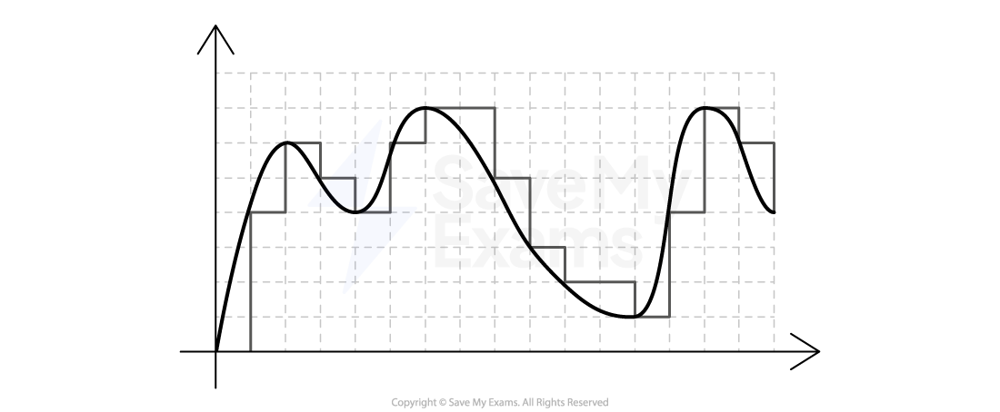
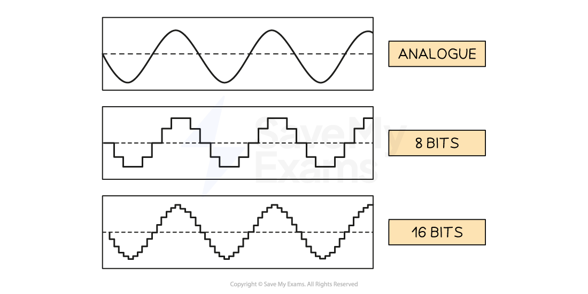

# Representing Sound

## How Sound is Sampled & Stored

> **Spec point** — `spcpt_qCrRJbJzyhC259w7` · "2 Understand how and why a computer represents
sound, including the effects of the sample rate
and sample resolution"

## How Sound is Sampled & Stored

### How is sound sampled & stored?

- Measurements of the original sound wave are **captured **and **stored as binary** on secondary storage
- Sound waves begin as ***analogue*** and for a computer system to understand them they must be converted into a **digital **form
- This process is called **Analogue to Digital conversion** (A2D)
- The process begins by **measuring the amplitude **of the **analogue sound wave **at a point in time, called **samples**
- Each measurement (sample) generates a value which can be represented in binary and stored
- Using the samples, a computer is able to create a digital version of the original analogue wave
- The digital wave is stored on secondary storage and can be played back at any time by reversing the process

- In this example, the grey line represents the digital wave that has been created by taking samples of the original analogue wave
- In order for the digital wave to look more like the analogue wave the sample rate and bit depth can be changed

## Sample Rate, Sample Resolution & File size

> **Spec point** — `spcpt_VVwHkrmXFqsT4WVd` · "2 Understand how and why a computer represents
sound, including the effects of the sample rate
and sample resolution"

## Sample Rate & Sample Resolution

### What is sample rate?

- Sample rate is the amount of **samples taken per second** of the analogue wave
- Samples are taken each second for the ***duration***** **of the sound
- The sample rate is measured in **Hertz **(Hz)
- 1 Hertz is equal to 1 sample of the sound wave

In this example you can see that the higher the sample rate, the closer to the original sound wave the digital version looks

- The sampling rate of a typical audio CD is 44.1kHz (44,100 Hertz or 44,100 samples per second)
- Using the graphic above helps to answer the question, “*Why does telephone hold music sound so bad?*”

### What is sample resolution?

- Sample resolution is the **number of bits stored per sample** of sound
- Sample resolution is closely related to the [colour depth](https://www.savemyexams.com/gcse/computer-science/aqa/20/revision-notes/3-fundamentals-of-data-representation/units-of-information/representing-images/) of a bitmap image, they measure the same thing in different contexts

### What effect do sample rate and sample resolution have?

|   | **Sample rate** | **Sample resolution** |   |   |
|---|---|---|---|---|
| **High** | **Low** | **High** | **Low** |   |
| **Playback quality** | ⇑ | ⇓ | ⇑ | ⇓ |
| **File size** | ⇑ | ⇓ | ⇑ | ⇓ |
