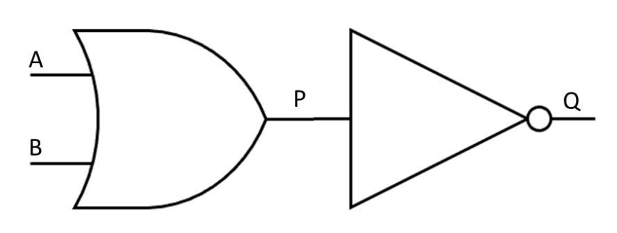

# Logic Circuits

## Logic Circuits

> **Spec point** — `spcpt_HY2mCJxGw3T58Q6D` · "3 (a) Use logic gates to create given logic circuits
from a:
 (i) problem statement
 (ii) logic expression
 (iii) truth table"

## Logic Circuits

### What is a logic circuit?

- A logic circuit **performs logical operations** on binary information
- Logic gates are **core components** of logic circuits
- Based on the** arrangement of logic gates** and the** input signals**, the circuit performs a specific function
- A logic diagram is a **visual representation** of a combinations of logic gates within a logic circuit
- **Brackets **are used to clarify the **order **of operations
- An example logic diagram for the *Boolean expression* **Q =** **NOT(A OR B) **would be:

- In the logic diagram above, the **inputs **are represented by **A and B**
- **P** is the **output **of the OR gate on the left and becomes the input of the NOT gate
- **Q** is the **final output **of the logic circuit

> **Exam Hint**
> You may be asked to draw a logic circuit from a logic statement or a Boolean expression **OR **write the logical expression that is expressed in the logic diagram using Boolean expression operators
> 
> Logic circuits will be limited to a **maximum of three inputs and one output**

#### Example of combining logic gates

- **P = (A OR B) AND NOT C **

> **Worked Example**
> A sprinkler system switches on if it is not daytime (input A) and the temperature is greater than 40 (input B)
> 
> Draw a logic circuit to represent the problem statement above
> 
> **[2]**
> 
> 
