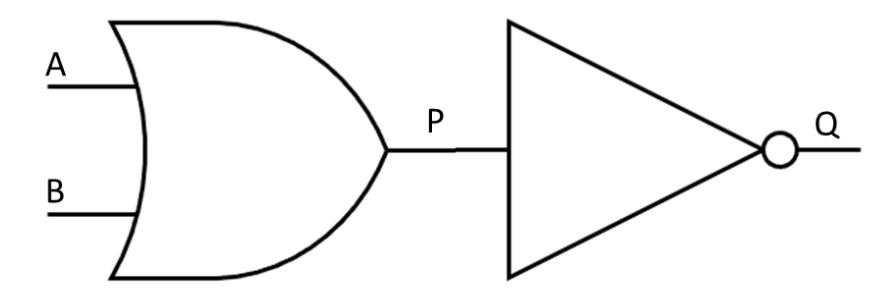
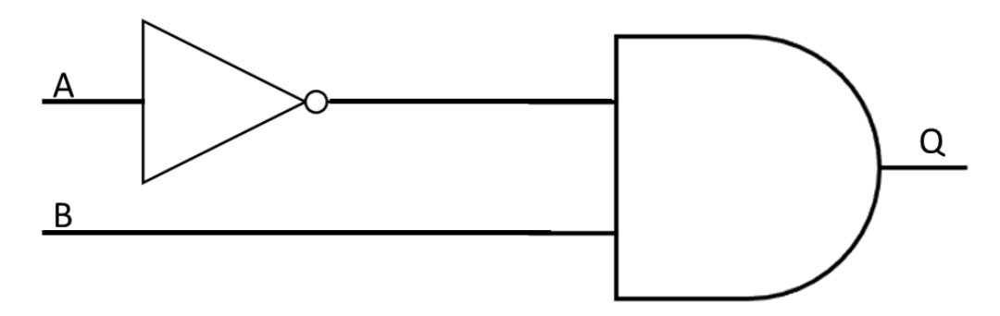
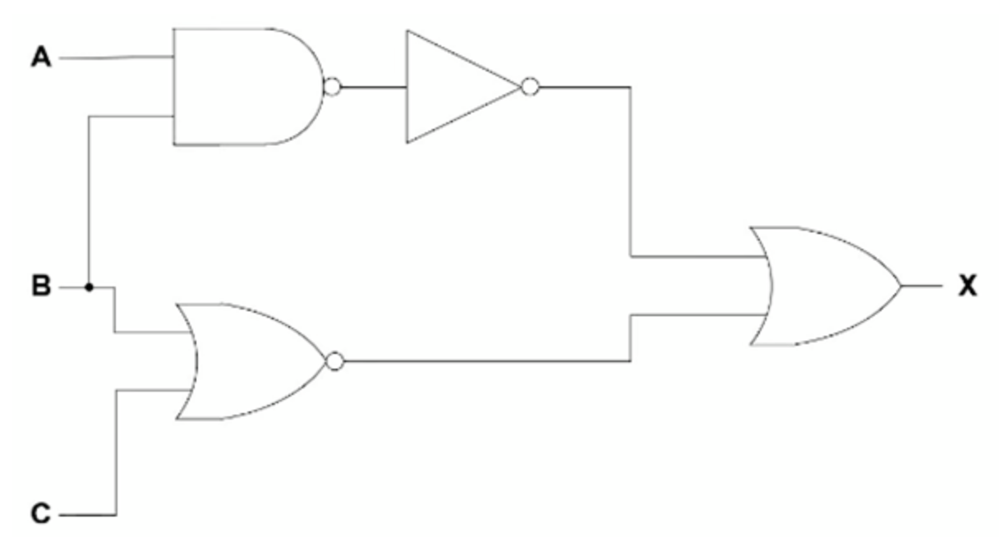

# Logic Expressions

## Logic Expressions

> **Spec point** — `spcpt_Bqr6RvC637zVPvBS` · "(c) Write a logic expression from a:
 (i) problem statement
 (ii) logic circuit
 (iii) truth table"

## Logic Expressions

- A **logic expression** is a way of expressing a logic gate or logic circuit as an **equation**
- The **output **appears on the **left **of the equals sign with the **inputs **and **logic gates** on the **right**

| **Gate** | **Symbol** | **Truth Table** | **Logic Expression** |
|---|---|---|---|
| **NOT** |  | \| **A** \| **Z** \| \|---\|---\| \| 0 \| 1 \| \| 1 \| 0 \| | Z = NOT A |
| **AND** |  | \| **A** \| **B** \| **Z** \| \|---\|---\|---\| \| 0 \| 0 \| 0 \| \| 0 \| 1 \| 0 \| \| 1 \| 0 \| 0 \| \| 1 \| 1 \| 1 \| | Z = A AND B |
| **OR** |  | \| **A** \| **B** \| **Z** \| \|---\|---\|---\| \| 0 \| 0 \| 0 \| \| 0 \| 1 \| 1 \| \| 1 \| 0 \| 1 \| \| 1 \| 1 \| 1 \| | Z = A OR B |
| **NAND** |  | \| **A** \| **B** \| **Z** \| \|---\|---\|---\| \| 0 \| 0 \| 1 \| \| 0 \| 1 \| 1 \| \| 1 \| 0 \| 1 \| \| 1 \| 1 \| 0 \| | Z = A NAND B |
| **NOR** |  | \| **A** \| **B** \| **Z** \| \|---\|---\|---\| \| 0 \| 0 \| 1 \| \| 0 \| 1 \| 0 \| \| 1 \| 0 \| 0 \| \| 1 \| 1 \| 0 \| | Z = A NOR B |
| **XOR** |  | \| **A** \| **B** \| **Z** \| \|---\|---\|---\| \| 0 \| 0 \| 0 \| \| 0 \| 1 \| 1 \| \| 1 \| 0 \| 1 \| \| 1 \| 1 \| 0 \| | Z = A XOR B |

- Logic circuits containing multiple gates can also be expressed as logic expressions/statements

**An example logic circuit containing two inputs**

- The logic circuit above can be expressed as the logic expression **Q= NOT(A OR B)**

** **

**An example logic circuit containing two inputs**

- The logic circuit above can be expressed as the logic expression **Q= (NOT A) AND B **

**An example logic circuit containing three inputs**

- The logic circuit above can be expressed as the logic expression **P = ((NOT A) OR B) NAND C**

** **

**An example logic circuit containing three inputs**

- This logic circuit above can be expressed as **X = NOT (A NAND B) OR (B NOR C)**

> **Exam Hint**
> - You may be required to write a logic expression/statement from a **truth table** or a **logic circuit**. You may also have to do the opposite - **draw a logic circuit** and **complete a truth table for a logic expression**

> **Worked Example**
> Consider the logic statement: **X = (((A AND B) OR (C AND NOT B)) XOR NOT C) **
> 
> a. Draw a logic circuit to represent the given logic statement. **[6]**
> 
> **Final answer:** **Answer**
> 
> 
> 
> One mark per correct logic gate, with the correct input
