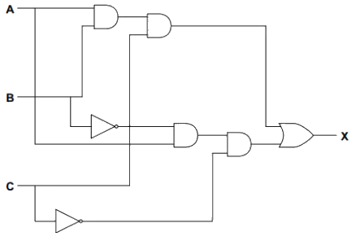

# Truth Tables

## Truth Tables

> **Spec point** — `spcpt_YFjMnPc9Ns3fb8WS` · "(b) Complete a truth table from a:
 (i) problem statement
 (ii) logic expression
 (iii) logic circuit"

## Truth Tables

### What is a truth table?

- A truth table is a tool used in logic and computer science to **visualise **the **results **of **Boolean expressions**
- They represent **all possible inputs** and the **associated outputs** for a **given Boolean expression**

#### AND

| **Circuit symbol** | **Truth Table** |
|---|---|
|  | \| A \| B \| A AND B \| \|---\|---\|---\| \| 0 \| 0 \| 0 \| \| 0 \| 1 \| 0 \| \| 1 \| 0 \| 0 \| \| 1 \| 1 \| 1 \| |

#### OR

| **Circuit symbol** | **Truth Table** |
|---|---|
|  | \| A \| B \| A OR B \| \|---\|---\|---\| \| 0 \| 0 \| 0 \| \| 0 \| 1 \| 1 \| \| 1 \| 0 \| 1 \| \| 1 \| 1 \| 1 \| |

#### NOT

| Circuit symbol | Truth Table |
|---|---|
|  | \| A \| NOT \| \|---\|---\| \| 0 \| 1 \| \| 1 \| 0 \| |

#### XOR (exclusive)

| **Circuit symbol** | **Truth Table** |
|---|---|
|  | \| A \| B \| A XOR B \| \|---\|---\|---\| \| 0 \| 0 \| 0 \| \| 0 \| 1 \| 1 \| \| 1 \| 0 \| 1 \| \| 1 \| 1 \| 0 \| |

#### NAND (not and)

| **Circuit symbol** | **Truth Table** |
|---|---|
|  | \| A \| B \| NOT (A AND B) \| \|---\|---\|---\| \| 0 \| 0 \| 1 \| \| 0 \| 1 \| 1 \| \| 1 \| 0 \| 1 \| \| 1 \| 1 \| 0 \| |

#### NOR (not or)

| **Circuit symbol** | **Truth Table** |
|---|---|
|  | \| A \| B \| NOT (A OR B) \| \|---\|---\|---\| \| 0 \| 0 \| 1 \| \| 0 \| 1 \| 0 \| \| 1 \| 0 \| 0 \| \| 1 \| 1 \| 0 \| |

## Truth Tables for Logic Circuits

> **Spec point** — `spcpt_pnccJBcWKPYZWjR7` · "(b) Complete a truth table from a:
 (i) problem statement
 (ii) logic expression
 (iii) logic circuit"

## Truth Tables for Logic Circuits

### How do you create truth tables for logic circuits?

- To create a truth table for the expression **P = (A AND B) AND NOT C **

  - Calculate the numbers of rows needed (**2****number of inputs**)
  - In this example there are 3 inputs (**A, B, C**) so a total of **8 rows** are needed (**2****3**)
  - To not miss any combination of inputs, start with **000 **and **count **up in** 3-bit binary (0-7)**

| **A** | **B** | **C** |
|---|---|---|
| **0** | **0** | **0** |
| **0** | **0** | **1** |
| **0** | **1** | **0** |
| **0** | **1** | **1** |
| **1** | **0** | **0** |
| **1** | **0** | **1** |
| **1** | **1** | **0** |
| **1** | **1** | **1** |

- Add a new column to show the **results **of the brackets first (A AND B)

| **A** | **B** | **C** | **A AND B** |
|---|---|---|---|
| 0 | 0 | 0 | **0** |
| 0 | 0 | 1 | **0** |
| 0 | 1 | 0 | **0** |
| 0 | 1 | 1 | **0** |
| 1 | 0 | 0 | **0** |
| 1 | 0 | 1 | **0** |
| 1 | 1 | 0 | **1** |
| 1 | 1 | 1 | **1** |

- Add a new column to show the **results **of NOT C

| **A** | **B** | **C** | **A AND B** | **NOT C** |
|---|---|---|---|---|
| 0 | 0 | 0 | 0 | **1** |
| 0 | 0 | 1 | 0 | **0** |
| 0 | 1 | 0 | 0 | **1** |
| 0 | 1 | 1 | 0 | **0** |
| 1 | 0 | 0 | 0 | **1** |
| 1 | 0 | 1 | 0 | **0** |
| 1 | 1 | 0 | 1 | **1** |
| 1 | 1 | 1 | 1 | **0** |

- The last column shows the **result **of the Boolean expression (**P**) by comparing (A AND B) AND NOT C** **// $(A. B). \vec{C}$

| A | B | C | **A AND B** | **NOT C** | P |
|---|---|---|---|---|---|
| 0 | 0 | 0 | 0 | 1 | **0** |
| 0 | 0 | 1 | 0 | 0 | **0** |
| 0 | 1 | 0 | 0 | 1 | **0** |
| 0 | 1 | 1 | 0 | 0 | **0** |
| 1 | 0 | 0 | 0 | 1 | **0** |
| 1 | 0 | 1 | 0 | 0 | **0** |
| 1 | 1 | 0 | 1 | 1 | **1** |
| 1 | 1 | 1 | 1 | 0 | **0** |

> **Exam Hint**
> It is possible to create a truth table when combining expressions that show only the inputs and the final outputs.
> 
> The inclusion of the extra columns supports the process but can be skipped if you feel able to do those in your head as you go.

### How do you create logic circuits from a truth table?

- To create a logic circuit from a truth table you need to:

  - Find the rows where the **output = 1**
  - **Build a logic branch** for each of the rows
  - **Combine **the branches
  - Determine the **gates needed**
  - Construct a [logic expression](https://www.savemyexams.com/igcse/computer-science/cie/23/revision-notes/10-boolean-logic/boolean-logic/logic-expressions/)
  - **Create **the logic circuit

#### Example

| **A** | **B** | **C** | X |
|---|---|---|---|
| 0 | 0 | 0 | **0** |
| 0 | 0 | 1 | **0** |
| 0 | 1 | 0 | **0** |
| 0 | 1 | 1 | **0** |
| `1` | `0` | `0` | `1` |
| 1 | 0 | 1 | **0** |
| 1 | 1 | 0 | **0** |
| `1` | `1` | `1` | `1` |

- Look at the truth table and **find the rows where X = 1**
- This happens when:

  - **A = 1, B = 0, C = 0**
  - **A = 1, B = 1, C = 1**
- Build a logic branch:

  - **A = 1, B = 0, C = 0**
  
    - Use a **NOT gate** on B
    - Use a **NOT gate** on C
    - **AND A**, **NOT B**, and **NOT C** together
    - This gives output = 1 for that row
  - **A = 1, B = 1, C = 1**
  
    - Just **AND** A, B, and C together
- Combine the branches

  - Use an **OR gate** to combine the two outputs
  
    - This way, X = 1 if either input combination happens
- Determine the gates needed:

  - **NOT gates**:
  
    - NOT B
    - NOT C
  - **AND gates**:
  
    - A AND NOT B → first AND
    - that result AND NOT C → second AND
    - A AND B → third AND
    - that result AND C → fourth AND
  - **OR gate**:
  
    - Combines the outputs of the second and fourth AND gates
- Construct the[ logic expression](https://www.savemyexams.com/igcse/computer-science/cie/23/revision-notes/10-boolean-logic/boolean-logic/logic-expressions/)

  - Final logic:
  
    - **(A AND NOT B AND NOT C) OR (A AND B AND C)**
- Create the logic circuit

