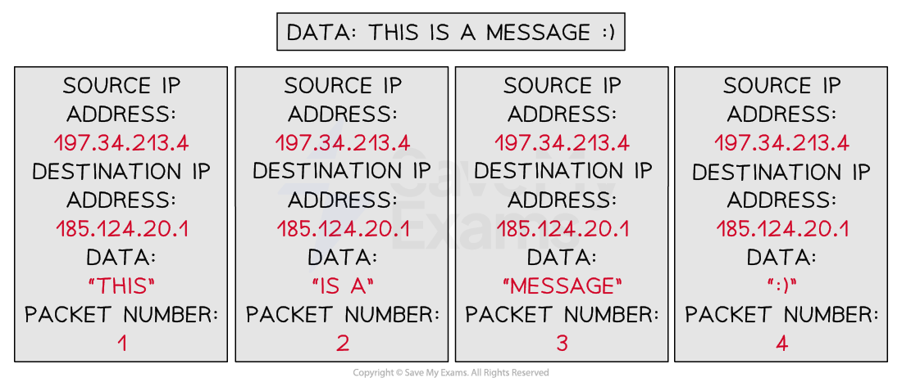

# Data Packets

## Data Packets

> **Spec point** — `spcpt_HpkkHsvxDdcpkHfr` · "1 (a) Understand that data is broken down into
packets to be transmitted
(b) Describe the structure of a packet"

## Data Packets

### What are packets?

- Packets are **small 'chunks' of data** that make up a larger piece of data that has been **broken down** by the **TCP **protocol so that it can be **transmitted **over the internet
- TCP stands for **Transmission Control Protocol** and is used for organising data transmission over networks
- Small 'chunks' of data are easier and quicker to **route** over the internet than big 'chunks' of data

  - **Routing** involves finding the most optimal path over a network
- Data can include anything from text, images, audio, video, animations, etc, or any combination of these

### What do packets contain?

- A packet consists of:

| **Header** | **Payload** | **Trailer** |
|---|---|---|
| Source IP address | Actual data being transported | Additional security information  (less common) |
| Destination IP address |   | End of packet notification |
| Packet number  (1 of 5 etc.) |   |   |

- To transmit the message “This is a message :)”over the internet, TCP might break the message down into **4 packets**

- Each packet contains a:

  - **source IP address**
  - **destination IP address**
  - **payload (the data)**
  - **a packet number**
- Error checks make sure that when a packet is received there is minimal or **no corruption** of the data
- **Corruption** is where packet data is changed or lost in some way, or data is gained that originally was not in the packet
- Read [error detection methods](https://www.savemyexams.com/igcse/computer-science/cie/23/revision-notes/2-data-transmission/methods-of-error-detection/error-detection-methods/) for more detail on **how data packets can be checked** to ensure corruption is avoided/minimised
