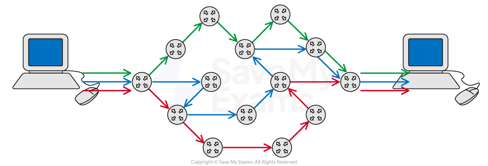

# Packet Switching

## Packet Switching

> **Spec point** — `spcpt_qvNBrYW4FTqwdvn8` · (c) Describe the process of packet switching

## Packet Switching

### What is packet switching?

- Packet switching is a **method of sending and receiving data** (packets) across a network
- Packet switching can be broken down into** five stages**:

| **Stage** | **Overview** | **Detail** |
|---|---|---|
| 1 | Data is broken down into packets | - *Learn more by reading our* [data packets](https://www.savemyexams.com/igcse/computer-science/cie/23/revision-notes/2-data-transmission/types-and-methods-of-data-transmission/data-packets/) revision note |
| 2 | Packets are assigned a header |   |
| 3 | Each packet makes its way to the destination | - Like normal car traffic, data traffic builds up on the internet - Routers can see this and decide to send a packet down a different route that avoids traffic |
| 4 | Routers control the routes taken for each packet | - Routers know which nearby router is closer to the destination device |
| 5 | Packets arrive and are reordered correctly | - If a packet does not reach its destination the receiver can send a resend request to the sender to resend the packet |

### What are the advantages of packet switching?

- **Interference **and **corruption **are minimal as individual packets can be resent if they are lost or damaged
- The whole file doesn’t need to be resent if a corruption occurs, this **saves time** and **internet bandwidth**
- Packet switching is **quicker **than sending a large packet as each packet finds the quickest way around the network
- It's **harder to hack** an individual's data as each packet contains minimal data, and travels through the network separately

> **Worked Example**
> A local market shop wishes to arrange a delivery of goods from a supplier. Anna, the shop owner, decides to send an email to request the delivery of the goods at a certain date and time.
> 
> Describe how packet switching is used to send this email and how it can be protected from corruption.
> 
> **[8]**
> 
> **Answer**
> 
> - **The business email is first broken down into packets which are given a source address (where it's come from) and a destination address (where it's going to) ****[1]**
> - **Each packet receives a packet number so that the email can be reassembled when it reaches its destination  ****[1]**
> - **Each packet also receives an error check such as a parity bit. A parity bit checks whether any bits have been flipped due to corruption  ****[1]**
> - **Each packet is sent over the internet via routers. Routers contain routing tables that determine the next closest router to the destination  ****[1]**
> - **Packets may take different routes depending on internet traffic and arrive at their destination in any order  ****[1]**
> - **Packets are checked for errors using the error checks and missing packets can be requested to be resent ****[1]**
> - **Once all packets have been received then they can be put together in order using the packet numbers ****[1]**
> - **Once assembled the original email can be read by the other business ****[1]**

> **Exam Hint**
> For high marks make sure your answer is coherent, that is it follows logically from one point to the next.
> 
> Some marks depend on previous points you have made.
> 
> Explaining parity bits without mentioning error checking first may not gain you additional marks
