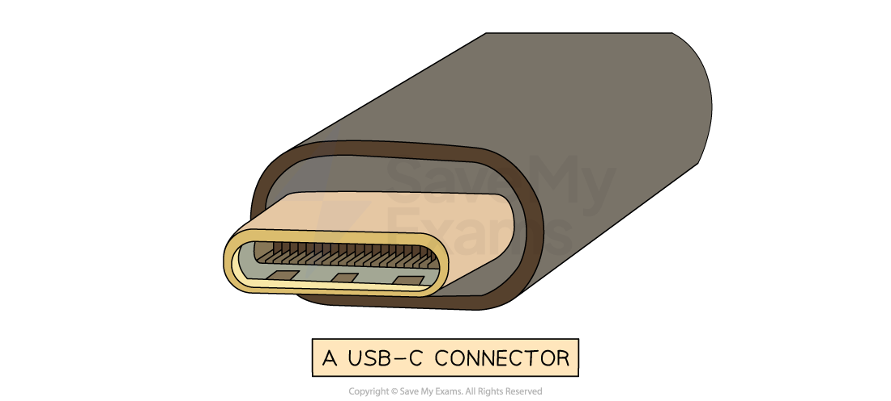

# Universal Serial Bus (USB)

## Universal Serial Bus (USB)

> **Spec point** — `spcpt_kq2K9PSj4G7ZSdBK` · "3 Understand the universal serial bus (USB)
interface and explain how it is used to transmit
data"

## Universal Serial Bus (USB)

### What is USB?

- The **Universal Serial Bus** (USB) is a widely used standard for transmitting data between devices
- It is a ***serial***** communication method**, and it **operates *****asynchronously***
- Many devices use USB such as:

  - **Keyboards**
  - **Mice**
  - **Video cameras**
  - **Printers**
  - **Portable media players**
  - **Mobile phone**
  - **Disk drives**
  - **Network adapters**
- Different USB **connector types** exist for different devices
- The letters refer to the **physical shape and design** of the USB connector:

  - **USB-A** - Commonly used for flash drives, mice, keyboards, external HDD
  - **USB-B** -  Found in printers, scanners, and older external storage devices
  - **USB-C **- Latest standard, known for it's **small size**, **transfer speeds**, and it's **ability to carry power**
- The term USB can also be followed by numbers (USB 2.0, 3.0, 4 etc.)
- The numbers refer to the **generation of USB technology**, which determines the **speed and performance**:

  - **USB 1.1** - 12 Mbps (very slow)
  - **USB 2.0** - 480 Mbps (very common but slower compared to modern versions)
  - **USB 3.0/3.1/3.2** - 5 Gbps to 20 Gbps (much faster, used for external HDDs and gaming devices)
  - **USB4/ USB4 2.0** - Up to 80 Gbps (the latest and fastest, used for high speed data transfer)
- When a device is connected to a USB port the computer:

  - **Automatically detects** that the device has been **connected**
  - **Looks for the correct driver:**
  
    - If the driver is already installed, the **appropriate device driver is loaded** so that the **device can communicate with the computer**
    - If the device is **new**, the computer will** look for a compatible device driver**
    - If one cannot be found, the **user must download and install** an appropriate driver **manually**

### Advantages and disadvantages of USB

| **Advantages** | **Disadvantages** |
|---|---|
| Devices are** automatically detected** and **drivers are automatically loaded** for communication | The **maximum** cable length is** roughly 5 metres** meaning it cannot be used over long distances,** limiting its use** |
| Cable connectors fit in only one way.  This prevents incorrect connections and **ensures compatible data transmission** | Older versions of USB have** limited transmission rates** for example** USB 2.0** has **480Mbps** |
| As USB usage is standardised, there is a lot of support available online and from retailers | **Very old USB standards** **may not be supported** in the near future (USB 1.1, USB 2.0, etc) |
| Several different **data transmission rates** are supported. The newest transmission rate as of 2022 is **USB4 2.0** with **80 Gbps** (81,920 Mbps, 170x faster than USB 2.0) |   |
| **Newer USB standards** are **backwards compatible** with older USB standards |   |

> **Worked Example**
> Julia uses a USB connection to transfer data onto her USB flash memory drive.
> 
> One benefit of using a USB connection is that it is a universal connection.
> 
> (i) State two other benefits of using a USB connection.
> 
> **[2]**
> 
> (ii) Identify the type of data transmission used in a USB connection.
> 
> **[1]**
> 
> **Answers**
> 
> (i) Any two of:
> 
> - **It cannot be inserted incorrectly ****[1]**
> - **Supports different transmission speeds ****[1]**
> - **High speed transmission ****[1]**
> - **Automatically detected ****[1]**
> - **Powers the device for data transfer ****[1]**
> 
> (ii)
> 
> - **Serial ****[1]**
