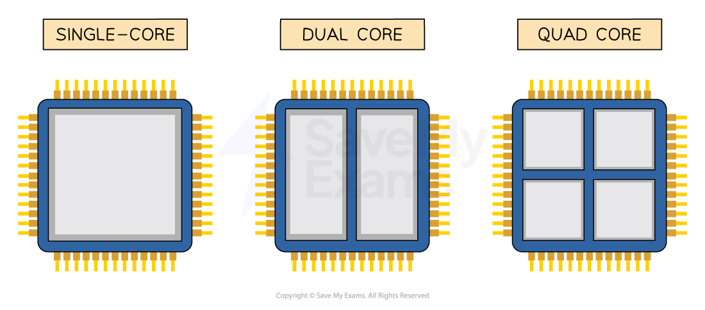

# Characteristics of the CPU

## Characteristics of the CPU

> **Spec point** — `spcpt_k6DNzFrypN8cpPgB` · "3 Understand what is meant by a core, cache and
clock in a CPU and explain how they can affect
the performance of a CPU"

## Characteristics of the CPU

### What are the common characteristics of the CPU?

- There are 3 common characteristics

  - **Clock Speed**
  - **Cache Size**
  - **Number of Cores**
- Each of these characteristics has a significant impact on the **performance **of the CPU

### How do the characteristics of the CPU affect performance?

#### Clock speed

- The clock speed is** measured in Hertz** (Hz)
- The clock speed measures the number of fetch-decode-execute cycles that can take place in 1 second
- The faster the clock speed, the more instructions can be fetched and executed per second
- Modern computers have a clock speed in Gigahertz (GHz), meaning billion
- A clock speed of 3.5GHz can perform up to **3.5 billion** **instructions per second**

#### Cache size

- Cache is very small, **very fast memory** on or close to the CPU
- Cache is used as temporary storage to provide quick access to **a copy of** frequently used instructions and data
- The larger the cache size, the more frequently used instructions or data can be stored
- This results in the CPU having to complete **fewer fetch cycles** from memory (RAM), speeding up the performance
- Cache also has a significantly faster read/write speed than RAM, making it much quicker to retrieve instructions from there instead of from memory (RAM)

#### Number of cores

- A core **works like it is its own CPU**
- Multiple core processors mean they have multiple separate processing units that can fetch, decode and execute instructions **at the same time**
- For example, a dual-core processor would have 2 processing units, each with their own

  - **Control Unit (CU)**
  - **Arithmetic Logic Unit (ALU)**
  - **Accumulator (ACC)**
  - **Registers **
- Multi-core processors can run more powerful programs with greater ease
- Multiple cores increase the performance of the CPU by working with the clock speed

  - Example: A quad-core CPU (4 cores), running at a clock speed of 3Ghz
  
    - **4** cores x **3**GHz
    - 4 x 3 billion instructions
    - 12 billion instructions per second

> **Worked Example**
> One computer has a single core processor and the other has a dual core processor.
> 
> Explain why having a dual core processor might improve the performance of the computer
> 
> **[2]**
> 
> **Answer**
> 
> Any **2 **from:
> 
> - **The computer with the dual core processor has**** two cores****/****double**** the amount of cores [1]**
> - **Parallel processing**** can take place [1]**
> - **Each core can execute a separate instruction ****at the same time**** [1]**
> - **Each core can process instructions ****independently ****of each other [1]**
