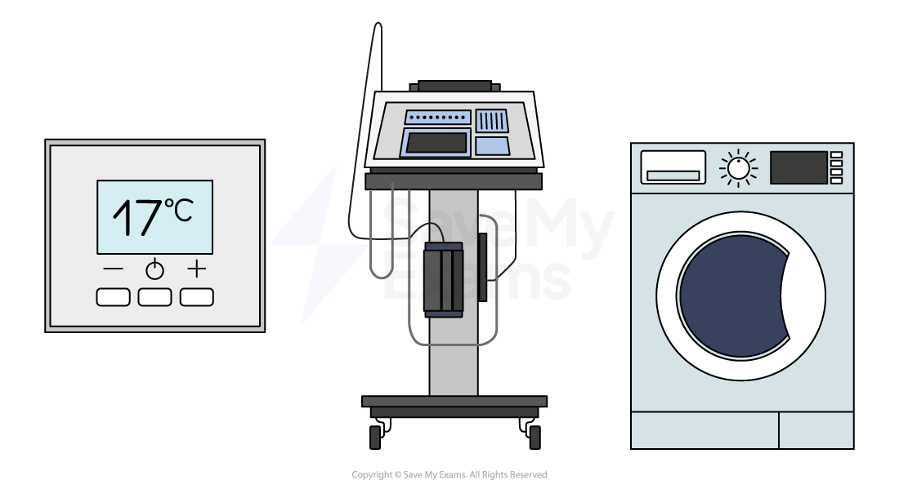

# Embedded Systems

## Embedded Systems

> **Spec point** — `spcpt_WdsY9CK9pytpgW3B` · "5 Describe the purpose and characteristics of an
embedded system and identify devices in which
they are commonly used"

## Embedded Systems

### What is an embedded system?

- An embedded system is a computer system which is used to** perform a dedicated function**, inside a larger mechanical unit
- Examples of embedded systems include

  - **Heating thermostats**
  - **Hospital equipment**
  - **Washing machines**
  - **Dishwashers**
  - **Coffee machines**
  - **Satellite navigation systems**
  - **Factory equipment**
  - **Security systems**
  - **Traffic lights**

### What are the properties of an embedded system?

- They are **small** in size
- They **use less power** than a general-purpose computer
- They have a** lower cost**

> **Exam Hint**
> Always use key examples from the list above and don’t try to use different examples such as a fridge or kettle as these will not appear on mark schemes because although they have a single purpose, most fridges and kettles do not have a CPU.

> **Worked Example**
> 1)    Tick **two** boxes below to show which are an example of an embedded system
> 
> **[2] **
> 
> |   | **Is it an example of an embedded system** |
> |---|---|
> | Laptop |   |
> | Washing Machine |   |
> | Mobile Phone |   |
> | Car Engine Management System |   |
> 
> 2)    Justify your choice to question 1
> 
> **[2]**
> 
> **Answers**
> 
> 1)    Tick **two** boxes below to show which are an example of an embedded system.  **[2]**
> 
> |   | **Is it an example of an embedded system** |
> |---|---|
> | Laptop |   |
> | Washing Machine | **Final answer:** **✓** |
> | Mobile Phone |   |
> | Car Engine Management System | **Final answer:** **✓** |
> 
> 2)    Justify your choice to question 1 **[2]**
> 
> *Any ****two ****of:*
> 
> - **A washing machine and car engine management system are not general-purpose computers ****[1]**
> - **A washing machine and car engine management system have a single purpose and are both housed inside a larger mechanical unit ****[1]**
> - **A washing machine and car engine management system have a microprocessor ****[1]**
