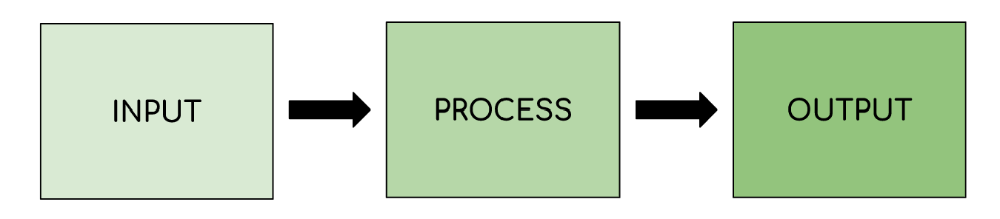

# The CPU & Microprocessors

## The CPU

> **Spec point** — `spcpt_j37xfk8ZSg9wGKwT` · "1 (a) Understand the role of the central processing
unit (CPU) in a computer
(b) Understand what is meant by a
microprocessor"

## The CPU & Microprocessors

### What is the purpose of the CPU?

- The purpose of the Central Processing Unit (CPU) is to **fetch**, **decode** and **execute** instructions

> **Exam Hint**
> *To earn marks, don’t just say “the CPU processes data.” You need to use keywords like ****fetch****, ****decode****, and ****execute****—these match the language in the mark scheme.*

- The CPU is the **brain of the computer** and its job is to take an input, process data and produce an output
- It is central to all devices including:

  - **Laptops**
  - **Desktops**
  - **Games-Consoles**
  - **Mobile Devices**
- Data and commands are inputted by the user using an input device, the central processing unit (CPU) **processes data** by **executing instructions **and the results are outputted to an output device
- Below is an example of data being inputted, processed and the results being outputted

| **Step** | **Example** |
|---|---|
| **Input** | A keyboard is used to input a number |
| **Process** | If the instruction being executed is ADD, the inputted value is added to an existing value |
| **Output** | The result of the calculation is outputted to the user via the monitor |

***A diagram showing the input, process, output sequence followed by computer systems***

#### Microprocessors

- A microprocessor is a type of **integrated circuit **that is contained on a** single chip**
- It contains the CPU and sometimes other components such as:

  - **Memory controllers**
  - **I/O interfaces**
- It is a hardware chip that **houses the CPU**

> **Exam Hint**
> *Examiners sometimes test the difference between a CPU and a microprocessor. The CPU is a ****component****. The microprocessor is the ****chip**** that may include the CPU and other parts like memory and I/O controllers.*
