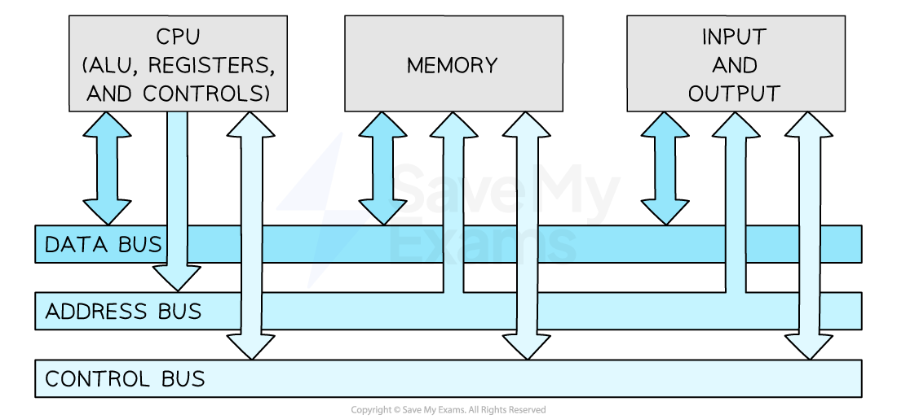

# Von Neumann Architecture

## Von Neumann Architecture

> **Spec point** — `spcpt_5M6QcjK4xvy9R62Y` · "2 (a) Understand the purpose of the components
in a CPU, in a computer that has a
Von Neumann architecture"

## Von Neumann Architecture

### What is the Von Neumann architecture?

> **Exam Hint**
> Cambridge IGCSE 0478 regularly tests your ability to describe the purpose of CPU components and registers in the Von Neumann architecture. Every explanation on this page is written in the format examiners expect—no waffle, no brand names, just mark-ready definitions.

- The Von Neumann Architecture is a design of the CPU which was proposed by Mathematician John Von Neumann in the 1940s, which most general-purpose computers are built upon
- The Von Neumann Architecture outlines how the computer memory, input/output devices and processor all work together

*The Von-Neumann architecture*

- The Von Neumann architecture consists of:

  - **Control unit (CU)**
  - **Arithmetic logic unit (ALU)**
  - **Registers**
  - **Buses**

### What is the function of each component?

#### Arithmetic logic unit (ALU)

- Performs ***arithmetic*** operations
- Performs ***logical*** decisions

  - IF X > 5 THEN
        DO ……….

#### Control unit (CU)

- **Coordinates how data moves around the CPU** by sending a signal to control the movement of the data
- **Decodes the instructions** fetched from memory

#### Registers

- Extremely **small**, extremely **fast memory **located **in the CPU**
- Hold small amounts of data **needed as part of the fetch-execute cycle**
- Each register has its own specific purpose
- It consists of 5 main registers

  - **The Program Counter (PC)**
  - **The Memory Address Register (MAR)**
  - **The Memory Data Register (MDR)**
  - **The Accumulator (ACC)**
  - **Current Instruction Register (CIR)**
- For each of the registers you must know

  - **The name of the register**
  - **Its acronym**
  - **The purpose of the register**

> **Exam Hint**
> *When describing registers like the ****PC****, ****MAR****, or ****MDR****, don’t just name what they “store”, you must also explain ****why**** they store it and ****how it’s used in the fetch-execute cycle****. The how is where marks are gained or lost.*

| **Name** | Acronym | **Purpose** |
|---|---|---|
| **Program Counter ** | **PC** | - **Holds the** **memory address** of the **next instructions** to be executed - **Increments** **by 1 **as the fetch-decode-execute cycle runs |
| **Memory Address  Register** | **MAR** | - **Holds the memory address** of where data or instructions are **to be fetched from** **memory** |
| **Memory Data Register** | **MDR** | - **Stores the data or instruction** which has been fetched from memory |
| **Current Instruction Register** | **CIR** | - **Stores the instruction** the CPU is currently decoding or executing |
| **Accumulator** | **ACC** | - **Stores the** **results** of any calculations that have taken place in the Arithmetic Logic Unit (ALU) |

> **Exam Hint**
> *To earn both marks for a register question, use this structure:*
> 
> *“[****Register****] holds [****what****], which is used to [****why/how it's used****].”*
> 
> *Example: “The MAR holds the memory address of data to be fetched, which is sent via the address bus.”*

#### Buses

- Components within the CPU and wider computer system are connected by buses
- A bus is **a set of parallel wires **through which **data/signals are transmitted** from one component to another
- There are 3 types of bus:

  - **Address **- ***unidirectional***, carries **location data** (addresses), data is written to/read from
  - **Data **- ***bidirectional***, carries** data or instructions**
  - **Control **- bidirectional, carries **commands **and **control signals** to tell components when they should be receiving reads or writes etc.**.**

> **Exam Hint**
> *Students often confuse the ****data**** and ****address**** bus. Remember: the ****address bus**** only carries memory locations (it’s ****unidirectional****), while the ****data bus**** carries actual data or instructions (it’s ****bidirectional****).*

> **Worked Example**
> Describe the role of the control unit, the control bus, the data bus and the address bus when fetching an instruction from memory **[4]**
> 
> **Answer**
> 
> - **The address of memory (holding instruction) is placed on the address bus ****(1)**
> - **The control unit sends a signal ****(1)**** on the control bus (to start a read operation)**** (1)**
> - **The instruction is/the contents of the memory are placed on the data bus ****(1)**
