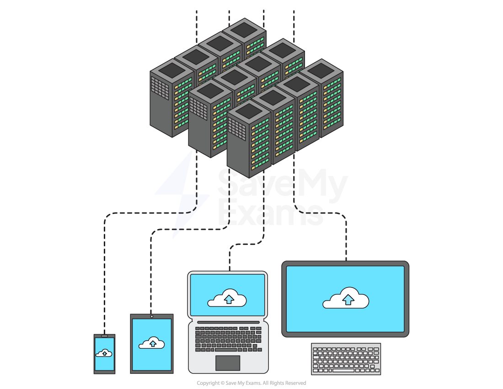

# Cloud Storage

## Cloud Storage

> **Spec point** — `spcpt_Cy7sNfqSxkwdRnyM` · 5 Understand what is meant by cloud storage

## Cloud Storage

### What is cloud storage?

- Cloud storage is a term to describe **long-term (secondary) storage of data** that resides in a **remote location**, accessible only** via a wide area network** (Internet)
- Data is stored on **remote servers**, typically using magnetic storage (**HDD**), but increasingly using solid state (**SSD**)

| **Advantages** | **Disadvantages** |
|---|---|
| **Reliability **-  Access data anywhere, any time, from any device | **Cost **- Typically a monthly/yearly subscription plan |
| **Security** - Automatic backups | **Availability **- No access without an internet connection |
| **Capacity **- Endless storage space (cost permitting), uses less space on own device |   |
| **Collaboration **- Multiple people can access the same file at the same time |   |

## Advantages of Cloud Storage

> **Spec point** — `spcpt_hby3w7WCGyvNKWXf` · "6 Explain the advantages and disadvantages of
storing data on the cloud in comparison to
storing it locally"

## Advantages of Cloud Storage

- Cloud storage offers several advantages over storing data on a local secondary storage device

| **Benefit** | **Explanation** |
|---|---|
| Accessibility | - Data can be **accessed from anywhere** - Data can be accessed by anyone with the **relevant permissions,** making it **quick to share files **and collaborate with others - Data can be **accessed on any device **with an internet connection |
| Scalability | - Cloud storage providers allow customers to **increase **or decrease their **storage capacity** as needed |
| Reliability | - Cloud storage providers often use **multiple servers** to store and **backup data**, reducing the risk of data loss due to hardware failure |
| Security | - Cloud storage providers offer **advanced security features**, such as data ***encryption***** **and ***multi-factor authentication***, to protect user data from unauthorised access - There is **no need to hire specialist staff **as IT services being provided by the cloud storage provider |

- You also do not need to purchase local secondary storage devices
- One cloud storage centre is more **environmentally friendly** than millions of individual servers
- There are some drawbacks to using cloud storage

  - If the user has a slow or **unreliable internet connection** they would have problems **accessing **their files
  - If you are storing a lot of data it can be **expensive**
  
    - You have to pay the cloud storage provider
    - You may need to commit to an annual subscription
    - You may have to pay for high download and upload data transfer limits
  - Data being sent over the internet has the potential to be **intercepted**
  - Security is managed by the cloud storage provider which means the user **does not have complete control **over it but is still legally responsible for ensuring any ***personal and sensitive data*** is secure

> **Worked Example**
> A school currently stores all of their data on local servers. They are considering upgrading their system to utilise cloud storage.
> 
> Explain two disadvantages to the school of storing their data in the cloud.
> 
> **[4]**
> 
> - You need a constant internet connection **[1]**
> - if the internet connection failed, teachers would not be able to access lesson files **[1]**
> - if the internet connection failed, teachers would not be able to access student data/take electronic registers **[1]**
> - if the internet connection failed, students would not be able to access their work/coursework **[1]**
> - Reliant on third party to carry out security procedures **[1]**
> - but the school is still legally responsible if data is accessed by unauthorised people **[1]**
> - Data stored on the cloud could be hacked or intercepted **[1]**
> 
> Explain two advantages to the school of storing their data in the cloud.
> 
> **[4]**
> 
> - Additional storage can be purchased if needed **[1]**
> - The cloud hosting company provides back up **[1]**
> - The cloud hosting company provides security **[1]**
> - Data can be accessed from anywhere and from any device provided there is an internet connection **[1]**
> - So teachers would be able to access data from home **[1]**
> - So students would be able to access work from home **[1]**
