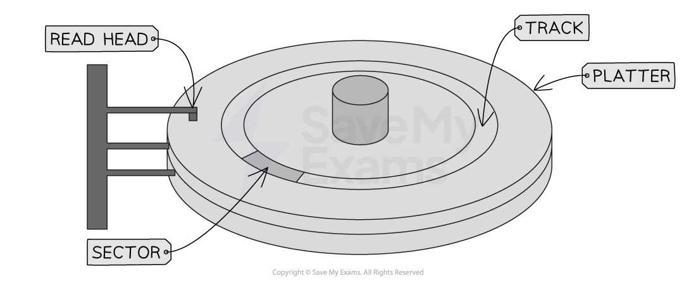
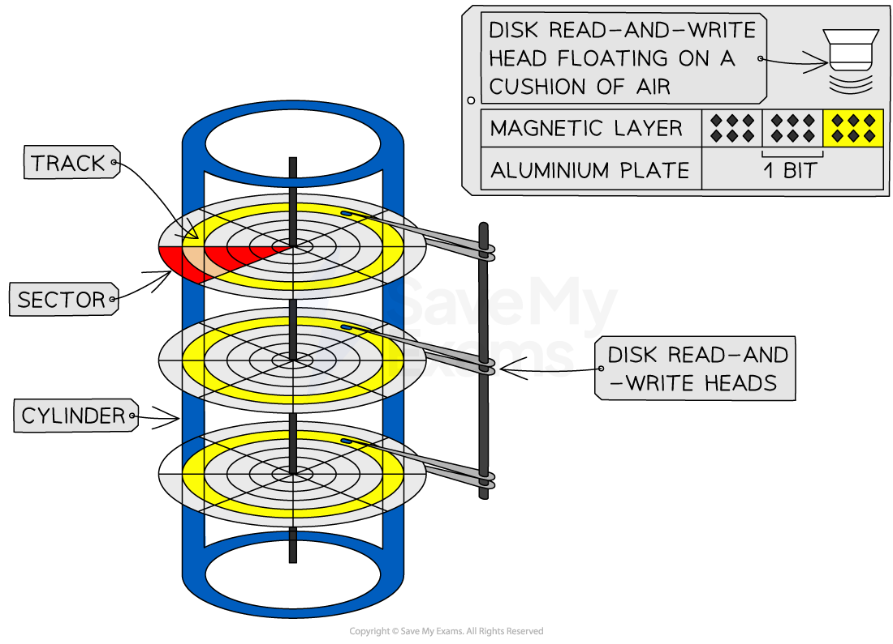
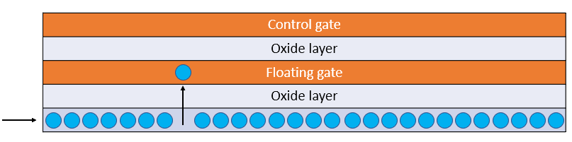

# Secondary Storage

## Secondary Storage

> **Spec point** — `spcpt_4TzDSW7wjt83BXTF` · 2 Understand what is meant by secondary storage 

## Secondary Storage

- Storage devices are **non-volatile secondary storage**, that retain digital data within a computer system
- They provide a means of storing, accessing, and retrieving data, which can include software applications, documents, images, videos, and more
- There are 3 types of storage:

  - **Magnetic**
  - **Solid-state (flash memory)**
  - **Optical**
- Computer systems need both primary and secondary storage to operate
- Both types of storage play a crucial role in the operation of a computer system
- A quick comparison of primary and secondary storage shows:

| **Primary** | **Secondary** |
|---|---|
| ***Volatile*** (with the exception of ROM) | ***Non-volatile*** |
| Small capacity | Large capacity |

### Why do you need secondary storage?

- A computer needs secondary storage for **long term storage** of programs and data that are **currently not in use **
- Secondary storage is needed as ROM is read only and RAM is volatile
- Secondary storage holds the **programs **and **data** whilst the computer is turned off (**non-volatile**)
- Performance of secondary storage is **slower **than primary storage but **capacity **is much **higher **which makes it perfect for backup & archive of data files

### What are the characteristics of secondary storage?

- **Capacity **- What is the maximum amount of data that can be stored?
- **Speed **- How fast can data be read from and written to? (R/W)
- **Cost **- How much does it cost?
- **Portability **- How easy is it to move around? What is the physical size? Weight?
- **Durability **- How robust is the storage?
- **Reliability **- What is the probability that the device will consistently perform its function?

> **Worked Example**
> A games console has secondary storage.
> 
> State, using an example, why the games console needs secondary storage **[2]**
> 
> **How to answer this question**
> 
> - They keyword is '**why**', why does a games console need secondary storage? Give an example, do not just describe what secondary storage is!
> 
> **Answer**
> 
> - To store data once the power is turned off / permanently // for non-volatile storage
> - Examples could include:
> 
>   - Storing games
>   - Save games
>   - User data/profiles
>   - Downloaded content/applications/updates

## Magnetic Storage

> **Spec point** — `spcpt_3WQhvNCVYsrXcHHx` · "3 Describe the operation of magnetic, optical and
solid-state (flash memory) storage and give
examples of each "

## Magnetic Storage

### What is magnetic storage?

- Magnetic storage is a type of **non-volatile media **that uses **magnets** (polarity) to store binary 0s and 1s
- A magnetic hard disk is made up of** several metal discs** coated with a magnetic material

  - These are called **platters**
  - Iron particles on each platter are **magnetised **to **represent a 0 or 1**

- Each platter is divided by concentric circles creating several **tracks **and wedge shaped **sectors**
- Where they intersect is a** track sector**

- The hard drive **spins the metal disk**(s) at a high speed (typically around 5400-7200 RPM) using a **motor**
- A **read/write arm**, controlled by an actuator, **moves the head** over the surface of the disc to the location of the data
- The data is read/written using **electromagnets**

| **Advantages** | **Disadvantages** |
|---|---|
| **Capacity **- High storage | **Durability **- Moving parts can get damaged if dropped |
| **Cost** - Low per gigabyte | **Portability **- Heavy & bulky making them less convenient for transport |
| **Speed** - Moderate read/write access** ** | **Reliability** - Prone to mechanical failure |
|   | **Noise **- Loud (spinning disks) |

## Solid State Storage

> **Spec point** — `spcpt_hP6YRH4KZnwmZwZJ` · "3 Describe the operation of magnetic, optical and
solid-state (flash memory) storage and give
examples of each "

## Solid-state (Flash Memory)

### What is solid state (flash memory)?

- Solid-state (flash memory) storage is a type of** non-volatile media** that uses **electronic circuits** to store binary 0s and 1s
- Examples of solid state storage devices include:

  - **Solid state drives (SSD)** - replacing magnetic hard drives as a computers primary secondary storage device as capacity increases and cost decreases
  - **USB flash memory **- most common form of portable storage device
- It uses **NAND **and **NOR gates **in electrical circuits to ***persistently*** control the flow of electrons

- Solid-state (flash memory) is memory made up of **tiny cells** that can contain **one bit of data** (1 or 0)
- Each cell **contains a *****transistor***** **that acts as a **switch **that can be **turned on or off**
- The transistor contains **two **main parts:

  - **Control gate** - top layer of transistor, connects to circuit and controls if current can flow through the transistor
  - **Floating gate** - can hold a charge (like a tiny rechargeable battery) and is sandwiched between two layers of insulating material (Oxide)
- To **store data** a charge is placed on the floating gate

  - A** high voltage is applied** to the **control gate**, which allows electrons to be **pushed through the oxide layer** and onto the** floating gate**
- To **remove data**, a high voltage charge is applied in the **opposite direction**, **pulling the electrons off the floating gate**

| **Advantages** | **Disadvantages** |
|---|---|
| **Capacity **- Medium/high storage | **Cost** - Very high per gigabyte |
| **Speed** - Very fast read/write access | **Reliability** - Limited read/write cycles |
| **Durability **- No moving parts |   |
| **Portability **- Small and no moving parts |   |
| **Noise **- Silent |   |

## Optical Storage

> **Spec point** — `spcpt_crpB5X4RtvhkFdJv` · "3 Describe the operation of magnetic, optical and
solid-state (flash memory) storage and give
examples of each "

## Optical Storage

### What is optical storage?

- Optical storage is a type of **non-volatile media **that uses **lasers **to burn the surface of a disk, creating pits and lands suitable for storing binary 0s and 1s
- Examples of optical storage include:

  - **Blu-rays** have the largest capacity
  - **CDs** have the lowest capacity
  - **CD-R** are read-only (you cannot save data on to them)
  - **CD-RW** can be written to and read from
  - **DVD-RW** can be written to and read from

- All optical devices work by** shining a laser at the disk** and** processing the reflection**
- An arm moves the laser **across the surface of the disk**
- In **CD-Rs** a laser burns the data, **permanently** on to the disk, by creating pits and lands
- The laser is also used to **read the data from the pits and lands**
- When the laser light **hits the point where the pit changes into a land** or vice versa the **light scatters** and** is not reflected back as well**.
- This is **captured by a sensor **and can be** interpreted as a change in the binary value**

> **Exam Hint**
> Optical storage devices contain moving parts because the disk spins and the laser mechanism moves, but there is no physical contact with the disk surface

| **Advantages** | **Disadvantages** |
|---|---|
| **Cost** - Very low per gigabyte | **Capacity **- Very low |
| **Durability **- No physical contact between the laser and the disk surface | **Speed** - Very slow read/write access |
| **Portability **- Small and lightweight | **Reliability** - Prone to scratches |
| **Noise **- Silent |   |

> **Worked Example**
> Zarmeen has purchased a new tablet computer. The tablet has an internal secondary storage device.
> 
> The storage device is a solid state device.
> 
> 1. Give **three** benefits of the tablet having a solid state device instead of a magnetic device **[3]**
> 2. Give **two** drawbacks of the tablet having a solid state device instead of a magnetic device** [2]**
> 
> **Answers**
> 
> - Benefits
> 
>   - Faster access / read/write speeds
>   - Smaller in physical size
>   - More durable // no moving parts
> - Drawbacks
> 
>   - More expensive (per gigabyte)
>   - Smaller capacity (usually)
>   - Limited number of read/write cycles
> 
> **Guidance**
> 
> - Portable is not enough on it's own
> - No moving parts is not enough on it's own
