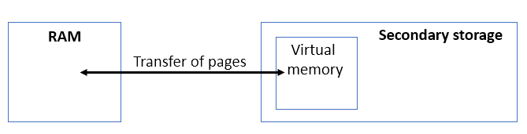
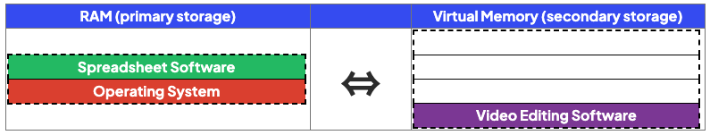
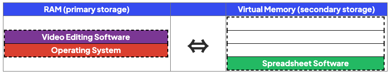

# Virtual Memory

## Virtual Memory

> **Spec point** — `spcpt_TtfQMfsCwkfdcYrC` · "4 Describe what is meant by virtual memory, how
it is created and used and why it is necessary"

## Virtual Memory

### What is virtual memory?

> **Exam Hint**
> *Cambridge IGCSE 0478 requires you to explain ****what virtual memory is****, ****when it is used****, and ****how it affects performance****. This page is written using the structure and phrasing examiners expect in 2–4 mark answers.*

- Virtual memory is an **extension of primary storage** (RAM) located on **secondary storage**
- In situations where RAM is close to being **full**, virtual memory can be used so that the computer **remains operational**
- Programs and data **not currently** being **executed **are transferred to virtual memory
- Programs and data are transferred back to RAM when they **are needed**
- Programs are stored as **pages of data**
- **Pages** of data are **transferred** between RAM and virtual memory when needed
- Virtual memory is much **slower **than RAM and its use will impact negatively on system performance
- To avoid the use of virtual memory, **increase** the size of the** RAM**

> **Exam Hint**
> *Virtual memory does ****not increase the actual size of RAM****. It creates ****temporary space**** on secondary storage. It makes the system usable, ****not faster****.*

#### Example

- In the example above, the computer is turned on and the elements of the operating system are loaded into RAM
- The user opens some spreadsheet and video editing software but RAM is full
- The program not currently being used (video editing) is transferred to virtual memory
- When the user wants to use the video editing software again, it is transferred back from virtual memory to RAM

> **Case Study**
> A student uses software to create 3D models.
> 
> - 3D modelling often means processing large amounts of data
> - This takes up a large amount of RAM
> - If there is not enough physical RAM, virtual memory is used to:
> 
>   - Extend the RAMs capacity
>   - Ensure the software does not freeze/crash when RAM gets full

> **Worked Example**
> A computer only has 4GB of RAM, Fynn says that virtual memory can be used instead of adding more RAM.
> 
> 1. Explain how virtual memory can compensate for the lack of RAM in Fynn's computer **[3]**
> 2. Explain why it would be beneficial for Fynn to get more RAM instead of relying on virtual memory **[2]**
> 
> **How to answer these questions**
> 
> 1. What is the definition of virtual memory? how does it work?
> 2. What is the downside of using virtual memory? turn this into an advantage of adding more RAM
> 
> **Answers**
> 
> - How can Virtual Memory compensate
> 
>   - Virtual Memory is used when RAM is full
>   - ...part of the secondary storage used as (temporary) RAM
>   - Data from RAM is moved to the secondary storage/Virtual Memory (to make space in RAM)
>   - RAM can then be filled with new data
>   - When data in Virtual Memory is needed it is moved back to RAM
> - Benefit of more RAM
> 
>   - More RAM will improve the performance of the computer // More RAM will speed up the access to data
>   - Virtual Memory is slower to access than RAM direct (because it has to go back to RAM first)
>   - Moving data between RAM and VM takes processor time
