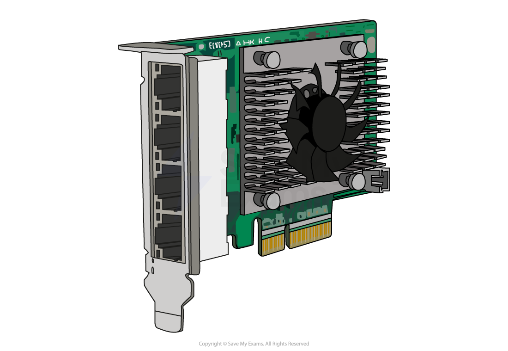

# Network Interface Card (NIC)

## Network Interface Card (NIC)

> **Spec point** — `spcpt_HtfS3kGsngz2pkK7` · "1 Understand that a computer needs a network
interface card (NIC) to access a network"

## Local Area Network Hardware: Network Interface Card (NIC)

- Network hardware is a selection of essential components that enable the **connectivity **and **communication **of devices within computer networks
- Networks use a variety of hardware to function, some of which include:

  - **Router**
  - **Wireless access point (WAP)**
  - **Switch**
  - **Transmission media**
  - **Network interface card (NIC)**
- The exam requires you to understand the purpose of the network interface card (NIC)

### What is a network interface card (NIC)?

- The Network Interface Card (**NIC**) is required for a computer to connect to a network
- A NIC can be both wired and wireless and allows your computer to send and receive data over a network

