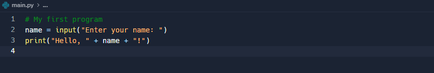
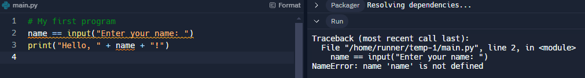
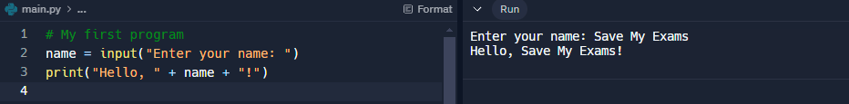

# Tools & Facilities in IDEs

## Tools & Facilities in IDEs

> **Spec point** — `spcpt_gwXMzkPB3GGymDxW` · " Explain the role of an IDE in writing program code
and the common functions IDEs provide"

## Tools & Facilities in IDEs

### What is an IDE?

- An Integrated Development Environment (IDE) is **software **designed to make **writing high-level languages **more **efficient**
- IDEs include tools and facilities to make the **process of creating/maintaining code easier,** such as:

  - **Editor**
  - **Error diagnostics**
  - **Run-time environment**
  - **Translators**

#### Editor

- An editor gives users an environment to **write, edit and maintain** high-level code
- Editors can provide:

  - **Basic code formatting tools **- changing the font, size of the font and making text bold etc
  - **Prettyprint **- using colour to make it easier to identify keywords, for example '`print`', '`input`' and '`if`' in Python
  - **Code editing** - auto-completion and auto-correction of code, bracket matching and syntax checks
  - **Commenting code** - allows sections of code to be commented out easily to stop it from being run or as comments on what the program is doing

#### Error-diagnostics

- Tools that help to **identify**, **understand **and **fix errors **in code, such as:

  - **Identifying errors** - highlight particular areas of code or provide direct error messages where the error may have appeared e.g. indentation errors etc
  - **Debugger **-  provide a 'step through' command which provides step by step instructions and shows what is happening to the code line by line, useful for finding **logic errors**

#### Run-time environment

- Gives users the ability **to run** and see the **corresponding output** of a high-level language

#### Translator

- Built in to **compile **or **interpret **code without the need for an extra piece of software
