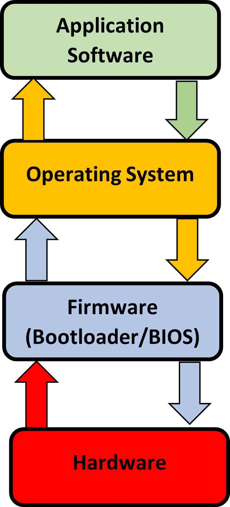

# Hardware, Firmware & the Operating System

## Hardware, Firmware & the Operating System

> **Spec point** — `spcpt_hMxCWw6JG8bBFD6z` · "3 Understand how hardware, firmware and an
operating system are required to run applications
software"

## Hardware, Firmware & the Operating System

### How does application software, the operating system and hardware communicate?

> **Exam Hint**
> *Cambridge IGCSE 0478 expects you to explain how ****application software****, the ****operating system****, and ****hardware**** interact, and describe the role of ****firmware**** during startup. This page is focused only on what’s required for the exam—nothing extra.*

- **Application software** talks to the **operating system**, this allows it to **interact** with the **hardware **
- The hardware **processes **and **sends **the information to the** operating system** which **talks directly** to the applications software
- This process is **repeated** while application software is **in use**

> **Exam Hint**
> Always describe the communication flow as:
> **Application software → Operating System → Hardware**.
> The OS acts as a **bridge**. Saying software “talks to hardware” without the OS in between will lose you marks.

### What is firmware?

- Firmware is **embedded directly in to the hardware of a device**, to make them function
- When a computer is turned on, it has to explore the **ROM** for its initial boot-up instructions, these are contained in a **Bootstrap loader**
- The initial process is handled by the **basic input/output system (BIOS)** which is known as** firmware**
- Once start-up is complete, instructions are sent to **RAM** to be processed by the operating system
- This layer ensures that hardware devices e.g. keyboard and mouse **are available** and can be **communicated directly by the operating system**
- Firmware **translates **between the **hardware **and the **software**

> **Exam Hint**
> *Students often confuse ****firmware**** with ****device drivers****. Firmware is ****permanently stored in ROM**** and controls basic hardware functions. Drivers are ****OS-level software**** that allow hardware to communicate with applications.*
