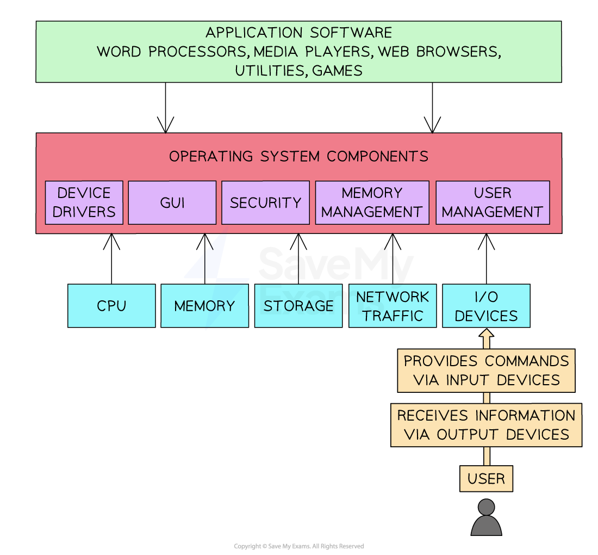

# The Purpose & Functionality of Operating Systems

## What is an operating system?

> **Exam Hint**
> *Cambridge IGCSE 0478 expects you to describe the ****functions of an operating system****, with clear examples. This page follows the structure used in past paper questions and mark schemes, so you’re only learning what gets you marks.*

- An operating system (**OS**) is software that **manages computer hardware** and **provides a platform for running applications**
- It** **provides **an interface between the user and the hardware** in a computer system
- It **hides the complexities of the hardware** from the user, for example:

  - A user does not need to know 'where' on secondary storage data is kept, just that it is saved for when they want it again
- An operating systems **main functions** can be divided in to **eight** key areas

> **Exam Hint**
> *In the exam, you’re often asked to name and describe two functions of an OS. Don’t waffle. Say what the OS does and why, for example:*
> 
> *“Memory management [1] allocates RAM between programs so they run efficiently [1].”*

## File Management

> **Spec point** — `spcpt_68X8wXQDqncQZDkV` · "2 Describe the role and basic functions of an
operating system"

## File Management

### What is file management?

- File management is a process carried out by the operating system** creating, organising, manipulating and accessing files and folders on a computer system**
- The OS **manages where data is stored** in both** primary and secondary** **storage**
- File management gives the user the ability to:

  - **Create files/folders**
  - **Name files/folders**
  - **Rename files/folders**
  - **Copy files/folders**
  - **Move files/folders**
  - **Delete files/folders**
- The OS allows users to control who can access, modify and delete files/folders (**permissions**)
- The OS provides a **search facility** to find specific files based on various criteria

## Handling Interrupts

> **Spec point** — `spcpt_7Q6TCtn4ZjNSvtRV` · "2 Describe the role and basic functions of an
operating system"

## Handling Interrupts

#### What is interrupt handling?

- Interrupt events **require the immediate attention** of the **central processing unit**
- In order to maintain the smooth running of the system, interrupts need to be **handled **and processed** in a timely manner**
- For example, if a user clicks cancel on a file conversion process, a signal is sent from the mouse, **interrupts the processor**, and the operating system will trigger the cancellation routine

## User Interface

> **Spec point** — `spcpt_ph2TnD75c874XQC4` · "2 Describe the role and basic functions of an
operating system"

## User Interface

### What is a user interface?

- A user interface is **how the user interacts with the operating system**
- Examples of user interfaces include:

  - **Command Line Interface (CLI)**
  - **Graphical User Interface (GUI)**
  - **Menu**
  - **Natural language (NLI)**

#### What is a command line interface?

- A Command Line Interface (**CLI**) requires users to interact with the operating system using** text based commands**
- CLIs are more commonly used by** advanced users**
- Examples of CLIs are MSDOS (Microsoft Disk Operating System) and Raspbian (for Raspberry Pi)

#### What is a graphical user interface?

- A Graphical User Interface (**GUI**) requires users to interact with the operating system using **visual elements** such as windows, icons, menus & pointers (**WIMP**)
- GUIs are **optimised for mouse and touch gesture input**
- Examples of GUIs are Windows, Android and MAC OS

#### What is a menu interface?

- A menu interface is **successive menus **presented to a user with a** single option at each stage**
- Often performed with **buttons** or a **keypad**
- Examples include

  - **Chip and pin machines**
  - **Vending machines**
  - **Entertainment streaming services**

#### What is a natural language interface?

- A natural language interface (**NLI**) uses the spoken word to respond to spoken or textual inputs from a user
- Examples include

  - **Virtual assistants **- Amazon Alexa, Google Assistant, Siri
  - **Search engines**
  - **Smart home devices**

### Advantages and disadvantages of user interfaces

| **Interface** | **Advantages** | **Disadvantages** |
|---|---|---|
| Command line (**CLI**) | - Uses less system resources - Useful for automation of tasks - Commands are often faster to type than navigating menus | - Requires users to remember commands - Typing errors are common - Less intuitive than GUI |
| Graphical (**GUI**) | - Intuitive and user-friendly - Requires no previous knowledge to use - Information is visual, making it easier to understand | - Uses more system resources - Can be slower to find and execute commands - Can be frustrating when doing repetitive tasks |
| Menu | - Simplicity - Efficiency | - Limited flexibility - Accessibility issues |
| Natural language (**NLI**) | - Can be used by people with disabilities - Intuitive | - Not always reliable - Privacy concerns |

## Peripheral Management & Device Drivers

> **Spec point** — `spcpt_k5YWrTHsGYPtdnB3` · "2 Describe the role and basic functions of an
operating system"

## Peripheral Management & Device Drivers

### What is peripheral management?

- Peripheral management is a process carried out by the operating system **managing the way** ***peripherals*** **(hardware) interact with software**
- The OS **allocates system resources** to peripherals to ensure** efficient operation**
- Peripheral management makes** plug-and-play** (PnP) functionality possible, **automatically detecting and configuring new peripherals** without the need for manually installing device drivers or power cycling the system

### What is a device driver?

- A device driver is **a piece of software used to control a piece of hardware**
- Peripherals** require device drivers** in order to be used by the operating system
- The OS has** generic device drivers built in** which makes **basic compatibilit**y possible and enables** plug-and-play** (PnP)
- In order for hardware to be used to its **maximum capacity**, often **a separate device driver must be downloaded** from the manufacturer
- Device drivers are** OS specific** and are **regularly updated**

## Memory Management & Multitasking

> **Spec point** — `spcpt_cNt7wpcrSSdJSqw8` · "2 Describe the role and basic functions of an
operating system"

## Memory Management & Multitasking

### What is memory management?

- Memory management is a process carried out by the operating system **allocating main memory (RAM) between different programs** that are **open at the same time**
- The OS is responsible for **copying programs and data from secondary to primary storage** as it is needed
- **Programs and data require different amounts of RAM** to operate efficiently and the OS manages this process
- **RAM is allocated** based on **priority and fairness**, for example, system applications (essential) may have a higher priority than user applications
- The OS **dynamically manages the memory**, adjusting allocation as needed to maintain optimal system performance
- Memory management makes **multitasking **possible

### What is multitasking?

- Multitasking is a process made possible by the OS **simultaneously managing system resources** (memory, CPU etc) to give a user the **perception of being able to use multiple programs at the same time**
- The OS **splits tasks and allocates system resources** based on a priority
- The CPU can only **execute one instruction at a time**, it can can execute billions of them in one second.
- This makes it **appear that multiple programs are running at the same time**

> **Exam Hint**
> *Just naming functions (e.g. “File management, memory management…”) won’t earn full marks. ****You must explain each one**** using exam-friendly language like “allocates,” “controls,” or “manages.”*

## Providing a Platform for Running Applications

> **Spec point** — `spcpt_v5ncTPg3j6Tv2gXt` · "2 Describe the role and basic functions of an
operating system"

## Providing a Platform for Running Applications

- Operating systems provide a **platform **on which **application software can run**, this is mainly by allowing software** access to system resources**
- For example, if a computer game has intensive graphics and online play, the operating system will grant it access to the GPU and the network card

***Organisation of application layer, operating system components, and input/output***

## Providing System Security

> **Spec point** — `spcpt_2pSkJSkyPRRcTW45` · "2 Describe the role and basic functions of an
operating system"

## Providing System Security

### What is system security?

- Operating systems provide various security features such as password-protected system accounts, a ***firewall***, virus scanning and ***file encryption***
- Password-protected system accounts are a very common feature in operating systems
- System accounts can also be restricted from performing certain actions, e.g. editing network settings, installing unapproved software, changing the account settings of other users

## User Management

> **Spec point** — `spcpt_W3RysBHxT4rJT9Ss` · "2 Describe the role and basic functions of an
operating system"

## User Management

### What is user management?

- User management is a process carried out by the operating system enabling different users to log onto a computer
- The OS is able to maintain settings for individual users, such as desktop backgrounds, icons and colour schemes
- A system administrator is able to allocate different ***access rights*** for different users on a network

> **Worked Example**
> Ella uses her computer to create artwork for a magazine
> 
> Ella makes use of system software.
> 
> One type of system software is the operating system.
> 
> **Identify **and describe **two functions** of an operating system **[6]**
> 
> **How to answer this question**
> 
> - Break down the 6 marks, 1 mark each for identifying a function of the operating system. For each function you need to make 2 points about how they work
> 
> **Answer**
> 
> - **Memory management**
> 
>   - **Allocates memory to programs currently in use **
>   - **Gets data from RAM**
>   - **Stores data in RAM**
> - **File management**
> 
>   - **Creating/editing/renaming files**
>   - **Creating/editing/renaming folders**
>   - **Movement of files/folders**
