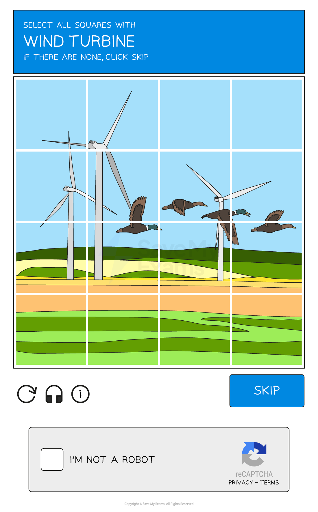

# Keeping Data Safe

## Access Levels

> **Spec point** — `spcpt_QxrV2RTBKVNvdJnv` · "2 Explain how a range of solutions are used to help
keep data safe from security threats"

## Access Levels

### What are access levels?

- Access levels ensure users of a network **can access what they need to access** and do not have access to information/resources they shouldn't
- Users can have **designated** **roles** on a network
- Access levels can be set based on a user's **role, responsibility, or clearance level**

  - **Full access - **this allows the user to open, create, edit & delete files
  - **Read-only access - **this only allows the user to open files without editing or deleting
  - **No access - **this hides the file from the user
- Some examples of different levels of access to a school network could include:

  - **Administrators: ***Unrestricted* - Can access all areas of the network
  - **Teaching Staff:** *Partially restricted - *Can access all student data but cannot access other staff members' data
  - **Students:** *Restricted* - Can only access their own data and files
- Users and groups of users can be given **specific file permissions**

## Anti Malware

> **Spec point** — `spcpt_Tzt3Cn3HMp4Qz9XF` · "2 Explain how a range of solutions are used to help
keep data safe from security threats"

## Anti Malware

### What is anti-malware software?

- Anti-malware software is a term used to describe a combination of different software to prevent computers from being susceptible to **viruses** and other **malicious software**
- The different software anti-malware includes are

  - **Anti-virus**
  - **Anti-spam**
  - **Anti-spyware **

### How does anti-malware work?

- Anti-malware **scans** through **email** attachments, **websites** and downloaded **files** to search for issues
- Anti-malware software has a list of known malware **signatures to block** immediately if they try to access your device in any way
- Anti-malware will also perform **checks for updates** to ensure the database of known issues is up to date

## Authentication

> **Spec point** — `spcpt_GCBVHmTMRZvBDSxj` · "2 Explain how a range of solutions are used to help
keep data safe from security threats"

## Authentication

### What is authentication?

- Authentication is the process of **ensuring that a system is secure** by asking the user to **complete tasks to prove they are an authorised** user of the system
- Authentication is done because **bots can submit data in online forms**
- Authentication can be done in several ways, these include

  - **Usernames and passwords**
  - ***Multi-factor authentication***
  - ***CAPTCHA***** **- see example below

#### Biometrics

- Biometrics use** biological data **for authentication by identifying **unique physical characteristics** of a human such as **fingerprints**, **facial recognition**, or** iris scans**
- Biometric authentication is **more secure** than using passwords as:

  - A biometric password **cannot be guessed**
  - It is very **difficult to fake** a biometric password
  - A biometric password** cannot be recorded **by spyware
  - A perpetrator **cannot shoulder surf** to see a biometric password

## Automating Software Updates

> **Spec point** — `spcpt_5FtK6Fnjph9j5zJR` · "2 Explain how a range of solutions are used to help
keep data safe from security threats"

## Automating Software Updates

### What are automatic software updates?

- Automatic software updates take away the need for a user to remember to keep software updated and **reduce the risk of software flaws/vulnerabilities** being targeted in** out of date software**
- Automatic updates** ensure fast deployment** of updates as they release

## Communication

> **Spec point** — `spcpt_d6zXhfPYRXt9yZmK` · "2 Explain how a range of solutions are used to help
keep data safe from security threats"

## Communication

### What is communication?

- One way of protecting data is by **monitoring digital communication** to check for errors in the **spelling** and **grammar **or **tone **of the communication
- Phishing scams often involve communication with users, monitoring it can be effective as:

  - **Rushed **- emails and texts pretending to be from a reputable company are focused on quantity rather than quality and often contain basic spelling and grammar errors
  - **Urgency **- emails using a tone that creates panic or makes a user feel rushed is often a sign that something is suspicious
  - **Professionalism **- emails from reputable companies should have flawless spelling and grammar

## URL

> **Spec point** — `spcpt_HbfW5v8mcwyPVsNb` · "2 Explain how a range of solutions are used to help
keep data safe from security threats"

## URL

### How to check a URL?

- Checking the **URL attached to a link **is another way to prevent phishing attacks
- Hackers often use fake URLs to trick users into visiting fraudulent websites

  - e.g. **http://amaz.on.co.uk/** rather than** http://amazon.co.uk/ **
- If you are unsure, always check the website URL **before clicking any links** contained in an email

## Firewalls

> **Spec point** — `spcpt_g2PdzSRQTnBmcntD` · "2 Explain how a range of solutions are used to help
keep data safe from security threats"

## Firewalls

### What is a firewall?

- A firewall** monitors incoming and outgoing network traffic **and uses a set of rules to determine which traffic to allow
- A firewall prevents **unwanted traffic** from entering a network by filtering requests to ensure they are **legitimate**
- It can be both **hardware** and **software** and they are often used together to provide stronger security to a network

  - **Hardware firewalls** will protect the whole network and prevent unauthorised traffic
  - **Software firewalls** will protect the individual devices on the network, monitoring the data going to and from each computer

### What form of attack would this prevent?

- Hackers
- Malware
- Unauthorised access to a network

## Privacy Settings

> **Spec point** — `spcpt_39xh2vcp5zQdZCm2` · "2 Explain how a range of solutions are used to help
keep data safe from security threats"

## Privacy Settings

### What are privacy settings?

- Privacy settings are used to **control the amount of personal information** that is shared online
- They are an important measure to prevent identity theft and other forms of online fraud
- Users should **regularly review** their privacy settings and adjust them as needed

## Proxy Servers

> **Spec point** — `spcpt_XrshRxKWjqd9XrCx` · "2 Explain how a range of solutions are used to help
keep data safe from security threats"

## Proxy Servers

### What is a proxy server?

- A proxy-server is used to** hide a user's IP address** and **location**, making it more difficult for** hackers to track them**
- They **act as a firewall **and can also be used to** filter web traffic **by setting criteria for traffic
- Malicious content **is blocked** and a warning message can be sent to the user
- Proxy-servers are a useful security measure for protecting against external security threats as it can direct traffic away from the server

## SSL

> **Spec point** — `spcpt_46gyBTd48R2cBY57` · "2 Explain how a range of solutions are used to help
keep data safe from security threats"

## SSL

### What is SSL?

- Secure Socket Layer (**SSL**) is a** security protocol **which is used to **encrypt data** transmitted **over the internet**
- This helps to prevent **eavesdropping **and other forms of **interception**
- SSL is widely used to protect **online transactions**, such as those involving credit card information or other sensitive data
- It works by sending a **digital certificate **to the user’s browser
- This contains the **public key** which can be used for **authentication**
- Once the certificate is authenticated, the transaction will begin

> **Worked Example**
> (i) ) Identify a security solution that could be used to protect a computer from a computer virus, hacking and spyware.
> 
> Each security solution must be different
> 
> | Threat | Security solution |
> |---|---|
> | **Computer virus** |   |
> | **Hacking** |   |
> | **Spyware** |   |
> 
> **[3]**
> 
> (ii) Describe how each security solution you identified in (i) will help protect the computer.
> 
> **[6]**
> 
> **Answers**
> 
> (i)
> 
> | Threat | Security solution |
> |---|---|
> | **Computer virus** | **Final answer:** **Anti-malware/virus (software) Firewall** |
> | **Hacking** | **Final answer:** **Firewall**  **Final answer:** **Passwords**  **Final answer:** **Biometrics**  **Final answer:** **Two-step verification** |
> | **Spyware** | **Final answer:** **Anti-malware/virus (software)**  **Final answer:** **Two-step verification**  **Final answer:** **Firewall** |
> 
> (ii) **Two **marks for each description
> 
> - **Anti-malware/virus (software)**
> 
>   - ** Scans the computer system (for viruses)**
>   - **Has a record of known viruses**
>   - **Removes/quarantines any viruses that are found**
>   - **Checks data before it is downloaded**
>   - **… and stops download if virus found/warns user may contain virus**
> - **Anti-malware/spyware (software)**
> 
>   - **Scans the computer for spyware**
>   - **Removes/quarantines any spyware that is found**
>   - **Can prevent spyware being downloaded**
> - **Firewall**
> 
>   - **Monitors traffic coming ****into and out of**** the computer system**
>   - **Checks**** that the traffic meets any criteria/rules set**
>   - **Blocks any traffic that does not meet the criteria/rules set // set blacklist/whitelist**
> - **Passwords**
> 
>   - **Making a password stronger // by example**
>   - **Changing it regularly**
>   - **Lock out after set number of attempts // stops brute force attacks // makes it more difficult to guess**
> - **Biometrics**
> 
>   - **Data needed to enter is unique to individual**
>   - **… therefore it is very difficult to replicate**
>   - **Lock out after set number of attempts**
> - **Two-step verification**
> 
>   - **Extra data is sent to device, pre-set by user**
>   - **… making it more difficult for hacker to obtain it**
>   - **Data has to be entered into the same system**
>   - **… so if attempted from a remote location, it will not be accepted**
